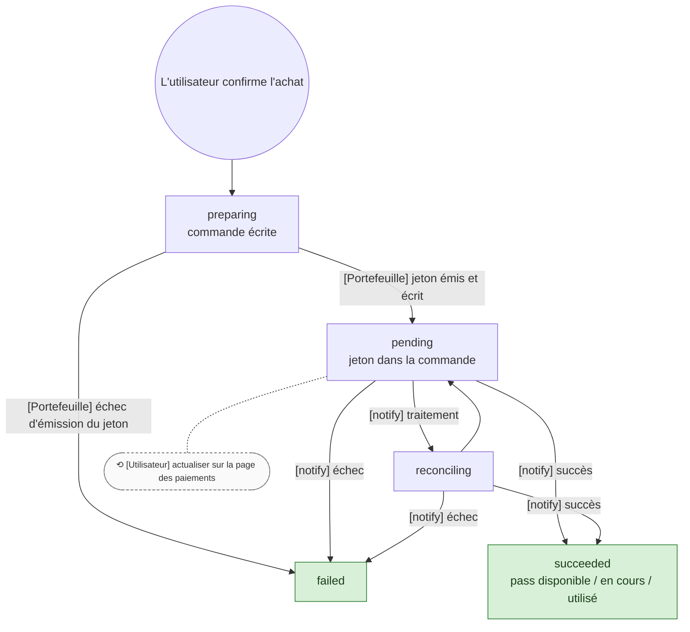

# B5 Tickets d'appel payants

[Retour au sommaire](../README.md) · B · Paiements et encaissements

## Diagramme d'états

GitHub affiche directement le bloc Mermaid ci-dessous ; en cas de problème d'affichage, ouvrez le SVG.

[SVG](diagrams/B5.svg) · [Source Mermaid](diagrams/B5.mmd)

## Tableau d'états

| ID | État (nom dans le code) | Condition d'entrée | Où sont les fonds / données | Affichage | Ce que l'utilisateur peut faire | Terminal ? | Emplacement dans le code |
|---|---|---|---|---|---|---|---|
| B5-01 | `preparing` → `Preparing` | L'utilisateur confirme l'achat ; ligne de commande écrite | Jeton pas encore émis ; ou émis mais pas encore écrit | Paiement en cours | Continuer / annuler | Non | `R/app_storage/rtc_tickets.rs:110`; `R/rtc/payments.rs:132` |
| B5-02 | `pending` / `reconciling` → `Confirming` | Jeton écrit dans la commande et remis à notify | Jeton dans la commande | Confirmation en cours ; la page de confirmation n'offre que Continue | Continuer à interroger | Non | `rtc_tickets.rs:128-141`; `R/rtc/payments.rs:58-59`, `:177-199`, `:329` |
| B5-03 | `succeeded` → `Available` / `UsePending` / `Used` | notify a confirmé ; ensuite projeté selon l'usage | Pass | Disponible / en cours d'utilisation / utilisé | Appeler | Oui (côté paiement) | `rtc_tickets.rs:143-153` |
| B5-04 | `failed` → `Failed` | notify a renvoyé un échec, ou le portefeuille n'a pas pu émettre le jeton | Jeton effacé | Échec | — | Oui | `rtc_tickets.rs:118-125`, `:152` |

« Idem » renvoie à la ligne précédente du tableau. Dans la colonne d'affichage, les valeurs `xxx.yyy` sont des clés de localisation.
