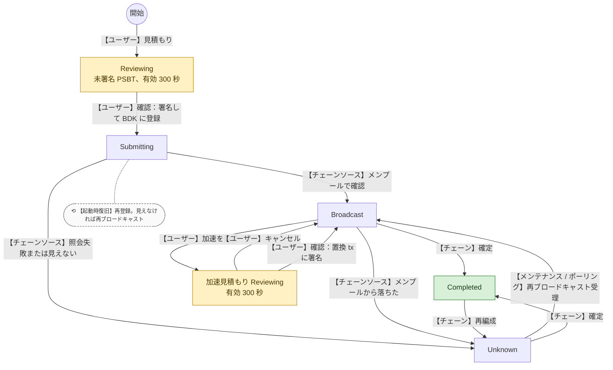
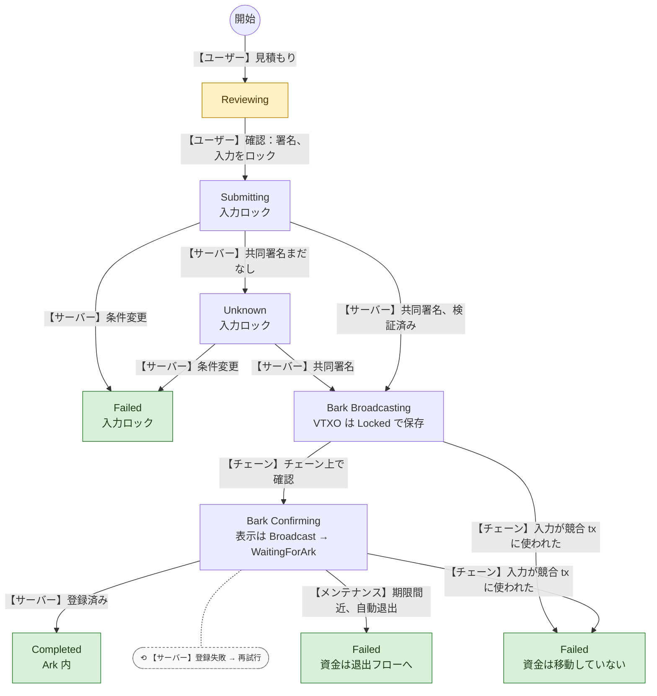

# A1 Ark への入金、BTC の直接送金、RBF による加速

[目次に戻る](../README.md) · A · オンチェーンと Ark の資金

## 状態図

GitHub は下の Mermaid ブロックを直接描画します。表示が崩れる場合は SVG を開いてください。

### A1a BTC の直接送金（RBF を含む）

[SVG](diagrams/A1a.svg) · [Mermaid ソース](diagrams/A1a.mmd)

### A1b Ark への入金

[SVG](diagrams/A1b.svg) · [Mermaid ソース](diagrams/A1b.mmd)

## 状態表

### 共通レコード（`keychat_bitcoin_transfers`）

| ID | 状態（コード名） | 遷移条件 | 資金・データの所在 | UI 表示 | ユーザーができること | 終了状態か | コード位置 |
|---|---|---|---|---|---|---|---|
| A1-01 | `Reviewing` | 見積もり生成と同時に永続化、有効期間 300 秒 | 未署名 PSBT。資金はオンチェーンウォレットにあり、ロックされていない | `wallet.bitcoin.review` | 確認する。または見積もりを破棄する（加速見積もりは削除可能） | いいえ（期限切れの自動削除なし。期限後の確認は拒否される） | `W/ark/bitcoin/transfer.rs:308-336`, `:355-358` |
| A1-02 | `Submitting` | 署名済み。`signed_tx_hex` を書き込み済み | 署名済み tx はローカルに保存。直接送金は BDK に `register_tx` 済みで使用済みとして計上。onboard の入力はロック済み | `wallet.bitcoin.submitting` + `wallet.bitcoin.unknown-help` | 待つのみ | いいえ | direct send `W/ark/bitcoin/transfer.rs:382-393`; onboard `W/ark/bark_runtime/onboard.rs:220-236` |
| A1-03 | `Broadcast` | チェーンソースがメンプールにあると報告 | tx はメンプール内 | `wallet.bitcoin.onboard.awaiting-confirmation` + `wallet.bitcoin.waiting-chain` | 待つ。直接送金は RBF 可能 | いいえ | direct `W/ark/bitcoin/replacement.rs:803-807`; onboard `W/ark/bark_runtime/onboard.rs:339` |
| A1-04 | `WaitingForArk` | onboard のみ：資金 tx は確定、Ark は未登録 | 資金は board 出力内。board VTXO は movement によりロック | 同上 + `wallet.bitcoin.waiting-ark` | 待つ | いいえ | `W/ark/bark_runtime/onboard.rs:336-338` |
| A1-05 | `Unknown` | チェーンソースの照会失敗、tx が見えない、onboard の共同署名なし、または movement が存在しない | 直接送金：署名済み tx は BDK に残る。onboard：入力はロック | `wallet.bitcoin.checking` + `wallet.bitcoin.unknown-help` | 待つ | いいえ | direct `W/ark/bitcoin/replacement.rs:806`, `:808-809`; onboard `W/ark/bark_runtime/onboard.rs:311-313`, `:340-345`; projected as Unknown without chain source `W/ark/provider/shared_bitcoin.rs:818-840` |
| A1-06 | `Completed` | 直接送金：いずれかの試行が確定。onboard：movement 成功かつ退出証明あり | 直接送金：相手に到達。onboard：Ark 内 | `wallet.bitcoin.completed` | — | はい（直接送金はチェーン再編成で Unknown に戻ることがある） | `W/ark/bitcoin/replacement.rs:796-802`; `W/ark/bark_runtime/onboard.rs:325-327` |
| A1-07 | `Failed` | onboard のみ：サーバー条件の変更（`submit_signed_board` が None を返す）、または Bark movement が Failed/Canceled | 条件変更時：入力はロックされたまま。movement 失敗時：資金が退出フロー内にある可能性 | `wallet.bitcoin.failed` ("Transfer failed. Review a new quote to try again.") | 新しい見積もり | はい | `W/ark/bark_runtime/onboard.rs:306-310`, `:328-329` |

### onboard に重なる Bark の状態（`Board.progress`）

| ID | 状態（コード名） | 遷移条件 | 資金・データの所在 | UI 表示 | ユーザーができること | 終了状態か | コード位置 |
|---|---|---|---|---|---|---|---|
| A1-08 | `Broadcasting` | 共同署名を取得、VTXO を構築済み | 資金 tx は送出待ち。VTXO は Locked として保存 | — | チェーン上で確認 → `Confirming`。確定 tx と入力が競合 → 失敗。それ以外は待機 | いいえ | `BK/actions/board.rs:147-160`, `:230-283` |
| A1-09 | `Confirming` | 資金 tx はメンプールまたはブロック内 | board VTXO は Locked、`pending_board` に計上 | — | 確認数が足りたら登録。登録失敗時は再試行。期限が近づくと退出を開始 | いいえ | `BK/actions/board.rs:290-393` |
| A1-10 | movement `Failed`（退出後） | VTXO が退出済み、または入力が競合 tx に使われた | 前者：退出フロー内。後者：資金は移動していない | — | 終了 | はい | `BK/actions/board.rs:299-314` |

### RBF 加速（直接送金の「系譜」）

| ID | 状態（コード名） | 遷移条件 | 資金・データの所在 | UI 表示 | ユーザーができること | 終了状態か | コード位置 |
|---|---|---|---|---|---|---|---|
| A1-11 | 加速見積もり `Reviewing` + `replacement` | ユーザーが加速を要求し、前提条件を満たす | 未署名の置換 PSBT、有効期間 300 秒 | — | 確認する。またはキャンセル（未署名レコードのみ削除） | いいえ（系譜に従う） | `W/ark/bitcoin/replacement.rs:378-401`, `:403-450` |
| A1-12 | 親の `replaced_by` を設定、子を署名 | ユーザーが確認 | 親と子を同一トランザクションでコミット | — | 待つ | いいえ（系譜に従う） | `W/ark/bitcoin/replacement.rs:825-860` |
| A1-13 | 系譜の状態 | 確定した試行が Completed、他は変化なし。先頭はメンプール有無で判定 | — | — | — | いいえ（系譜に従う） | `W/ark/bitcoin/replacement.rs:786-823` |

「同上」は表の直前の行を指します。UI 列の `xxx.yyy` はローカライズキーです。
