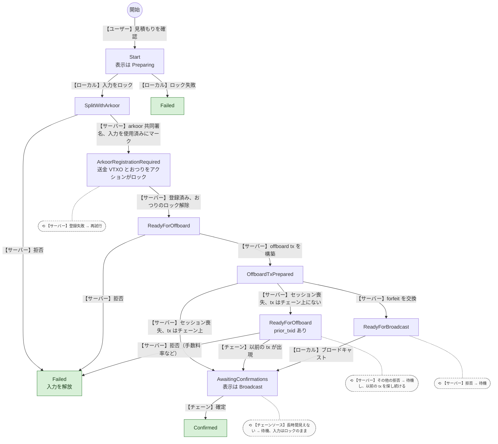

# A2 Ark からオンチェーンアドレスへの BTC 送金

[目次に戻る](../README.md) · A · オンチェーンと Ark の資金

## 状態図

GitHub は下の Mermaid ブロックを直接描画します。表示が崩れる場合は SVG を開いてください。

[SVG](diagrams/A2.svg) · [Mermaid ソース](diagrams/A2.mmd)

## 状態表

| ID | 状態（コード名） | 遷移条件 | 資金・データの所在 | UI 表示 | ユーザーができること | 終了状態か | コード位置 |
|---|---|---|---|---|---|---|---|
| A2-01 | `Preparing` (Bark `Start` / `SplitWithArkoor`) | ユーザーが確認。アクションのチェックポイントを書き込み | 入力 VTXO はアクションによりロック | `wallet.bitcoin-send.preparing` ("Payment in progress") | 「状態を確認」 | いいえ | projection `W/ark/bark_runtime/bitcoin_send.rs:105-111`, `:127-139`; locking `BK/actions/offboard.rs:553-572` |
| A2-02 | `Preparing` (Bark `ArkoorRegistrationRequired`) | arkoor 分割済み。元の入力は使用済みにマーク | 分割した送金 VTXO **とおつり** の両方がアクションによりロックされ、サーバー登録待ち | 同上 | 同上 | いいえ | `BK/actions/offboard.rs:605-636`, `:641-661` |
| A2-03 | `Preparing` (Bark `ReadyForOffboard` / `OffboardTxPrepared` / `ReadyForBroadcast`) | 登録済み。サーバーと offboard tx および forfeit を交換 | 送金 VTXO はロック。おつりはロック解除 | 同上 | 同上 | いいえ | `BK/actions/offboard.rs:263-286`, `:670-760` |
| A2-04 | `Broadcast` (Bark `AwaitingConfirmations`) | offboard tx を送出 | 資金はオンチェーン tx 内。VTXO は forfeit 済み | `wallet.bitcoin-send.broadcast` | 「状態を確認」 | いいえ | `bitcoin_send.rs:109`; `BK/actions/offboard.rs:287-326` |
| A2-05 | `Confirmed` | Movement 成功 | 受取人アドレスに到達 | `wallet.bitcoin-send.confirmed` | — | はい | `bitcoin_send.rs:106` |
| A2-06 | `Failed` | Movement が Failed / Canceled（Bark は `Start`、`SplitWithArkoor`、forfeit 前の `ReadyForOffboard` の失敗時に入力を解放） | 入力は再び使用可能 | `wallet.bitcoin-send.failed` | 新しい見積もり | はい | `bitcoin_send.rs:107`; `BK/actions/offboard.rs:352-414` |
| A2-07 | 結果不明（確認呼び出しがタイムアウトまたはエラー） | `start_send_onchain_confirmed` はチェックポイントを書き込んだがタイムアウト | 基礎となる Bark の状態による | `wallet.bitcoin-send.uncertain` | 元の操作を確認する。新しい操作は開始できない | いいえ | `bitcoin_send.rs:73-79`; `iOS/Wallet/Views/Forms/ArkBitcoinSendReview.swift:240-242` |

「同上」は表の直前の行を指します。UI 列の `xxx.yyy` はローカライズキーです。
