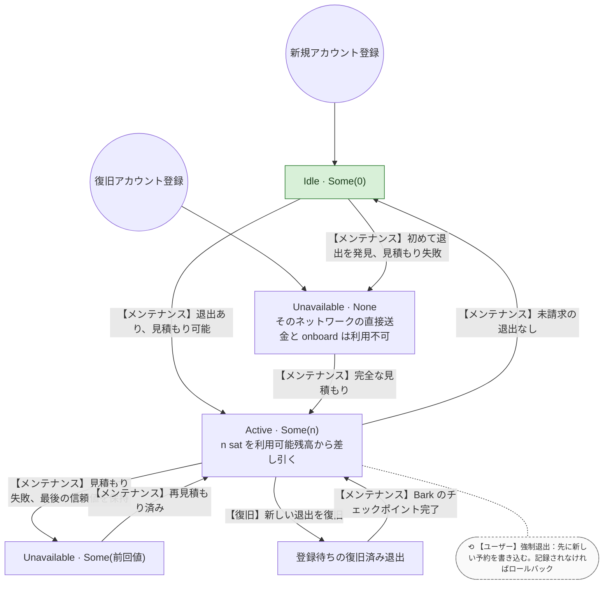

# A3 出口手数料の予約

[目次に戻る](../README.md) · A · オンチェーンと Ark の資金

## 状態図

GitHub は下の Mermaid ブロックを直接描画します。表示が崩れる場合は SVG を開いてください。

[SVG](diagrams/A3.svg) · [Mermaid ソース](diagrams/A3.mmd)

## 状態表

| ID | 状態（コード名） | 遷移条件 | 資金・データの所在 | UI 表示 | ユーザーができること | 終了状態か | コード位置 |
|---|---|---|---|---|---|---|---|
| A3-01 | `Idle`, `remaining_sats = Some(0)` | 新規アカウント登録。未請求の退出なし | 予約なし | なし | — | いいえ（再び Active になり得る） | registration `W/ark/bitcoin.rs:259-271`; zeroing `W/ark/bark_runtime/exit_fee.rs:195-200` |
| A3-02 | `Active`, `Some(n)` | 退出が進行中で、手数料を見積もれる | 共有 BTC のうち n sat を予約扱いし、利用可能残高から差し引く | 残高構造に `reserved_sats` / `available_sats` がある（`W/ark/types.rs:429-439`） | 予約分に食い込む送金は明示的な確認が必要（`BitcoinExitReserveImpact`） | いいえ | `exit_fee.rs:215-221`, `:116-122` |
| A3-03 | `Unavailable`、`Some(前回値)` | 見積もり失敗。最後の信頼できる値を保持 | 同上 | 同上 | 同上 | いいえ | `exit_fee.rs:207-212`; retention rule `W/ark/bitcoin.rs:322-330` |
| A3-04 | `Unavailable`, `None` | 復旧開始、新しい退出を復旧、Idle から初めて退出を発見、または再見積もりなしで新しい退出を承認 | 予約は不明。同じネットワークの直接送金と onboard は利用不可 | 送金がエラーになる | なし | いいえ | `W/ark/bitcoin.rs:62-77`, `:245-251`, `:259-267`; `exit_fee.rs:123-131`; error site `W/ark/bitcoin/transfer.rs:232-235` |
| A3-05 | 登録待ちの復旧済み退出（`pending_recovered_exit_ids` が空でない） | 復旧した退出は記録済み、Bark のチェックポイントは未完了 | 同上 | 同上 | なし | いいえ | `W/ark/bitcoin.rs:69`; rejected on read `transfer.rs:231-234`; cleared `exit_fee.rs:92-105` |

「同上」は表の直前の行を指します。UI 列の `xxx.yyy` はローカライズキーです。
