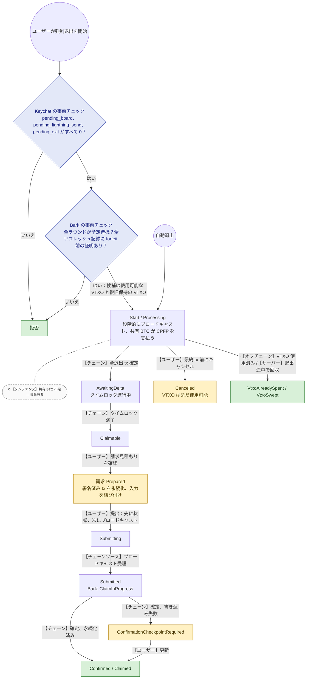

# A4 強制退出と請求

[目次に戻る](../README.md) · A · オンチェーンと Ark の資金

## 状態図

GitHub は下の Mermaid ブロックを直接描画します。表示が崩れる場合は SVG を開いてください。

[SVG](diagrams/A4.svg) · [Mermaid ソース](diagrams/A4.mmd)

## 状態表

### 退出（VTXO ごとに 1 件）

| ID | 状態（コード名） | 遷移条件 | 資金・データの所在 | UI 表示 | ユーザーができること | 終了状態か | コード位置 |
|---|---|---|---|---|---|---|---|
| A4-01 | `Start` / `Processing` | ユーザーが強制退出を確認、またはシステムが board / HTLC のために自動退出 | 退出チェーンの tx を段階的にブロードキャスト。共有 BTC が CPFP を支払う | `wallet.ark.exit-in-progress`, `wallet.ark.pending-funding`, `wallet.ark.refresh-to-progress-exit` | リフレッシュして進める。オンチェーン資金を追加 | いいえ | `BK/exit/progress/mod.rs:45-56`; funding check `W/ark/bark_runtime/exit_fee.rs:225-250` |
| A4-02 | `AwaitingDelta` | 全退出 tx が確定 | 退出出力。タイムロック未満了 | `wallet.ark.claim-timelock-running` | 待つ | いいえ | `BK/exit/progress/mod.rs:57` |
| A4-03 | `Claimable` | タイムロック満了 | 退出出力。ユーザーのみが使用可能 | `wallet.ark.claim-to-bitcoin-address` | 請求 | いいえ | `BK/exit/progress/states.rs:356-361` |
| A4-04 | `ClaimInProgress` | 出力を使うメンプール tx が現れる | 請求 tx はメンプール内 | `wallet.ark.claim-in-progress` | 待つ | いいえ。メンプールから落ちると `Claimable` に戻る | `BK/exit/progress/states.rs:367-389` |
| A4-05 | `Claimed` | 使用 tx が確定 | ユーザーのアドレスにある | — | — | はい | `BK/exit/progress/states.rs:344-349`, `:375-378` |
| A4-06 | `VtxoAlreadySpent` / `VtxoSwept` | VTXO はオフチェーンで使用済み、またはサーバーが退出途中で回収 | なし | — | — | はい | `BK/exit/models/mod.rs:40-47` |
| A4-07 | `Canceled` | 最終 tx のブロードキャスト前にキャンセル | VTXO はまだ使用可能 | — | 再度開始 | 再開可能 | `BK/exit/models/mod.rs:48-51` |

### Keychat の請求レコード（`ark_claims`。入力は署名済み tx と 1:1 で結び付く）

| ID | 状態（コード名） | 遷移条件 | 資金・データの所在 | UI 表示 | ユーザーができること | 終了状態か | コード位置 |
|---|---|---|---|---|---|---|---|
| A4-08 | `Prepared` | ユーザーが見積もりを確認。署名済み tx を永続化。入力を `ark_claim_inputs` に登録 | — | `wallet.ark.claim-prepared` | 「元の tx を提出」 | いいえ | `W/ark/bark_runtime/exit_claim.rs:46-61`; `W/ark/claim_store.rs:189-218` |
| A4-09 | `Submitting` | ブロードキャスト開始（状態を先に書き込む） | — | 請求中 | 待つ | いいえ | `exit_claim.rs:97-104`; `claim_store.rs:262-271` |
| A4-10 | `Submitted` | ブロードキャスト成功、またはチェーンソースがメンプールにあると報告 | — | `wallet.ark.claim-in-progress-message` | 「更新」 | いいえ | `claim_store.rs:272-279`; `exit_claim.rs:140-142` |
| A4-11 | `ConfirmationCheckpointRequired`（投影） | チェーン上で確定したが DB 書き込みに失敗 | — | `wallet.ark.claim-confirmation-checkpoint-required` | 更新 | いいえ | `exit_claim.rs:130-139`, `:153-159` |
| A4-12 | `Confirmed` | チェーン上で確定し、永続化済み | — | 請求済み | — | はい | `claim_store.rs:287-293` |

「同上」は表の直前の行を指します。UI 列の `xxx.yyy` はローカライズキーです。
