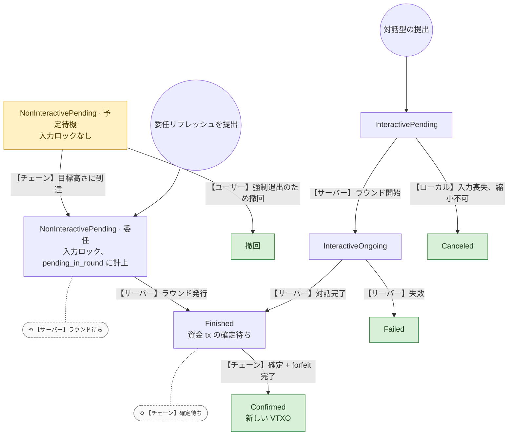
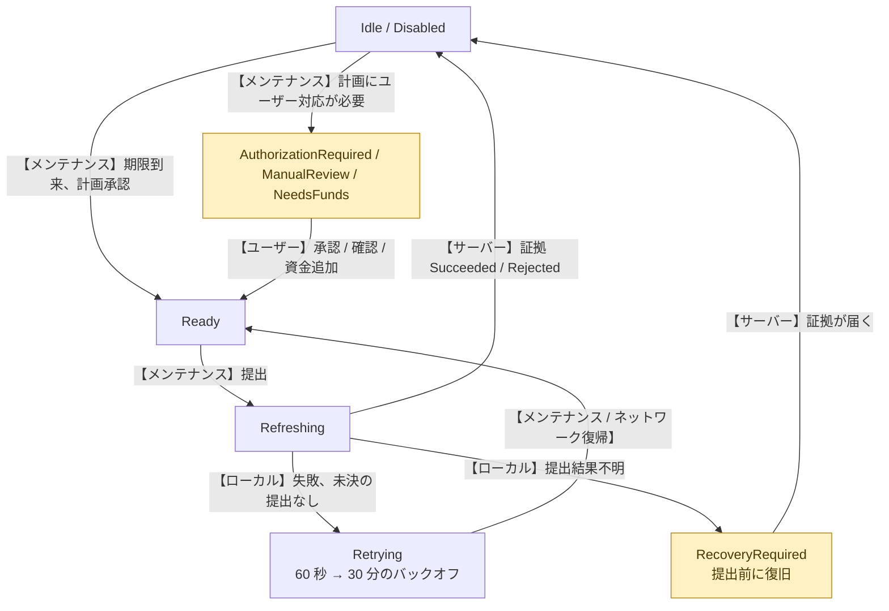

# A5 リフレッシュと自動メンテナンス

[目次に戻る](../README.md) · A · オンチェーンと Ark の資金

## 状態図

GitHub は下の Mermaid ブロックを直接描画します。表示が崩れる場合は SVG を開いてください。

### A5a リフレッシュ 1 件（Bark ラウンド）

[SVG](diagrams/A5a.svg) · [Mermaid ソース](diagrams/A5a.mmd)

### A5b Keychat のメンテナンス段階（アカウントごと）

[SVG](diagrams/A5b.svg) · [Mermaid ソース](diagrams/A5b.mmd)

## 状態表

### リフレッシュ 1 件（Bark ラウンド）

| ID | 状態（コード名） | 遷移条件 | 資金・データの所在 | UI 表示 | ユーザーができること | 終了状態か | コード位置 |
|---|---|---|---|---|---|---|---|
| A5-01 | `NonInteractivePending{scheduled_height: Some}` | 予定リフレッシュがサーバーに受理され、目標高さを待つ。予定待機：はい（`is_scheduled_waiting`） | 入力はロックされていない。強制退出可能 | — | — | いいえ | `BK/round/mod.rs:262-267` |
| A5-02 | `NonInteractivePending{scheduled_height: None}` / `Redelegating` | 委任リフレッシュを提出し、サーバーのラウンドを待つ。予定待機：いいえ | 入力は movement によりロック、`pending_in_round` に計上 | — | — | いいえ | `BK/round/mod.rs:1043-1059`, `:816-830`; balance `BK/balance.rs:190-197` |
| A5-03 | `InteractivePending` / `InteractiveOngoing` | 対話型ラウンドの待機中 / 進行中。予定待機：いいえ | 同上 | — | — | いいえ | `BK/round/mod.rs:777`, `:783-803` |
| A5-04 | `Finished`（未完了） | 対話完了、ラウンドの資金 tx の確定待ち。予定待機：いいえ | 同上。forfeit は未完了 | — | — | いいえ | `BK/round/mod.rs:923-959` |
| A5-05 | `Finished`（完了）→ `Confirmed` | 資金 tx 確定、forfeit 完了。予定待機：— | 新しい VTXO | — | — | はい | `BK/round/mod.rs:771-775`, `:937-948` |
| A5-06 | `Failed` / `Canceled` | ラウンド失敗、ユーザーがキャンセル、または入力喪失で縮小不可。予定待機：— | 入力を解放 | — | — | はい | `BK/round/mod.rs:793-813` |

### Keychat のメンテナンス段階（アカウントごと）

| ID | 状態（コード名） | 遷移条件 | 資金・データの所在 | UI 表示 | ユーザーができること | 終了状態か | コード位置 |
|---|---|---|---|---|---|---|---|
| A5-07 | `Idle` / `Disabled` | リフレッシュ不要 / 自動リフレッシュ無効 | — | `disabled-title` | 有効にする、または手動でリフレッシュ | いいえ（常駐） | `W/ark/maintenance.rs:72-75` |
| A5-08 | `Ready` / `Refreshing` | 計画承認済み / 提出済み | — | — | 待つ | いいえ | `W/ark/provider/maintenance.rs:530-538` |
| A5-09 | `Retrying` | 失敗時のバックオフ 60 秒 → 30 分 | — | — | 待つ | いいえ | `W/ark/maintenance.rs:132-146` |
| A5-10 | `RecoveryRequired` | 提出結果不明。先に復旧 | — | — | 待つ（`URGENT_CHECK_SECONDS` ごとに再確認） | いいえ | `W/ark/provider/maintenance.rs:241-258` |
| A5-11 | `AuthorizationRequired` / `ManualReview` / `NeedsFunds` | ユーザーによる手数料承認、手動確認、または資金追加が必要 | — | `authorization-*`、`funds-title` など | 承認、確認、または資金追加 | いいえ（ユーザー待ち） | `W/ark/maintenance.rs:35-62` |

「同上」は表の直前の行を指します。UI 列の `xxx.yyy` はローカライズキーです。
