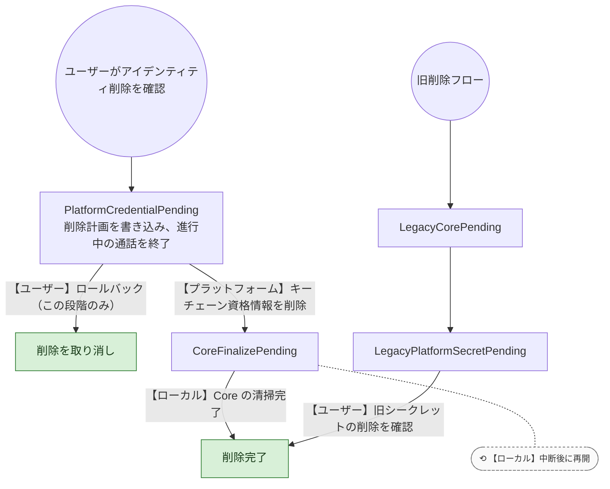

# D1 アイデンティティの削除

[目次に戻る](../README.md) · D · アイデンティティ、デバイス、復旧

## 状態図

GitHub は下の Mermaid ブロックを直接描画します。表示が崩れる場合は SVG を開いてください。

[SVG](diagrams/D1.svg) · [Mermaid ソース](diagrams/D1.mmd)

## 状態表

| ID | 状態（コード名） | 遷移条件 | 資金・データの所在 | UI 表示 | ユーザーができること | 終了状態か | コード位置 |
|---|---|---|---|---|---|---|---|
| D1-01 | `PlatformCredentialPending` | ユーザーが削除を確認。Core が削除計画を書き込み、そのアイデンティティの進行中通話を終了 | アイデンティティはまだ存在。新しい処理はブロック | — | ロールバック（この段階のみ） | いいえ | `A/data_store/identity_deletion.rs:6-50`; rollback `A/app_storage/identities.rs:1386-1409` |
| D1-02 | `CoreFinalizePending` | プラットフォームがキーチェーン資格情報の削除を確認 | 資格情報は削除済み。Core データは清掃待ち | — | 続行（繰り返し可） | いいえ | `identity_deletion.rs:54-82`, `:101-138` |
| D1-03 | `LegacyCorePending` / `LegacyPlatformSecretPending` | 旧削除フローの中間点 | 同上 | — | 続行。旧シークレットの削除を確認 | いいえ | `identity_deletion.rs:121-126`, `:237`, `:271` |
| D1-04 | 削除完了 | Core の清掃完了。削除行を除去 | アイデンティティは消えた | — | — | はい | — |

「同上」は表の直前の行を指します。UI 列の `xxx.yyy` はローカライズキーです。
