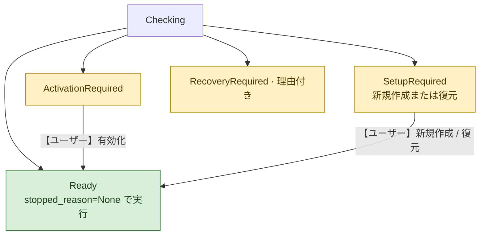
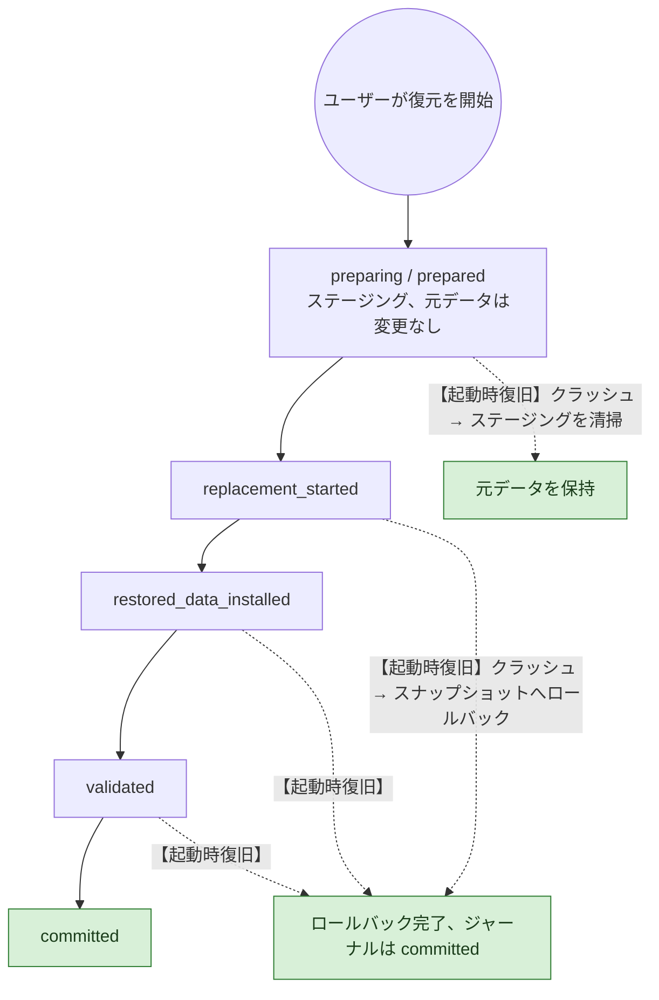

# D2 デバイスの有効化、起動、バックアップ復元

[目次に戻る](../README.md) · D · アイデンティティ、デバイス、復旧

## 状態図

GitHub は下の Mermaid ブロックを直接描画します。表示が崩れる場合は SVG を開いてください。

### D2a 起動

[SVG](diagrams/D2a.svg) · [Mermaid ソース](diagrams/D2a.mmd)

### D2b バックアップ復元（iOS トランザクションジャーナル）

[SVG](diagrams/D2b.svg) · [Mermaid ソース](diagrams/D2b.mmd)

## 状態表

### 起動

| ID | 状態（コード名） | 遷移条件 | 資金・データの所在 | UI 表示 | ユーザーができること | 終了状態か | コード位置 |
|---|---|---|---|---|---|---|---|
| D2-01 | `Checking` | 起動 | — | — | 待つ | いいえ | `A/device_activation.rs:61-62` |
| D2-02 | `SetupRequired` | データなし | — | — | 新規作成または復元 | いいえ（ユーザー待ち） | `:63` |
| D2-03 | `ActivationRequired{pending}` | データあり、有効化は未検証 | — | — | 有効化 | いいえ（ユーザー待ち） | `:64-66` |
| D2-04 | `RecoveryRequired{reason}` | 復元がブロック、DB 鍵がない、ストレージが利用不可 / 非互換、キーチェーン利用不可、資格情報の競合、未対応のポリシー | — | — | 理由に応じて対処 | いいえ（ユーザー待ち） | `:49-58`, `:67-69` |
| D2-05 | `Ready{stopped_reason}` | すべて準備完了。または手動 / 移行元 / 移行先として一時停止 | — | — | — | はい（常駐） | `:70-80` |

### バックアップ復元（Core の進捗）と iOS トランザクションジャーナル

| ID | 状態（コード名） | 遷移条件 | 資金・データの所在 | UI 表示 | ユーザーができること | 終了状態か | コード位置 |
|---|---|---|---|---|---|---|---|
| D2-06 | `RestoreInspecting` / `RestoreValidating` / `RestoreStaging` (iOS: `preparing` / `prepared`) | — | ステージング領域。元のデータは変更なし | — | 起動時にステージングを清掃 | いいえ | `A/backup_restore.rs:606-621`; `iOS/Services/BackupRestoreTransaction.swift:197-199` |
| D2-07 | `RestoreReplacingLocalData` / `RestoreWritingKeychain` (iOS: `replacement_started` / `restored_data_installed`) | — | 元データのスナップショット + 新データ | — | 起動時にスナップショットへロールバックし、繰り返しを防ぐためジャーナルを committed にする | いいえ | `BackupRestoreTransaction.swift:200-205`, `:209-258` |
| D2-08 | `RestoreReopeningClient` / `RestoreWalletChecking` (iOS: `validated`) | — | 新データ | — | 同上（ロールバック） | いいえ | same as above |
| D2-09 | `RestoreComplete` (iOS: `committed`) | — | 新データ。スナップショットは清掃済み | — | — | はい | `BackupRestoreTransaction.swift:178-181` |
| D2-10 | `Failed` (iOS: —) | — | 失敗箇所による | — | Idle に戻るのみ | はい | `A/backup_restore.rs:698-741` |

「同上」は表の直前の行を指します。UI 列の `xxx.yyy` はローカライズキーです。
