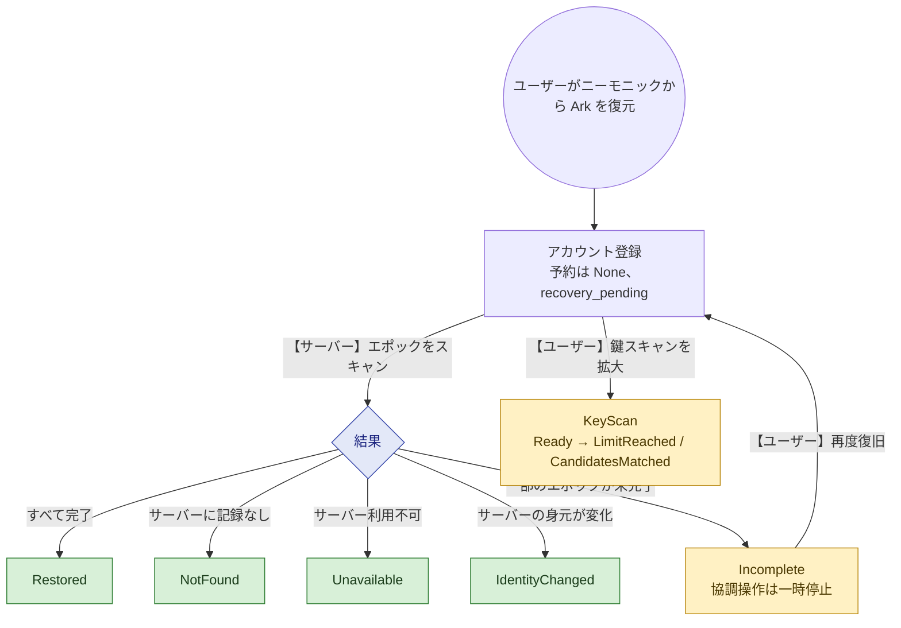

# D3 ウォレットの復旧

[目次に戻る](../README.md) · D · アイデンティティ、デバイス、復旧

## 状態図

GitHub は下の Mermaid ブロックを直接描画します。表示が崩れる場合は SVG を開いてください。

[SVG](diagrams/D3.svg) · [Mermaid ソース](diagrams/D3.mmd)

## 状態表

| ID | 状態（コード名） | 遷移条件 | 資金・データの所在 | UI 表示 | ユーザーができること | 終了状態か | コード位置 |
|---|---|---|---|---|---|---|---|
| D3-01 | `Restored` | 全エポック完了 | 復旧した VTXO と退出 | — | — | はい | `W/ark/types.rs:69` |
| D3-02 | `NotFound` | サーバーにこのウォレットの記録がない | — | — | 別のソースを試す | はい | `types.rs:70` |
| D3-03 | `Incomplete` | いずれかのエポックが未完了。アカウントは `recovery_pending` のまま、協調操作は拒否、予約は None | 一部復旧 | — | 再度復旧 | いいえ | `W/ark/types.rs:71` |
| D3-04 | `Unavailable` / `IdentityChanged` | サーバー利用不可 / サーバーの身元が変わった | — | — | 後で再試行 / 手動で判断 | はい（今回の試行） | `types.rs:72-73` |
| D3-05 | 鍵スキャン `Ready` / `LimitReached` / `CandidatesMatched` | 上限までスキャン、またはインデックスで一致 | スキャン進捗 | — | スキャンを拡大 | いいえ | `types.rs:89-108` |
| D3-06 | BTC 履歴スキャン `Ready` / `LimitReached` / `UnsupportedChainSource` | 同上（共有 BTC） | 発見したアドレス数 | — | スキャンを拡大 | いいえ | `types.rs:441-457` |

「同上」は表の直前の行を指します。UI 列の `xxx.yyy` はローカライズキーです。
