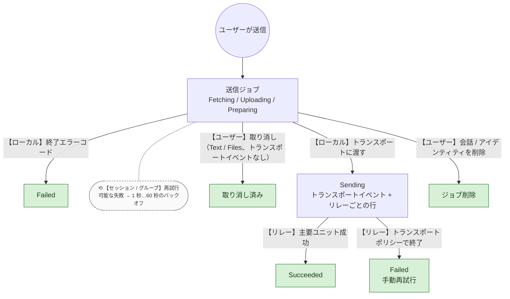

# C1 メッセージ送信

[目次に戻る](../README.md) · C · メッセージと関係

## 状態図

GitHub は下の Mermaid ブロックを直接描画します。表示が崩れる場合は SVG を開いてください。

[SVG](diagrams/C1.svg) · [Mermaid ソース](diagrams/C1.mmd)

## 状態表

| ID | 状態（コード名） | 遷移条件 | 資金・データの所在 | UI 表示 | ユーザーができること | 終了状態か | コード位置 |
|---|---|---|---|---|---|---|---|
| C1-01 | `Fetching` | リンクプレビューの意図が未完了 | 送信ジョブ | 送信中 | テキスト / ファイルは取り消し可能 | いいえ | `A/messaging/delivery_queries.rs:420-424` |
| C1-02 | `Uploading` | 添付ファイルの意図が未完了 | 送信ジョブ + ローカル添付 | アップロード中 | 同上 | いいえ | `delivery_queries.rs:425-429` |
| C1-03 | `Preparing` | ジョブあり、まだトランスポートに渡していない | 送信ジョブ | 送信中 | 同上 | いいえ | `delivery_queries.rs:430-432` |
| C1-04 | `Failed`（ジョブ内） | アップロード一時停止 | 送信ジョブ | 失敗 | 再試行 | いいえ | `delivery_queries.rs:421-422` |
| C1-05 | `Sending` | トランスポートイベントを作成。業務上の成功でも終了でもない | `app_message_transport_events` + リレーごとの配信行 | 送信中 | 待つ | いいえ | `delivery_queries.rs:443-445` |
| C1-06 | `Succeeded` | 主要ユニットが業務上の成功に到達 | 配信行 | 送信済み | — | はい | `delivery_queries.rs:433-437` |
| C1-07 | `Failed`（配信） | トランスポートポリシーが終了と判定 | 配信行 | 失敗 | 手動再試行（`manual_retryable` に従う） | はい | `delivery_queries.rs:438-442` |

「同上」は表の直前の行を指します。UI 列の `xxx.yyy` はローカライズキーです。
