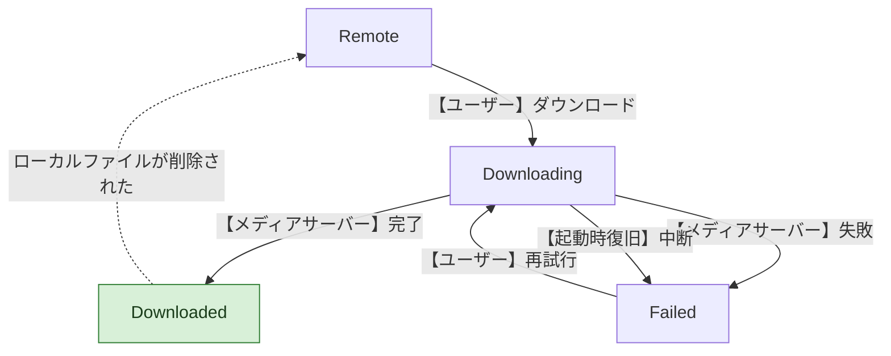
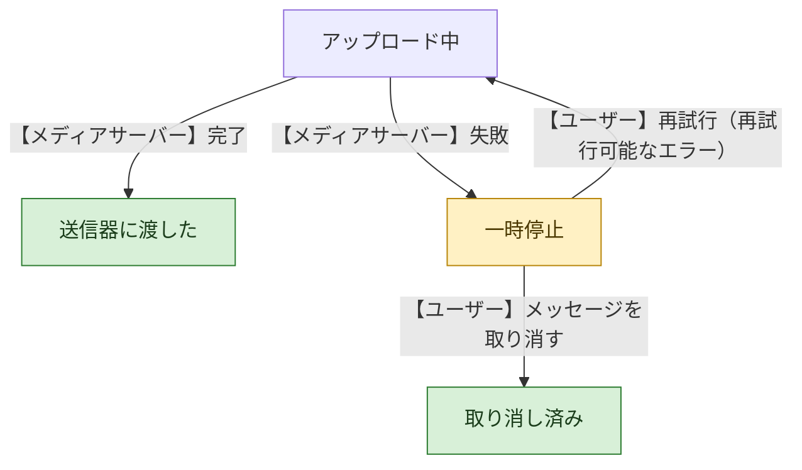

# C2 添付ファイルのアップロードとダウンロード

[目次に戻る](../README.md) · C · メッセージと関係

## 状態図

GitHub は下の Mermaid ブロックを直接描画します。表示が崩れる場合は SVG を開いてください。

### C2a ダウンロード

[SVG](diagrams/C2a.svg) · [Mermaid ソース](diagrams/C2a.mmd)

### C2b アップロード（送信ジョブの一部）

[SVG](diagrams/C2b.svg) · [Mermaid ソース](diagrams/C2b.mmd)

## 状態表

### ダウンロード

| ID | 状態（コード名） | 遷移条件 | 資金・データの所在 | UI 表示 | ユーザーができること | 終了状態か | コード位置 |
|---|---|---|---|---|---|---|---|
| C2-01 | `Remote` | 未ダウンロード | リモート URL + 鍵 | ダウンロード可能 | ダウンロード | いいえ | `A/data_store/message_snapshot.rs:536-540` |
| C2-02 | `Downloading` | ダウンロード開始（`transfer_state=1`） | 一時ファイル | ダウンロード中 | 待つ | いいえ | `A/app_storage/attachments.rs:356` |
| C2-03 | `Downloaded` | `transfer_state=2` かつローカルファイルが存在 | ローカルファイル | 開ける | — | はい（ファイルがなくなると Remote 投影に戻る） | `message_snapshot.rs:527-535` |
| C2-04 | `Failed` | ダウンロード失敗、または起動時 / ランタイム再起動時に中断を検出 | `last_error_code` | 失敗 | 再試行 | いいえ | `attachments.rs:462-469`, `:472-492` |

### アップロード（送信ジョブの一部）

| ID | 状態（コード名） | 遷移条件 | 資金・データの所在 | UI 表示 | ユーザーができること | 終了状態か | コード位置 |
|---|---|---|---|---|---|---|---|
| C2-05 | アップロード中 | 添付ファイルの意図が未完了 | — | `Uploading` | テキスト / ファイルのメッセージは取り消し可能 | いいえ | `A/messaging/delivery_queries.rs:425-429` |
| C2-06 | 一時停止（ジョブ内の失敗） | アップロード失敗で `upload_state='paused'` を書き込み | — | `Failed` | 再試行可能なエラーは再試行可。ソース欠落、無効な意図、安全でない宛先は不可 | いいえ | `A/app_storage/message_sender_attachments.rs:349`; `A/message_sender/projection.rs:73-94` |

「同上」は表の直前の行を指します。UI 列の `xxx.yyy` はローカライズキーです。
