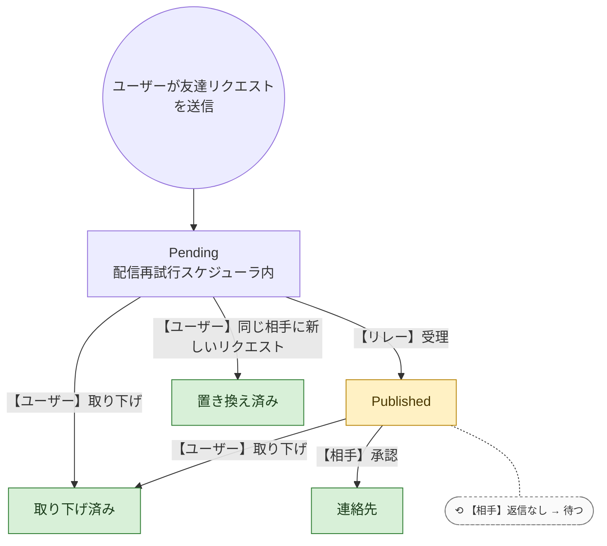

# C3 友達リクエストと PQXDH アップグレード

[目次に戻る](../README.md) · C · メッセージと関係

## 状態図

GitHub は下の Mermaid ブロックを直接描画します。表示が崩れる場合は SVG を開いてください。

[SVG](diagrams/C3.svg) · [Mermaid ソース](diagrams/C3.mmd)

## 状態表

| ID | 状態（コード名） | 遷移条件 | 資金・データの所在 | UI 表示 | ユーザーができること | 終了状態か | コード位置 |
|---|---|---|---|---|---|---|---|
| C3-01 | `Pending`（送信側） | リクエストを配信再試行スケジューラに投入 | 保留中のリクエスト + プロトコル層の保留セッション | 相手を待つ | 取り下げ | いいえ | `A/friend_request.rs:1260-1263`, `:1611-1625` |
| C3-02 | `Published` | 少なくとも 1 つのリレーが受理 | 同上 | 相手を待つ | 取り下げ | いいえ | `A/types.rs:3512` |
| C3-03 | 相手が承認 | 相手の返信を受信 | セッション確立 | 連絡先 | — | はい | — |
| C3-04 | 取り下げ済み | ユーザーが取り下げ。または同じ相手への新しいリクエストが置き換え | プロトコルの保留セッションとトランスポートを消去 | — | — | はい | `A/friend_request.rs:1265-1369`, `:1220-1258` |
| C3-05 | PQXDH アップグレードの再試行 | ユーザーが手動で実行 | — | `Sent` / `AlreadyUpgraded` / `PeerNotReady` / `IneligibleRoom` / `InFlight` ごとに別の表示 | 後で再試行 | 呼び出しごとに返る | `A/types.rs:533-540` |

「同上」は表の直前の行を指します。UI 列の `xxx.yyy` はローカライズキーです。
