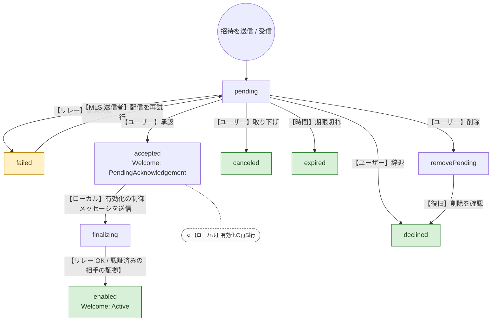

# C4 グループ招待と MLS Welcome の有効化

[目次に戻る](../README.md) · C · メッセージと関係

## 状態図

GitHub は下の Mermaid ブロックを直接描画します。表示が崩れる場合は SVG を開いてください。

[SVG](diagrams/C4.svg) · [Mermaid ソース](diagrams/C4.mmd)

## 状態表

| ID | 状態（コード名） | 遷移条件 | 資金・データの所在 | UI 表示 | ユーザーができること | 終了状態か | コード位置 |
|---|---|---|---|---|---|---|---|
| C4-01 | `pending` | 招待を送信または受信。配信再試行で pending に戻る | — | — | 承認 / 辞退 / 取り下げ | いいえ | `A/group_invite/outgoing.rs:216`, `:395`; `A/group_invite/welcome.rs:212`; `A/group_invite/delivery.rs:413` |
| C4-02 | `failed` | 配信失敗、または決定の処理に失敗 | — | — | MLS の送信者は配信を再試行可能（`group_invite_lifecycle_allows_delivery_retry`） | いいえ | `outgoing.rs:440`, `:482`, `:519`; `A/group_invite/decisions.rs:244`; `A/group_invite.rs:308-318` |
| C4-03 | `accepted` / `finalizing` | 承認済み。メンバー有効化の制御メッセージの到達待ち | — | `PendingAcknowledgement` | 待つ | いいえ | `A/group_invite/projection.rs:14`, `:24` |
| C4-04 | `enabled` | 認証済みの有効化証拠またはリレー OK を受信 | — | `Active` | — | はい | `A/group_invite/delivery.rs:513`; `projection.rs:25` |
| C4-05 | `declined` / `canceled` / `expired` | 辞退、取り下げ、期限切れ | — | — | — | はい | `A/group_invite/removal_recovery.rs:55-63`, `:93-103` |
| C4-06 | `removePending` | 削除中の確認待ち | — | — | — | いいえ | `A/group_invite/decisions.rs:175`; `removal_recovery.rs:235`, `:345` |

「同上」は表の直前の行を指します。UI 列の `xxx.yyy` はローカライズキーです。
