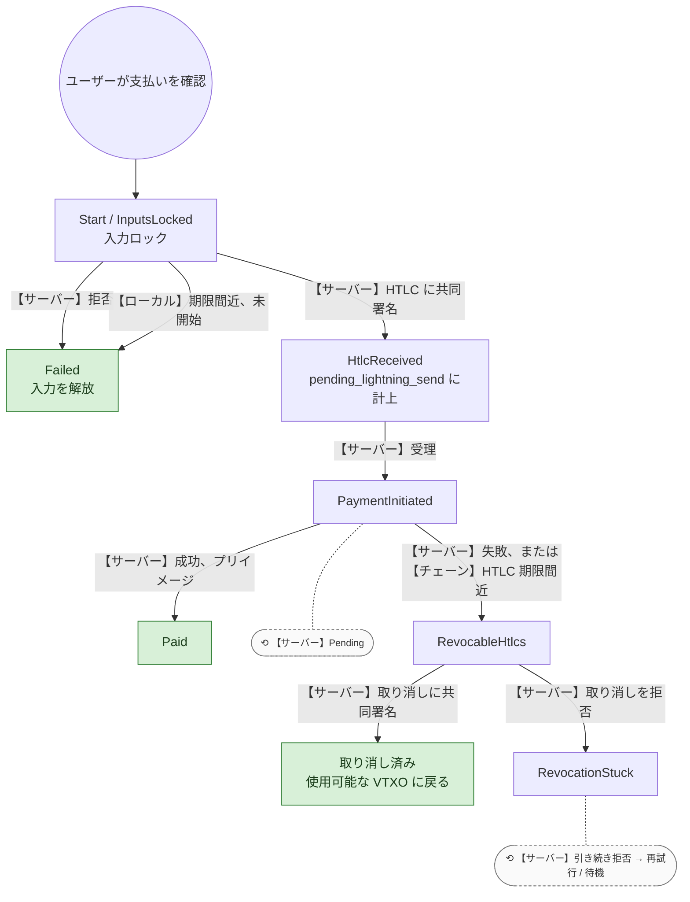
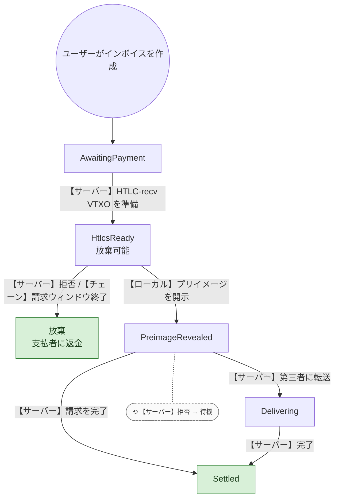

# B1 Lightning の送受信（Ark）

[目次に戻る](../README.md) · B · 支払いと受け取り

## 状態図

GitHub は下の Mermaid ブロックを直接描画します。表示が崩れる場合は SVG を開いてください。

### B1a 送信（インボイスを支払う）

[SVG](diagrams/B1a.svg) · [Mermaid ソース](diagrams/B1a.mmd)

### B1b 受信（インボイスを発行）

[SVG](diagrams/B1b.svg) · [Mermaid ソース](diagrams/B1b.mmd)

## 状態表

### 送信

| ID | 状態（コード名） | 遷移条件 | 資金・データの所在 | UI 表示 | ユーザーができること | 終了状態か | コード位置 |
|---|---|---|---|---|---|---|---|
| B1-01 | `Start` / `InputsLocked` | ユーザーが支払いを確認 | 入力 VTXO はアクションによりロック | `InProgress` | 待つ | いいえ | `BK/actions/lightning/pay.rs:326-330`, `:221-229` |
| B1-02 | `HtlcReceived` | サーバーが HTLC 出力に共同署名 | HTLC VTXO はロック、`pending_lightning_send` に計上 | `InProgress` | 待つ | いいえ | `BK/actions/lightning/pay.rs:331-332` |
| B1-03 | `PaymentInitiated` | サーバーに支払いを指示 | 同上 | `InProgress` | 待つ | いいえ | `BK/actions/lightning/pay.rs:183-207` |
| B1-04 | `RevocableHtlcs` | サーバーが失敗を報告、または HTLC 期限間近でも Pending | 同上。取り消しを準備 | `InProgress` | 待つ | いいえ | `BK/actions/lightning/pay.rs:189-198` |
| B1-05 | `RevocationStuck` | サーバーが取り消しを拒否 | 同上 | `InProgress{has_failed_revocation: true}` | 待つ | いいえ | `BK/actions/lightning/pay.rs:260-275`, `:299-315`; `W/ark/bark_runtime.rs:3032-3038`; `iOS/Wallet/Ark/ArkWalletModels.swift:1117` |
| B1-06 | `Paid` | プリイメージを取得 | 支払い済み | `Paid` | — | はい | `BK/actions/lightning/pay.rs:185-188` |
| B1-07 | 取り消し完了（Done） | サーバーが取り消しに共同署名 | 使用可能な VTXO に戻る | — | — | はい | `BK/actions/lightning/pay.rs:209-213` |

### 受信

| ID | 状態（コード名） | 遷移条件 | 資金・データの所在 | UI 表示 | ユーザーができること | 終了状態か | コード位置 |
|---|---|---|---|---|---|---|---|
| B1-08 | `AwaitingPayment` | インボイスを作成 | なし | — | — | いいえ | `BK/actions/lightning/receive.rs:257-258` |
| B1-09 | `HtlcsReady` | サーバーが HTLC-recv VTXO を準備 | ロック。まだ放棄可能 | — | — | いいえ。請求ウィンドウが閉じるか請求が拒否されると放棄 | `BK/actions/lightning/receive.rs:259-262`, `:204-211`, `:240-246` |
| B1-10 | `PreimageRevealed` | プリイメージをサーバーに開示 | HTLC-recv VTXO はロック、`claimable_lightning_receive` に計上 | — | — | いいえ。請求失敗後は待機 | `BK/actions/lightning/receive.rs:263-269`, `:212-224`, `:247-249`; `BK/lightning/receive.rs:205-240` |
| B1-11 | `Delivering` | 請求出力を第三者に転送する必要がある | ロック | — | — | いいえ | `BK/actions/lightning/receive.rs:270-273` |
| B1-12 | `Settled` | 請求完了 | 新しい VTXO | — | — | はい | `W/ark/bark_runtime.rs:3007-3014` |

「同上」は表の直前の行を指します。UI 列の `xxx.yyy` はローカライズキーです。
