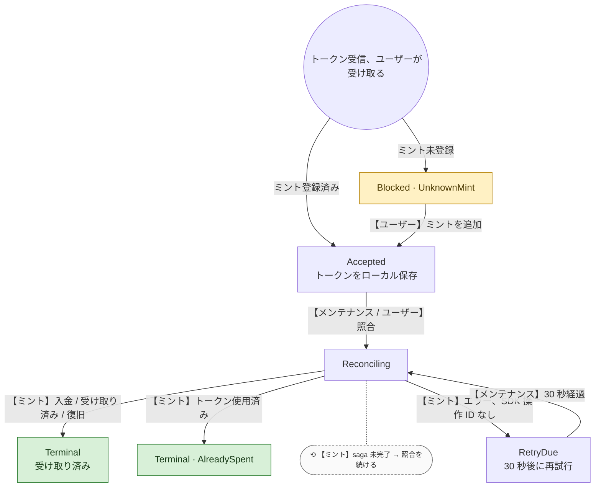

# B2 Cashu の受け取り

[目次に戻る](../README.md) · B · 支払いと受け取り

## 状態図

GitHub は下の Mermaid ブロックを直接描画します。表示が崩れる場合は SVG を開いてください。

[SVG](diagrams/B2.svg) · [Mermaid ソース](diagrams/B2.mmd)

## 状態表

| ID | 状態（コード名） | 遷移条件 | 資金・データの所在 | UI 表示 | ユーザーができること | 終了状態か | コード位置 |
|---|---|---|---|---|---|---|---|
| B2-01 | `Accepted` | トークン受信、ミント登録済み | ベアラートークンはローカル暗号化ストアにある（唯一の再生可能なコピー） | 受け取り処理中 | 待つ | いいえ | `W/cashu/receive_store.rs:340-345`; `W/cashu/receive_operations.rs:63` |
| B2-02 | `Blocked` (`UnknownMint`) | ミント未登録 | 同上 | ミントの追加が必要 | ミントを追加して続行 | いいえ | `receive_store.rs:342-345`; skipped by maintenance `receive_operations.rs:509-512` |
| B2-03 | `Reconciling` | 照合中、または SDK にこの操作の saga がある | トークン + CDK saga | 処理中 | 待つ | いいえ | `receive_operations.rs:188-194`, `:216-226` |
| B2-04 | `RetryDue` (`RetryRequired`) | 照合がエラーで SDK 操作 ID なし。30 秒後に再試行 | トークン | 処理中 | 待つ | いいえ | `receive_operations.rs:192`, `:214-227` |
| B2-05 | `Terminal`（問題なし） | `Credited` / `AlreadyReceived` / `Recovered` を取得 | CDK 残高内 | 受け取り済み | — | はい | `receive_operations.rs:196-206` |
| B2-06 | `Terminal` (`AlreadySpent`) | ミントがトークン使用済みと応答 | なし | `CashuTokenAlreadySpent` エラー | — | はい | `receive_operations.rs:207-213` |

「同上」は表の直前の行を指します。UI 列の `xxx.yyy` はローカライズキーです。
