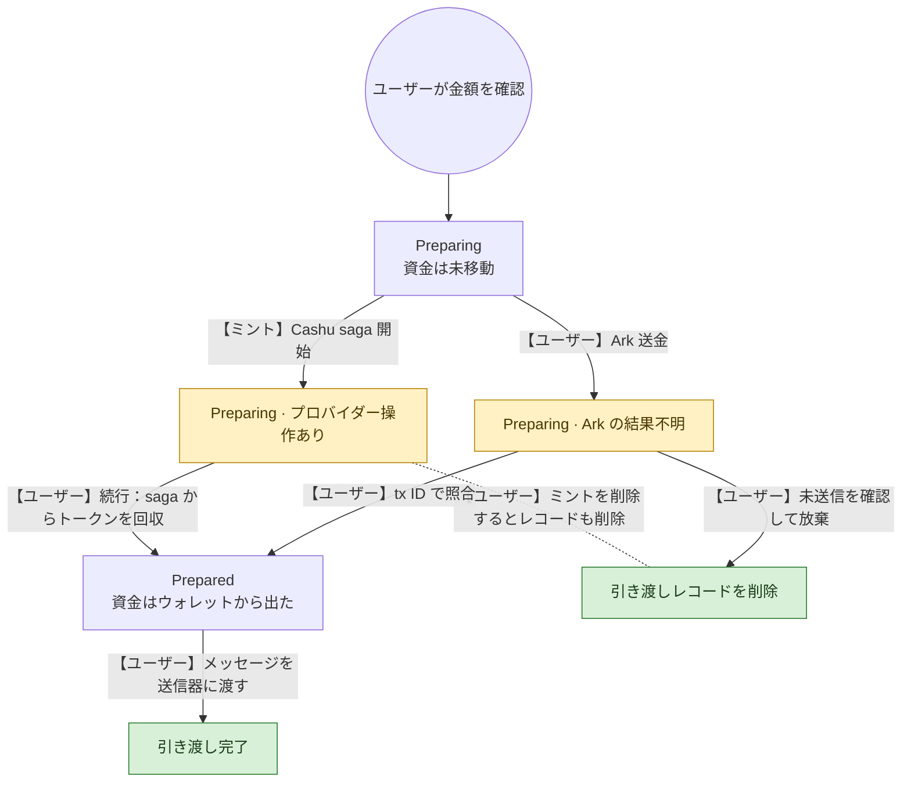
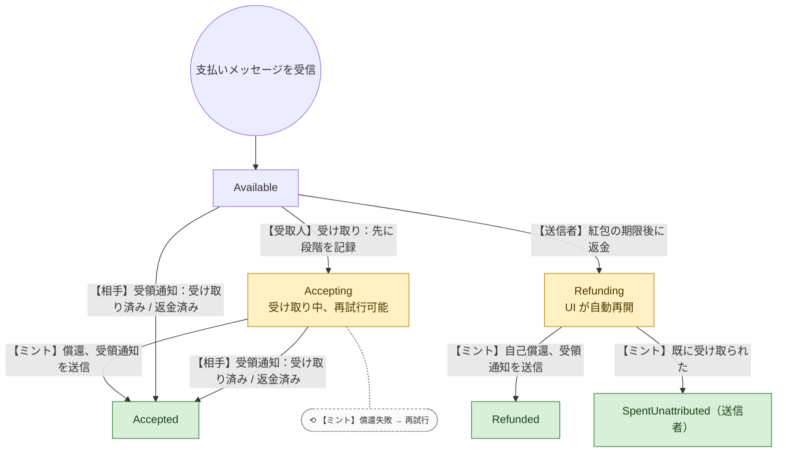

# B3 チャット送金、紅包、受領通知

[目次に戻る](../README.md) · B · 支払いと受け取り

## 状態図

GitHub は下の Mermaid ブロックを直接描画します。表示が崩れる場合は SVG を開いてください。

### B3a 送信者：ウォレット引き渡し（ルームとアイデンティティごとに 1 件）

[SVG](diagrams/B3a.svg) · [Mermaid ソース](diagrams/B3a.mmd)

### B3b メッセージ側：Cashu 送金 / 紅包（Signal DM）

[SVG](diagrams/B3b.svg) · [Mermaid ソース](diagrams/B3b.mmd)

## 状態表

### 送信者：ウォレット引き渡し（ルームごとに最大 1 件）

| ID | 状態（コード名） | 遷移条件 | 資金・データの所在 | UI 表示 | ユーザーができること | 終了状態か | コード位置 |
|---|---|---|---|---|---|---|---|
| B3-01 | `Preparing`、プロバイダー操作なし | ユーザーが金額を確認 | 資金は未移動 | — | 続行 | いいえ | `W/ledger.rs:539-606` |
| B3-02 | `Preparing`、プロバイダー操作あり（Cashu） | Cashu 送金 saga を開始 | ミント側の saga。トークンが既に存在する可能性 | `wallet.chat.previous-cashu-interrupted` | 「続行」：saga からトークンを回収 | いいえ | `WU/wallet.rs:2752-2810`, `:1880-1931` |
| B3-03 | `Preparing`、Ark の結果未確定 | Ark 送金の結果が不明 | 既にアカウントから出ている可能性 | `wallet.chat.previous-wallet-transfer-interrupted` | tx ID で照合する。または送られていないことを確認して放棄 | いいえ | `W/ledger.rs:734-759`; `iOS/Wallet/Views/ChatPayFlowSheet.swift:862-900` |
| B3-04 | `Prepared` | トークン（Cashu）または tx ID（Ark）を取得 | 資金はウォレットから出た。トークンはローカル saga 内 | `wallet.chat.wallet-transfer-complete`（メッセージの引き渡しを再開可能） | メッセージ送信を続ける | いいえ | `W/ledger.rs:691-722`; `ChatPayFlowSheet.swift:725-731` |
| B3-05 | 削除（完了） | メッセージを送信器に引き渡した | 引き渡しレコードを削除 | — | — | はい | `W/ledger.rs:724-732`; `ChatPayFlowSheet.swift:851` |

### メッセージ側：Cashu 送金 / 紅包（Signal DM のみ）

| ID | 状態（コード名） | 遷移条件 | 資金・データの所在 | UI 表示 | ユーザーができること | 終了状態か | コード位置 |
|---|---|---|---|---|---|---|---|
| B3-06 | なし → `Pending` / `Available` | 受信または送信 | — | 受け取り可能 | 受取人が受け取る。送信者は受け取れない（紅包） | いいえ | `A/payment_lifecycle.rs:826-849` |
| B3-07 | `Accepting` → `Pending` / `Accepting` | 受取人が受け取りをタップ。償還前に段階を記録 | — | 受け取り中、`can_retry` | 再試行 | いいえ | `A/messaging/payment_messages.rs:876-935`; projection `payment_lifecycle.rs:843-844`, `:858` |
| B3-08 | `Accepted` → `Succeeded` / `Accepted` | 償還して受領通知を送信。または相手の受領通知を受信 | — | 請求済み | 失敗した場合は受領通知を再送 | はい | `payment_lifecycle.rs:417-455`, `:828-841` |
| B3-09 | `Refunding` → `Expired` / `Accepting` | 紅包の期限後に送信者が返金を開始 | — | `chat.payment.shared.refunding` / `continue-refund` | 返金を続ける（UI が自動再開） | いいえ | `payment_lifecycle.rs:470-480`; `iOS/Views/Components/CashuBubble.swift:723-726`, `:330`, `:1007-1025` |
| B3-10 | `Refunded` | 返金完了 | — | 返金済み | 失敗した場合は受領通知を再送 | はい | `payment_lifecycle.rs:497-522`, `:826-827` |
| B3-11 | `SpentUnattributed`（送信者側の観測） | 送信者がトークン使用済みかつ受領通知なしを検出 | — | `payment_spent_without_receipt` | — | はい（投影） | `payment_lifecycle.rs:810-815`; `CashuBubble.swift:1001-1003`, `:1018-1019` |

「同上」は表の直前の行を指します。UI 列の `xxx.yyy` はローカライズキーです。
