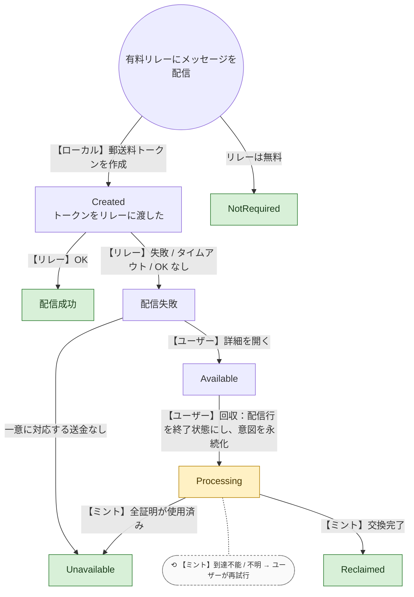

# B4 リレー郵送料と回収

[目次に戻る](../README.md) · B · 支払いと受け取り

## 状態図

GitHub は下の Mermaid ブロックを直接描画します。表示が崩れる場合は SVG を開いてください。

[SVG](diagrams/B4.svg) · [Mermaid ソース](diagrams/B4.mmd)

## 状態表

### 配信ごと（メッセージ × リレー）

| ID | 状態（コード名） | 遷移条件 | 資金・データの所在 | UI 表示 | ユーザーができること | 終了状態か | コード位置 |
|---|---|---|---|---|---|---|---|
| B4-01 | `NotRequired` | リレーは郵送料を取らない | — | — | — | はい（その配信について） | `PC/transport.rs:79-84` |
| B4-02 | `NotStarted` / `Unavailable` | 未払い、または支払えない | 未払い | — | — | いいえ | same as above |
| B4-03 | `Created` | 郵送料トークンを作成し、イベントとともにリレーへ送信 | トークンをリレーに渡し、ウォレット台帳に `relay_stamp` 送金を記録 | — | — | はい（その配信について） | same as above; ledger marker `W/cashu/stamp_reclaim.rs:132-142` |

### 回収（失敗した配信行のみ）

| ID | 状態（コード名） | 遷移条件 | 資金・データの所在 | UI 表示 | ユーザーができること | 終了状態か | コード位置 |
|---|---|---|---|---|---|---|---|
| B4-04 | 回収不可（結び付けなし） | 配信行の状態が failed / timeout / no_ack / terminal_failed / retry_exhausted のいずれでもない、または OK を受信済み | — | 入口を表示しない | — | — | `A/messaging/stamp_reclaim.rs:5-23` |
| B4-05 | `Available` | 結び付けが `TokenCreated` の送金 saga 1 件にのみ対応 | トークンはまだリレーに換金されていない可能性 | 回収を表示 | 回収 | いいえ | `W/cashu/stamp_reclaim.rs:128-186` |
| B4-06 | `Processing` | 回収の意図を受理（ミント操作前に永続化）、またはミントの状態が不明 / 到達不能 | 意図 + 元の証明 | 処理中 | 再度回収 | いいえ | `W/cashu/stamp_reclaim.rs:187-199`, `:209-252` |
| B4-07 | `Reclaimed` | 交換完了 | ウォレットに戻った | 回収済み | — | はい | `W/cashu/stamp_reclaim.rs:203-208`, `:415` |
| B4-08 | `Unavailable` | 全証明が使用済み（リレーが換金済み）、または一意に対応する台帳エントリなし | リレー側 | 回収不可 | — | はい | `W/cashu/stamp_reclaim.rs:149-158`, `:220-224` |

「同上」は表の直前の行を指します。UI 列の `xxx.yyy` はローカライズキーです。
