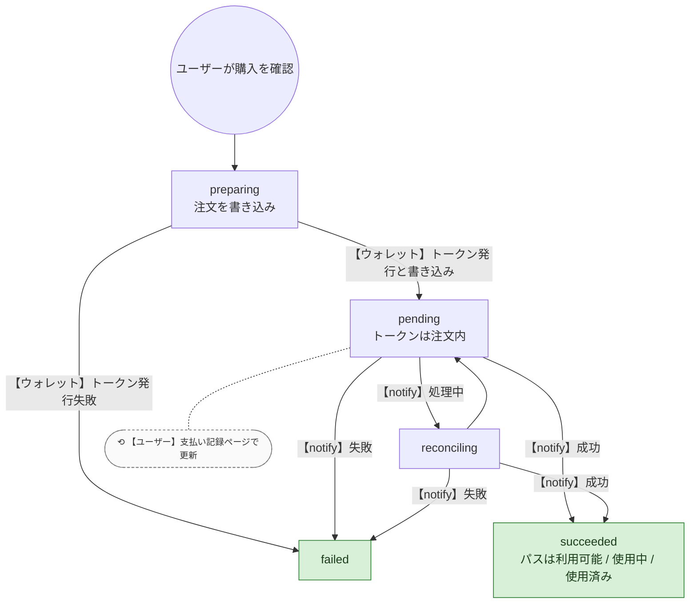

# B5 有料通話チケット

[目次に戻る](../README.md) · B · 支払いと受け取り

## 状態図

GitHub は下の Mermaid ブロックを直接描画します。表示が崩れる場合は SVG を開いてください。

[SVG](diagrams/B5.svg) · [Mermaid ソース](diagrams/B5.mmd)

## 状態表

| ID | 状態（コード名） | 遷移条件 | 資金・データの所在 | UI 表示 | ユーザーができること | 終了状態か | コード位置 |
|---|---|---|---|---|---|---|---|
| B5-01 | `preparing` → `Preparing` | ユーザーが購入を確認。注文行を書き込み | トークン未発行。または発行済みで未書き込み | 支払い中 | 続行 / キャンセル | いいえ | `R/app_storage/rtc_tickets.rs:110`; `R/rtc/payments.rs:132` |
| B5-02 | `pending` / `reconciling` → `Confirming` | トークンを注文に書き込み notify に渡した | トークンは注文内 | 確認中。確認ページは Continue のみ | ポーリングを続ける | いいえ | `rtc_tickets.rs:128-141`; `R/rtc/payments.rs:58-59`, `:177-199`, `:329` |
| B5-03 | `succeeded` → `Available` / `UsePending` / `Used` | notify が確認。その後利用状況で投影 | パス | 利用可能 / 使用中 / 使用済み | 通話 | はい（支払い面） | `rtc_tickets.rs:143-153` |
| B5-04 | `failed` → `Failed` | notify が失敗を返した、またはウォレットがトークン発行に失敗 | トークンを消去 | 失敗 | — | はい | `rtc_tickets.rs:118-125`, `:152` |

「同上」は表の直前の行を指します。UI 列の `xxx.yyy` はローカライズキーです。
