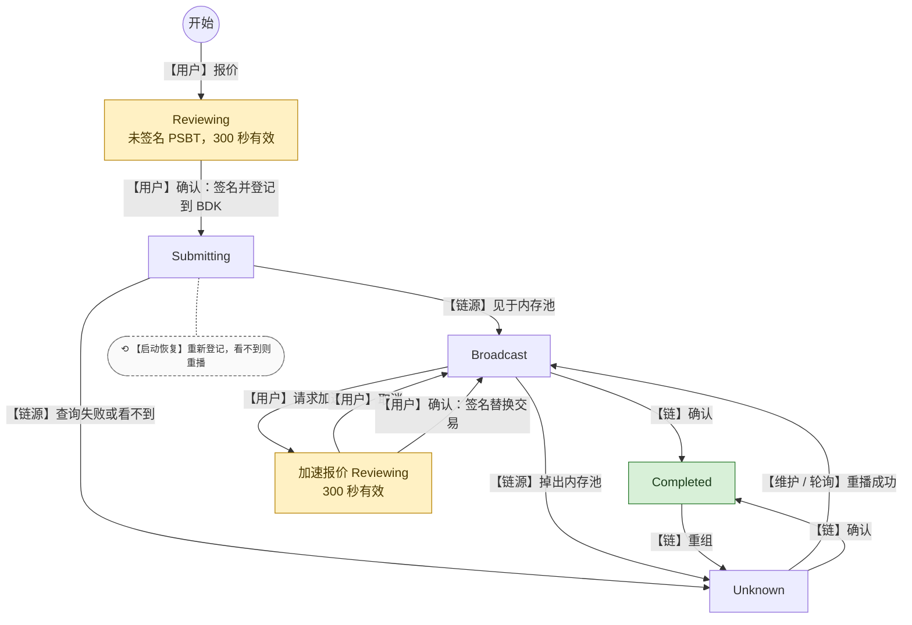
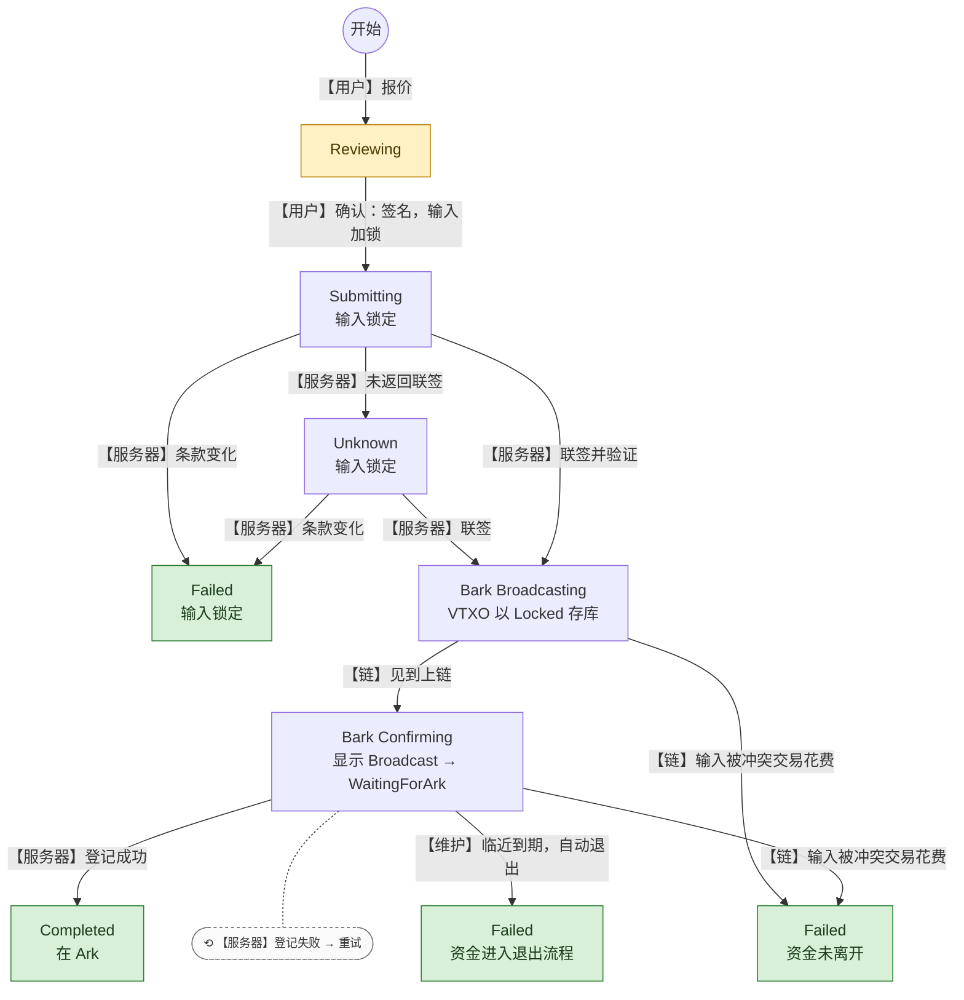

# A1 转入 Ark、直接发送 BTC、RBF 加速

[返回目录](../README.md) · A · 链上与 Ark 资金

## 状态图

GitHub 会直接渲染下方的 Mermaid 代码块；如果显示异常，请打开 SVG 图。

### A1a 直接发送 BTC（含 RBF）

[SVG 图](diagrams/A1a.svg) · [Mermaid 源](diagrams/A1a.mmd)

### A1b 转入 Ark（onboard）

[SVG 图](diagrams/A1b.svg) · [Mermaid 源](diagrams/A1b.mmd)

## 状态表

### 共用记录（`keychat_bitcoin_transfers`）

| 编号 | 状态（代码名） | 进入条件 | 资金或数据在哪 | 界面显示 | 用户可做的事 | 是否终态 | 代码位置 |
|---|---|---|---|---|---|---|---|
| A1-01 | `Reviewing` | 报价生成即落库，有效期 300 秒 | 未签名 PSBT；资金仍在链上钱包，未加锁 | `wallet.bitcoin.review` | 确认；或放弃报价（加速报价可删除） | 否（无过期清理，过期后确认被拒） | `W/ark/bitcoin/transfer.rs:308-336`, `:355-358` |
| A1-02 | `Submitting` | 已签名并写入 `signed_tx_hex` | 签名交易在本地；直接发送已 `register_tx` 进 BDK，余额按已花计；onboard 输入被锁定 | `wallet.bitcoin.submitting` + `wallet.bitcoin.unknown-help` | 只能等待 | 否 | direct send `W/ark/bitcoin/transfer.rs:382-393`; onboard `W/ark/bark_runtime/onboard.rs:220-236` |
| A1-03 | `Broadcast` | 链源报 Mempool | 交易在内存池 | `wallet.bitcoin.onboard.awaiting-confirmation` + `wallet.bitcoin.waiting-chain` | 等待；直接发送可 RBF | 否 | direct `W/ark/bitcoin/replacement.rs:803-807`; onboard `W/ark/bark_runtime/onboard.rs:339` |
| A1-04 | `WaitingForArk` | 仅 onboard：资金交易已确认，Ark 尚未登记 | 资金在 board 输出；board VTXO 被 movement 锁定 | 同上 + `wallet.bitcoin.waiting-ark` | 等待 | 否 | `W/ark/bark_runtime/onboard.rs:336-338` |
| A1-05 | `Unknown` | 链源查询失败、看不到交易、onboard 未拿到联签或 movement 缺失 | 直接发送：签名交易仍在 BDK；onboard：输入锁定 | `wallet.bitcoin.checking` + `wallet.bitcoin.unknown-help` | 等待 | 否 | direct `W/ark/bitcoin/replacement.rs:806`, `:808-809`; onboard `W/ark/bark_runtime/onboard.rs:311-313`, `:340-345`; projected as Unknown without chain source `W/ark/provider/shared_bitcoin.rs:818-840` |
| A1-06 | `Completed` | 直接发送：某次尝试被确认；onboard：movement 成功且有退出凭据 | 直接发送：已到对方；onboard：在 Ark | `wallet.bitcoin.completed` | — | 是（直接发送遇链重组可回到 Unknown） | `W/ark/bitcoin/replacement.rs:796-802`; `W/ark/bark_runtime/onboard.rs:325-327` |
| A1-07 | `Failed` | 仅 onboard：服务器条款变化（`submit_signed_board` 返回 None），或 Bark movement 记为 Failed/Canceled | 条款变化时：输入仍锁定；movement 失败时：资金可能处于退出流程中 | `wallet.bitcoin.failed`（"Transfer failed. Review a new quote to try again."） | 重新报价 | 是 | `W/ark/bark_runtime/onboard.rs:306-310`, `:328-329` |

### onboard 叠加的 Bark 状态（`Board.progress`）

| 编号 | 状态（代码名） | 进入条件 | 资金或数据在哪 | 界面显示 | 用户可做的事 | 是否终态 | 代码位置 |
|---|---|---|---|---|---|---|---|
| A1-08 | `Broadcasting` | 拿到联签、VTXO 已构建 | 资金交易待推送；VTXO 以 Locked 存库 | — | 见到上链 → `Confirming`；输入被确认交易冲突 → 失败；否则停泊等待 | 否 | `BK/actions/board.rs:147-160`, `:230-283` |
| A1-09 | `Confirming` | 资金交易在内存池或区块 | board VTXO Locked，计入 `pending_board` | — | 确认数够即登记；登记失败则重试；临近到期自动发起退出 | 否 | `BK/actions/board.rs:290-393` |
| A1-10 | movement `Failed`（退出后） | VTXO 已 Exited 或已被冲突花费 | 前者在退出流程中，后者资金未离开 | — | 终态 | 是 | `BK/actions/board.rs:299-314` |

### RBF 加速（直接发送的「谱系」）

| 编号 | 状态（代码名） | 进入条件 | 资金或数据在哪 | 界面显示 | 用户可做的事 | 是否终态 | 代码位置 |
|---|---|---|---|---|---|---|---|
| A1-11 | 加速报价 `Reviewing` + `replacement` | 用户请求加速，条件满足 | 未签名替换 PSBT，300 秒有效 | — | 确认；或取消（只删未签名记录） | 否（随谱系） | `W/ark/bitcoin/replacement.rs:378-401`, `:403-450` |
| A1-12 | 父记录 `replaced_by` 置位、子记录签名 | 用户确认 | 父子同一事务提交 | — | 等待 | 否（随谱系） | `W/ark/bitcoin/replacement.rs:825-860` |
| A1-13 | 谱系状态 | 任一尝试确认即该尝试 Completed，其余维持；头部按内存池/未见判定 | — | — | — | 否（随谱系） | `W/ark/bitcoin/replacement.rs:786-823` |

「同上」指本表上一行。界面显示列中的 `xxx.yyy` 为本地化文案键。
