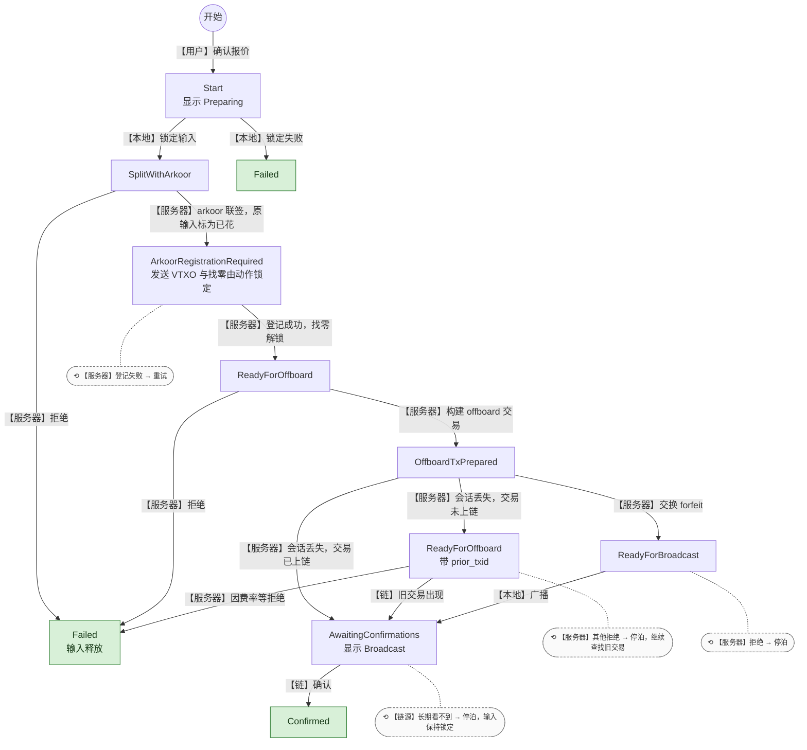

# A2 从 Ark 发送 BTC 到链上地址

[返回目录](../README.md) · A · 链上与 Ark 资金

## 状态图

GitHub 会直接渲染下方的 Mermaid 代码块；如果显示异常，请打开 SVG 图。

[SVG 图](diagrams/A2.svg) · [Mermaid 源](diagrams/A2.mmd)

## 状态表

| 编号 | 状态（代码名） | 进入条件 | 资金或数据在哪 | 界面显示 | 用户可做的事 | 是否终态 | 代码位置 |
|---|---|---|---|---|---|---|---|
| A2-01 | `Preparing`（Bark `Start` / `SplitWithArkoor`） | 用户确认，动作检查点写入 | 输入 VTXO 被动作锁定 | `wallet.bitcoin-send.preparing`（"Payment in progress"） | 「检查状态」 | 否 | projection `W/ark/bark_runtime/bitcoin_send.rs:105-111`, `:127-139`; locking `BK/actions/offboard.rs:553-572` |
| A2-02 | `Preparing`（Bark `ArkoorRegistrationRequired`） | 已做 arkoor 拆分，原输入标为已花 | 拆出的发送 VTXO **与找零** 都被动作锁定，等待向服务器登记 | 同上 | 同上 | 否 | `BK/actions/offboard.rs:605-636`, `:641-661` |
| A2-03 | `Preparing`（Bark `ReadyForOffboard` / `OffboardTxPrepared` / `ReadyForBroadcast`） | 登记成功，与服务器交换 offboard 交易与 forfeit | 发送 VTXO 锁定；找零已解锁 | 同上 | 同上 | 否 | `BK/actions/offboard.rs:263-286`, `:670-760` |
| A2-04 | `Broadcast`（Bark `AwaitingConfirmations`） | offboard 交易已推送 | 资金在链上交易里；VTXO 已 forfeit | `wallet.bitcoin-send.broadcast` | 「检查状态」 | 否 | `bitcoin_send.rs:109`; `BK/actions/offboard.rs:287-326` |
| A2-05 | `Confirmed` | movement Successful | 已到对方地址 | `wallet.bitcoin-send.confirmed` | — | 是 | `bitcoin_send.rs:106` |
| A2-06 | `Failed` | movement Failed / Canceled（Bark 在 `Start`、`SplitWithArkoor`、未经 forfeit 的 `ReadyForOffboard` 失败时释放输入） | 输入回到可花 | `wallet.bitcoin-send.failed` | 重新报价 | 是 | `bitcoin_send.rs:107`; `BK/actions/offboard.rs:352-414` |
| A2-07 | 结果未知（确认调用超时或报错） | `start_send_onchain_confirmed` 已写检查点但返回超时 | 同所在 Bark 状态 | `wallet.bitcoin-send.uncertain` | 先查原操作，不能新建 | 否 | `bitcoin_send.rs:73-79`; `iOS/Wallet/Views/Forms/ArkBitcoinSendReview.swift:240-242` |

「同上」指本表上一行。界面显示列中的 `xxx.yyy` 为本地化文案键。
