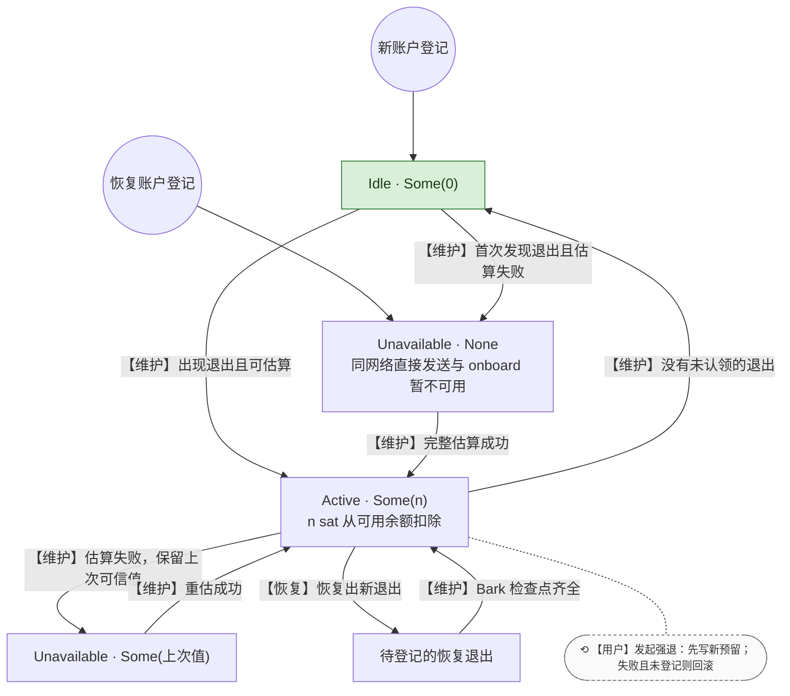

# A3 出口预留

[返回目录](../README.md) · A · 链上与 Ark 资金

## 状态图

GitHub 会直接渲染下方的 Mermaid 代码块；如果显示异常，请打开 SVG 图。

[SVG 图](diagrams/A3.svg) · [Mermaid 源](diagrams/A3.mmd)

## 状态表

| 编号 | 状态（代码名） | 进入条件 | 资金或数据在哪 | 界面显示 | 用户可做的事 | 是否终态 | 代码位置 |
|---|---|---|---|---|---|---|---|
| A3-01 | `Idle`，`remaining_sats = Some(0)` | 新账户登记；没有未认领的退出 | 无预留 | 无 | — | 否（可再次进入 Active） | registration `W/ark/bitcoin.rs:259-271`; zeroing `W/ark/bark_runtime/exit_fee.rs:195-200` |
| A3-02 | `Active`，`Some(n)` | 有进行中的退出，且能估算出手续费 | 共享 BTC 中 n sat 被视为预留，从可用余额扣除 | 余额结构里有 `reserved_sats` / `available_sats`（`W/ark/types.rs:429-439`） | 用户发送时如侵占预留须单独确认（`BitcoinExitReserveImpact`） | 否 | `exit_fee.rs:215-221`, `:116-122` |
| A3-03 | `Unavailable`，`Some(上次值)` | 估算失败，保留上次可信值 | 同上 | 同上 | 同上 | 否 | `exit_fee.rs:207-212`; retention rule `W/ark/bitcoin.rs:322-330` |
| A3-04 | `Unavailable`，`None` | 恢复开始、恢复出新退出、从 Idle 首次发现退出、或授权新退出但不可重估 | 预留未知，同网络的直接发送与 onboard 暂不可用 | 发送报错 | 无 | 否 | `W/ark/bitcoin.rs:62-77`, `:245-251`, `:259-267`; `exit_fee.rs:123-131`; error site `W/ark/bitcoin/transfer.rs:232-235` |
| A3-05 | 待登记的恢复退出（`pending_recovered_exit_ids` 非空） | 恢复出的退出已登记、Bark 检查点未齐 | 同上 | 同上 | 无 | 否 | `W/ark/bitcoin.rs:69`; rejected on read `transfer.rs:231-234`; cleared `exit_fee.rs:92-105` |

「同上」指本表上一行。界面显示列中的 `xxx.yyy` 为本地化文案键。
