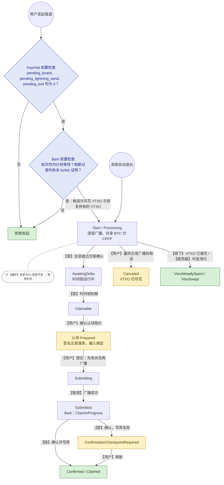

# A4 强制退出与认领

[返回目录](../README.md) · A · 链上与 Ark 资金

## 状态图

GitHub 会直接渲染下方的 Mermaid 代码块；如果显示异常，请打开 SVG 图。

[SVG 图](diagrams/A4.svg) · [Mermaid 源](diagrams/A4.mmd)

## 状态表

### 退出（每个 VTXO 一条）

| 编号 | 状态（代码名） | 进入条件 | 资金或数据在哪 | 界面显示 | 用户可做的事 | 是否终态 | 代码位置 |
|---|---|---|---|---|---|---|---|
| A4-01 | `Start` / `Processing` | 用户确认强退，或系统为 board / HTLC 自动退出 | 退出链交易逐层广播，需要共享 BTC 付 CPFP | `wallet.ark.exit-in-progress`、`wallet.ark.pending-funding`、`wallet.ark.refresh-to-progress-exit` | 刷新推进；补充链上资金 | 否 | `BK/exit/progress/mod.rs:45-56`; funding check `W/ark/bark_runtime/exit_fee.rs:225-250` |
| A4-02 | `AwaitingDelta` | 全部退出交易确认 | 退出输出，时间锁未到 | `wallet.ark.claim-timelock-running` | 等待 | 否 | `BK/exit/progress/mod.rs:57` |
| A4-03 | `Claimable` | 时间锁到期 | 退出输出，仅用户可花 | `wallet.ark.claim-to-bitcoin-address` | 认领 | 否 | `BK/exit/progress/states.rs:356-361` |
| A4-04 | `ClaimInProgress` | 链上出现花费该输出的内存池交易 | 认领交易在内存池 | `wallet.ark.claim-in-progress` | 等待 | 否；交易掉出内存池回到 `Claimable` | `BK/exit/progress/states.rs:367-389` |
| A4-05 | `Claimed` | 花费交易确认 | 在用户地址 | — | — | 是 | `BK/exit/progress/states.rs:344-349`, `:375-378` |
| A4-06 | `VtxoAlreadySpent` / `VtxoSwept` | VTXO 已在链下被花；或服务器在退出中途清扫 | 无 | — | — | 是 | `BK/exit/models/mod.rs:40-47` |
| A4-07 | `Canceled` | 最终交易广播前取消 | VTXO 仍可花 | — | 重新发起 | 可恢复 | `BK/exit/models/mod.rs:48-51` |

### Keychat 认领记录（`ark_claims`，输入与签名交易一对一绑定）

| 编号 | 状态（代码名） | 进入条件 | 资金或数据在哪 | 界面显示 | 用户可做的事 | 是否终态 | 代码位置 |
|---|---|---|---|---|---|---|---|
| A4-08 | `Prepared` | 用户确认报价，签名交易落库，输入登记到 `ark_claim_inputs` | — | `wallet.ark.claim-prepared` | 「提交原交易」 | 否 | `W/ark/bark_runtime/exit_claim.rs:46-61`; `W/ark/claim_store.rs:189-218` |
| A4-09 | `Submitting` | 开始广播（先改状态再广播） | — | 认领中 | 等待 | 否 | `exit_claim.rs:97-104`; `claim_store.rs:262-271` |
| A4-10 | `Submitted` | 广播返回成功，或链源报内存池 | — | `wallet.ark.claim-in-progress-message` | 「刷新」 | 否 | `claim_store.rs:272-279`; `exit_claim.rs:140-142` |
| A4-11 | `ConfirmationCheckpointRequired`（投影） | 链上已确认但写库失败 | — | `wallet.ark.claim-confirmation-checkpoint-required` | 刷新 | 否 | `exit_claim.rs:130-139`, `:153-159` |
| A4-12 | `Confirmed` | 链上确认并写库 | — | 已认领 | — | 是 | `claim_store.rs:287-293` |

「同上」指本表上一行。界面显示列中的 `xxx.yyy` 为本地化文案键。
