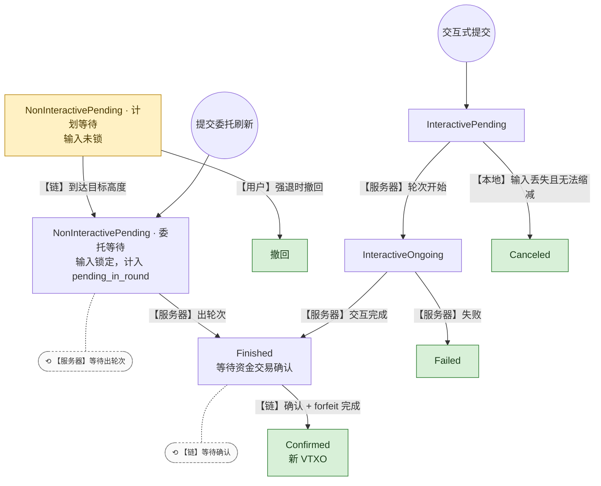
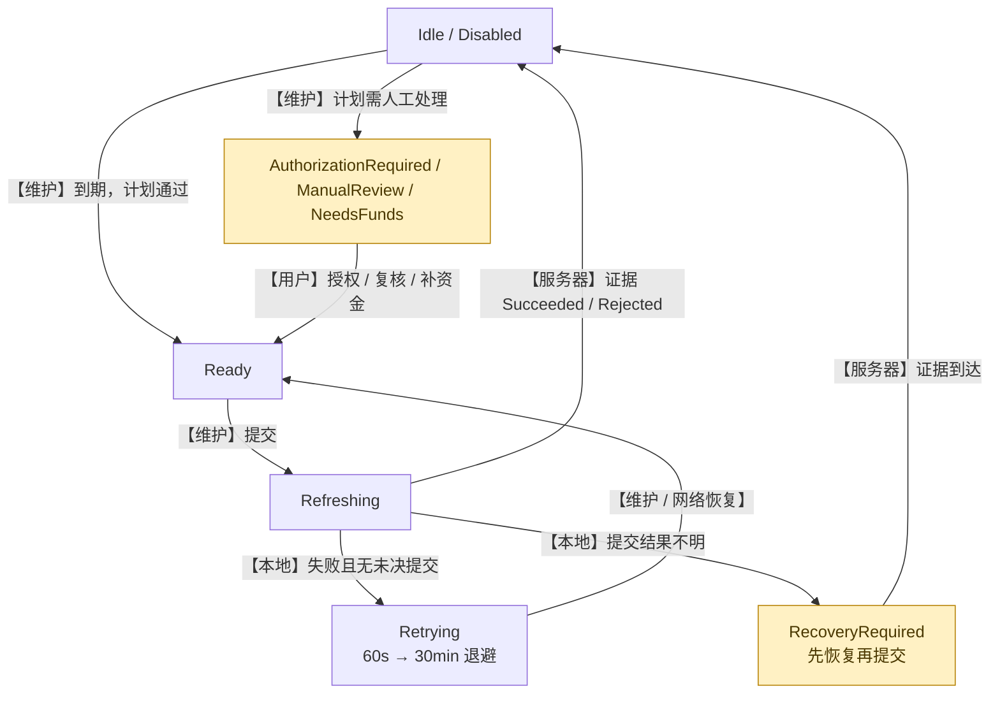

# A5 刷新与自动维护

[返回目录](../README.md) · A · 链上与 Ark 资金

## 状态图

GitHub 会直接渲染下方的 Mermaid 代码块；如果显示异常，请打开 SVG 图。

### A5a 一笔刷新（Bark 轮次）

[SVG 图](diagrams/A5a.svg) · [Mermaid 源](diagrams/A5a.mmd)

### A5b Keychat 维护阶段（每账户）

[SVG 图](diagrams/A5b.svg) · [Mermaid 源](diagrams/A5b.mmd)

## 状态表

### 一笔刷新（Bark 轮次）

| 编号 | 状态（代码名） | 进入条件 | 资金或数据在哪 | 界面显示 | 用户可做的事 | 是否终态 | 代码位置 |
|---|---|---|---|---|---|---|---|
| A5-01 | `NonInteractivePending{scheduled_height: Some}` | 计划刷新已被服务器接受，等待目标高度；计划等待：是（`is_scheduled_waiting`） | 输入未锁，仍可强退 | — | — | 否 | `BK/round/mod.rs:262-267` |
| A5-02 | `NonInteractivePending{scheduled_height: None}` / `Redelegating` | 委托刷新已提交，等待服务器出轮次；计划等待：否 | 输入被 movement 锁定，计入 `pending_in_round` | — | — | 否 | `BK/round/mod.rs:1043-1059`, `:816-830`; balance `BK/balance.rs:190-197` |
| A5-03 | `InteractivePending` / `InteractiveOngoing` | 交互式轮次排队 / 进行中；计划等待：否 | 同上 | — | — | 否 | `BK/round/mod.rs:777`, `:783-803` |
| A5-04 | `Finished`（未 done） | 交互结束，等待轮次资金交易确认；计划等待：否 | 同上；forfeit 尚未完成 | — | — | 否 | `BK/round/mod.rs:923-959` |
| A5-05 | `Finished`（done）→ `Confirmed` | 资金交易确认、forfeit 完成；计划等待：— | 新 VTXO | — | — | 是 | `BK/round/mod.rs:771-775`, `:937-948` |
| A5-06 | `Failed` / `Canceled` | 轮次失败、用户取消、输入丢失无法缩减；计划等待：— | 输入释放 | — | — | 是 | `BK/round/mod.rs:793-813` |

### Keychat 维护阶段（每账户一份）

| 编号 | 状态（代码名） | 进入条件 | 资金或数据在哪 | 界面显示 | 用户可做的事 | 是否终态 | 代码位置 |
|---|---|---|---|---|---|---|---|
| A5-07 | `Idle` / `Disabled` | 无需刷新 / 自动刷新关闭 | — | `disabled-title` | 开启或手动刷新 | 否（常驻） | `W/ark/maintenance.rs:72-75` |
| A5-08 | `Ready` / `Refreshing` | 计划已批准 / 已提交 | — | — | 等待 | 否 | `W/ark/provider/maintenance.rs:530-538` |
| A5-09 | `Retrying` | 失败退避 60s→30min | — | — | 等待 | 否 | `W/ark/maintenance.rs:132-146` |
| A5-10 | `RecoveryRequired` | 提交结果不明，需先恢复 | — | — | 等待（每 `URGENT_CHECK_SECONDS` 再查） | 否 | `W/ark/provider/maintenance.rs:241-258` |
| A5-11 | `AuthorizationRequired` / `ManualReview` / `NeedsFunds` | 需用户授权费用、人工复核、补资金 | — | `authorization-*`、`funds-title` 等 | 授权、复核或补资金 | 否（待用户） | `W/ark/maintenance.rs:35-62` |

「同上」指本表上一行。界面显示列中的 `xxx.yyy` 为本地化文案键。
