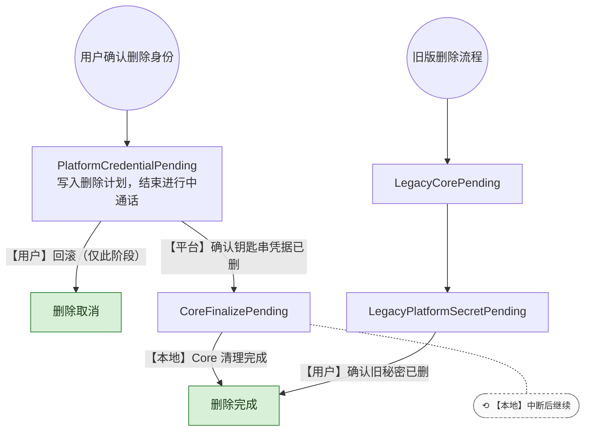

# D1 身份删除

[返回目录](../README.md) · D · 身份、设备与恢复

## 状态图

GitHub 会直接渲染下方的 Mermaid 代码块；如果显示异常，请打开 SVG 图。

[SVG 图](diagrams/D1.svg) · [Mermaid 源](diagrams/D1.mmd)

## 状态表

| 编号 | 状态（代码名） | 进入条件 | 资金或数据在哪 | 界面显示 | 用户可做的事 | 是否终态 | 代码位置 |
|---|---|---|---|---|---|---|---|
| D1-01 | `PlatformCredentialPending` | 用户确认删除，Core 写入删除计划；结束该身份的进行中通话 | 身份仍在，新工作被挡 | — | 回滚（只此阶段允许） | 否 | `A/data_store/identity_deletion.rs:6-50`; rollback `A/app_storage/identities.rs:1386-1409` |
| D1-02 | `CoreFinalizePending` | 平台确认已删钥匙串凭据 | 凭据已删，Core 数据待清 | — | 继续（可重复） | 否 | `identity_deletion.rs:54-82`, `:101-138` |
| D1-03 | `LegacyCorePending` / `LegacyPlatformSecretPending` | 旧版删除流程的中间点 | 同上 | — | 继续；确认旧秘密已删 | 否 | `identity_deletion.rs:121-126`, `:237`, `:271` |
| D1-04 | 删除完成 | Core 清理完成，删除行移除 | 身份消失 | — | — | 是 | — |

「同上」指本表上一行。界面显示列中的 `xxx.yyy` 为本地化文案键。
