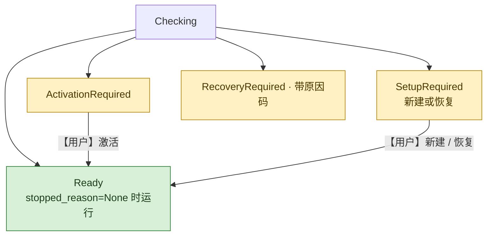
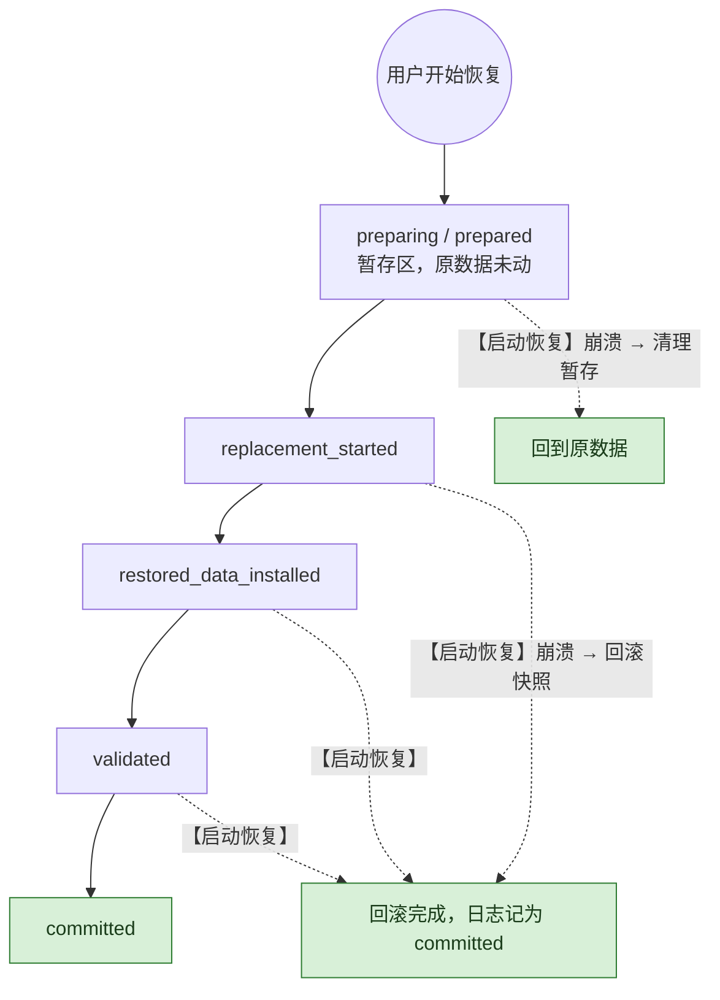

# D2 设备激活、启动与备份恢复

[返回目录](../README.md) · D · 身份、设备与恢复

## 状态图

GitHub 会直接渲染下方的 Mermaid 代码块；如果显示异常，请打开 SVG 图。

### D2a 启动

[SVG 图](diagrams/D2a.svg) · [Mermaid 源](diagrams/D2a.mmd)

### D2b 备份恢复（iOS 事务日志）

[SVG 图](diagrams/D2b.svg) · [Mermaid 源](diagrams/D2b.mmd)

## 状态表

### 启动

| 编号 | 状态（代码名） | 进入条件 | 资金或数据在哪 | 界面显示 | 用户可做的事 | 是否终态 | 代码位置 |
|---|---|---|---|---|---|---|---|
| D2-01 | `Checking` | 启动 | — | — | 等待 | 否 | `A/device_activation.rs:61-62` |
| D2-02 | `SetupRequired` | 无数据 | — | — | 新建或恢复 | 否（待用户） | `:63` |
| D2-03 | `ActivationRequired{pending}` | 数据在，激活未验证 | — | — | 激活 | 否（待用户） | `:64-66` |
| D2-04 | `RecoveryRequired{reason}` | 恢复被挡、库密钥缺失、存储不可用 / 不兼容、钥匙串不可用、凭据冲突、策略不支持 | — | — | 按原因处理 | 否（待用户） | `:49-58`, `:67-69` |
| D2-05 | `Ready{stopped_reason}` | 一切就绪；或因手动 / 迁移源 / 迁移目标暂停 | — | — | — | 是（常驻） | `:70-80` |

### 备份恢复（Core 进度）与 iOS 事务日志

| 编号 | 状态（代码名） | 进入条件 | 资金或数据在哪 | 界面显示 | 用户可做的事 | 是否终态 | 代码位置 |
|---|---|---|---|---|---|---|---|
| D2-06 | `RestoreInspecting` / `RestoreValidating` / `RestoreStaging`（iOS：`preparing` / `prepared`） | — | 暂存区；原数据未动 | — | 启动时清理暂存 | 否 | `A/backup_restore.rs:606-621`; `iOS/Services/BackupRestoreTransaction.swift:197-199` |
| D2-07 | `RestoreReplacingLocalData` / `RestoreWritingKeychain`（iOS：`replacement_started` / `restored_data_installed`） | — | 原数据快照 + 新数据 | — | 启动时回滚到快照，回滚后把日志记为 committed 以免重复回滚 | 否 | `BackupRestoreTransaction.swift:200-205`, `:209-258` |
| D2-08 | `RestoreReopeningClient` / `RestoreWalletChecking`（iOS：`validated`） | — | 新数据 | — | 同上（回滚） | 否 | same as above |
| D2-09 | `RestoreComplete`（iOS：`committed`） | — | 新数据，快照清理 | — | — | 是 | `BackupRestoreTransaction.swift:178-181` |
| D2-10 | `Failed`（iOS：—） | — | 视失败点 | — | 只能回到 Idle | 是 | `A/backup_restore.rs:698-741` |

「同上」指本表上一行。界面显示列中的 `xxx.yyy` 为本地化文案键。
