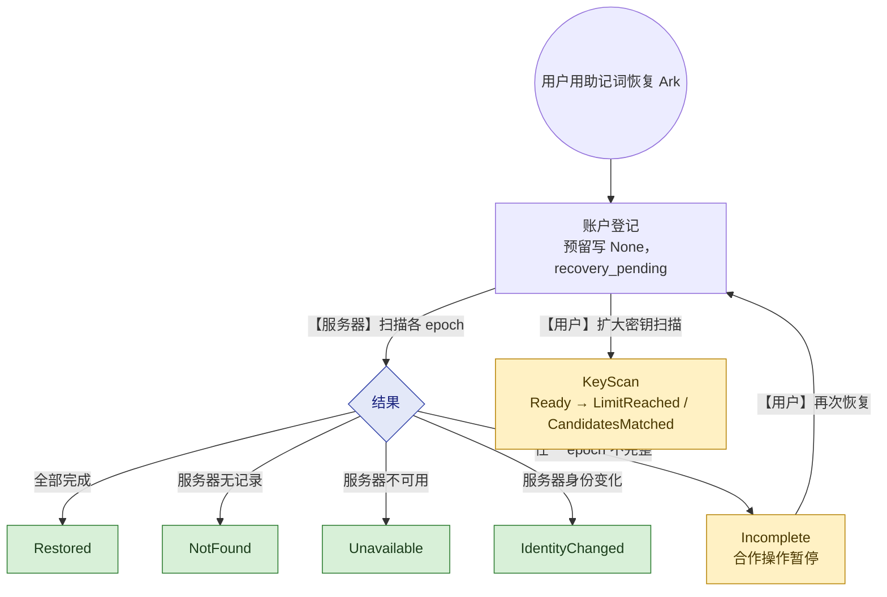

# D3 钱包恢复

[返回目录](../README.md) · D · 身份、设备与恢复

## 状态图

GitHub 会直接渲染下方的 Mermaid 代码块；如果显示异常，请打开 SVG 图。

[SVG 图](diagrams/D3.svg) · [Mermaid 源](diagrams/D3.mmd)

## 状态表

| 编号 | 状态（代码名） | 进入条件 | 资金或数据在哪 | 界面显示 | 用户可做的事 | 是否终态 | 代码位置 |
|---|---|---|---|---|---|---|---|
| D3-01 | `Restored` | 所有 epoch 完成 | 已恢复的 VTXO 与退出 | — | — | 是 | `W/ark/types.rs:69` |
| D3-02 | `NotFound` | 服务器无此钱包记录 | — | — | 换源再试 | 是 | `types.rs:70` |
| D3-03 | `Incomplete` | 任一 epoch 不完整；账户保持 `recovery_pending`，合作操作被拒，预留为 None | 部分恢复 | — | 再次恢复 | 否 | `W/ark/types.rs:71` |
| D3-04 | `Unavailable` / `IdentityChanged` | 服务器不可用 / 服务器身份变了 | — | — | 稍后再试 / 人工判断 | 是（本次） | `types.rs:72-73` |
| D3-05 | 密钥扫描 `Ready` / `LimitReached` / `CandidatesMatched` | 按索引扫描到上限或命中 | 扫描进度 | — | 扩大扫描 | 否 | `types.rs:89-108` |
| D3-06 | BTC 历史扫描 `Ready` / `LimitReached` / `UnsupportedChainSource` | 同上（共享 BTC） | 已发现地址数 | — | 扩大扫描 | 否 | `types.rs:441-457` |

「同上」指本表上一行。界面显示列中的 `xxx.yyy` 为本地化文案键。
