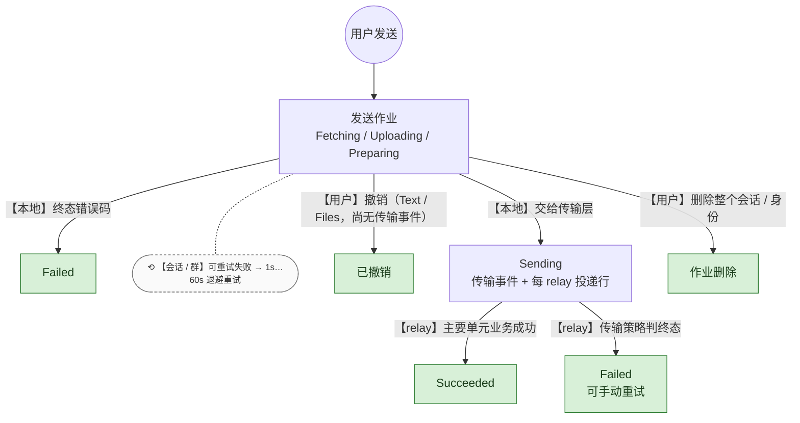

# C1 消息发送

[返回目录](../README.md) · C · 消息与关系

## 状态图

GitHub 会直接渲染下方的 Mermaid 代码块；如果显示异常，请打开 SVG 图。

[SVG 图](diagrams/C1.svg) · [Mermaid 源](diagrams/C1.mmd)

## 状态表

| 编号 | 状态（代码名） | 进入条件 | 资金或数据在哪 | 界面显示 | 用户可做的事 | 是否终态 | 代码位置 |
|---|---|---|---|---|---|---|---|
| C1-01 | `Fetching` | 有链接预览意图未完成 | 发送作业 | 发送中 | 文本 / 文件可撤销 | 否 | `A/messaging/delivery_queries.rs:420-424` |
| C1-02 | `Uploading` | 附件意图未完成 | 发送作业 + 本地附件 | 上传中 | 同上 | 否 | `delivery_queries.rs:425-429` |
| C1-03 | `Preparing` | 作业存在，尚未交给传输层 | 发送作业 | 发送中 | 同上 | 否 | `delivery_queries.rs:430-432` |
| C1-04 | `Failed`（作业内） | 上传被暂停 | 发送作业 | 失败 | 重试 | 否 | `delivery_queries.rs:421-422` |
| C1-05 | `Sending` | 已生成传输事件，未达业务成功也未终态 | `app_message_transport_events` + 每 relay 投递行 | 发送中 | 等待 | 否 | `delivery_queries.rs:443-445` |
| C1-06 | `Succeeded` | 主要单元达到业务成功 | 投递行 | 已发送 | — | 是 | `delivery_queries.rs:433-437` |
| C1-07 | `Failed`（投递） | 传输策略判终态 | 投递行 | 失败 | 手动重试（视 `manual_retryable`） | 是 | `delivery_queries.rs:438-442` |

「同上」指本表上一行。界面显示列中的 `xxx.yyy` 为本地化文案键。
