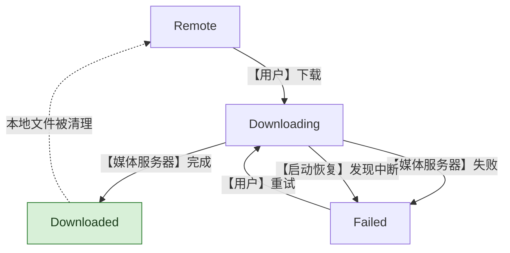
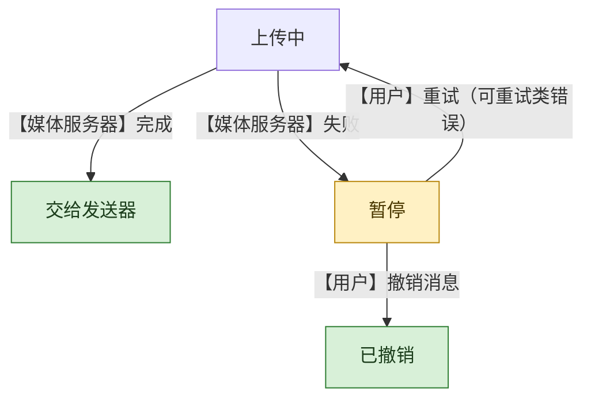

# C2 附件上传与下载

[返回目录](../README.md) · C · 消息与关系

## 状态图

GitHub 会直接渲染下方的 Mermaid 代码块；如果显示异常，请打开 SVG 图。

### C2a 下载

[SVG 图](diagrams/C2a.svg) · [Mermaid 源](diagrams/C2a.mmd)

### C2b 上传（随发送作业）

[SVG 图](diagrams/C2b.svg) · [Mermaid 源](diagrams/C2b.mmd)

## 状态表

### 下载

| 编号 | 状态（代码名） | 进入条件 | 资金或数据在哪 | 界面显示 | 用户可做的事 | 是否终态 | 代码位置 |
|---|---|---|---|---|---|---|---|
| C2-01 | `Remote` | 未下载 | 远端 URL + 密钥 | 可下载 | 下载 | 否 | `A/data_store/message_snapshot.rs:536-540` |
| C2-02 | `Downloading` | 开始下载（`transfer_state=1`） | 临时文件 | 下载中 | 等待 | 否 | `A/app_storage/attachments.rs:356` |
| C2-03 | `Downloaded` | `transfer_state=2` 且本地文件存在 | 本地文件 | 可打开 | — | 是（文件丢失则回到 Remote 投影） | `message_snapshot.rs:527-535` |
| C2-04 | `Failed` | 下载失败，或启动 / 重启运行时发现中断 | `last_error_code` | 失败 | 重试 | 否 | `attachments.rs:462-469`, `:472-492` |

### 上传（随消息发送作业）

| 编号 | 状态（代码名） | 进入条件 | 资金或数据在哪 | 界面显示 | 用户可做的事 | 是否终态 | 代码位置 |
|---|---|---|---|---|---|---|---|
| C2-05 | 上传中 | 附件意图未完成 | — | `Uploading` | 文本 / 文件消息可撤销 | 否 | `A/messaging/delivery_queries.rs:425-429` |
| C2-06 | 暂停（作业内失败） | 上传失败写 `upload_state='paused'` | — | `Failed` | 可重试类错误允许重试；来源丢失、意图无效、不安全目标不可重试 | 否 | `A/app_storage/message_sender_attachments.rs:349`; `A/message_sender/projection.rs:73-94` |

「同上」指本表上一行。界面显示列中的 `xxx.yyy` 为本地化文案键。
