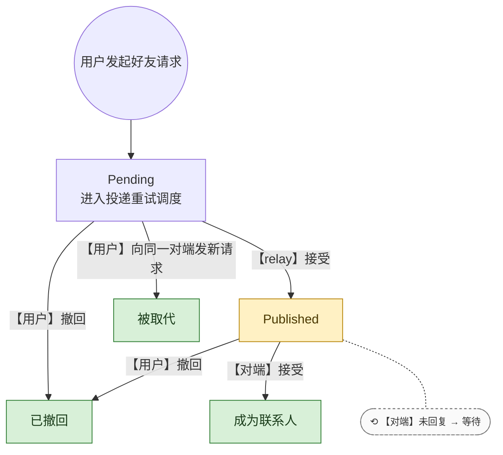

# C3 好友请求与 PQXDH 升级

[返回目录](../README.md) · C · 消息与关系

## 状态图

GitHub 会直接渲染下方的 Mermaid 代码块；如果显示异常，请打开 SVG 图。

[SVG 图](diagrams/C3.svg) · [Mermaid 源](diagrams/C3.mmd)

## 状态表

| 编号 | 状态（代码名） | 进入条件 | 资金或数据在哪 | 界面显示 | 用户可做的事 | 是否终态 | 代码位置 |
|---|---|---|---|---|---|---|---|
| C3-01 | `Pending`（发出方） | 请求已提交入投递重试调度 | 待发请求 + 协议层待定会话 | 等待对方 | 撤回请求 | 否 | `A/friend_request.rs:1260-1263`, `:1611-1625` |
| C3-02 | `Published` | 至少一处 relay 接受 | 同上 | 等待对方 | 撤回请求 | 否 | `A/types.rs:3512` |
| C3-03 | 被对方接受 | 收到对方回复 | 会话建立 | 联系人 | — | 是 | — |
| C3-04 | 撤回 | 用户撤回；或同一对端的新请求取代旧请求 | 清除协议层待定会话与传输 | — | — | 是 | `A/friend_request.rs:1265-1369`, `:1220-1258` |
| C3-05 | PQXDH 升级重试 | 用户手动触发 | — | `Sent` / `AlreadyUpgraded` / `PeerNotReady` / `IneligibleRoom` / `InFlight` 分别提示 | 稍后重试 | 每次调用即返回 | `A/types.rs:533-540` |

「同上」指本表上一行。界面显示列中的 `xxx.yyy` 为本地化文案键。
