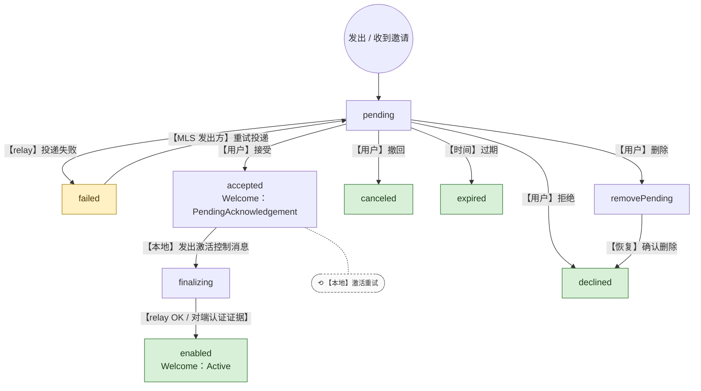

# C4 群邀请与 MLS Welcome 激活

[返回目录](../README.md) · C · 消息与关系

## 状态图

GitHub 会直接渲染下方的 Mermaid 代码块；如果显示异常，请打开 SVG 图。

[SVG 图](diagrams/C4.svg) · [Mermaid 源](diagrams/C4.mmd)

## 状态表

| 编号 | 状态（代码名） | 进入条件 | 资金或数据在哪 | 界面显示 | 用户可做的事 | 是否终态 | 代码位置 |
|---|---|---|---|---|---|---|---|
| C4-01 | `pending` | 发出或收到邀请；投递重试回到待定 | — | — | 接受 / 拒绝 / 撤回 | 否 | `A/group_invite/outgoing.rs:216`, `:395`; `A/group_invite/welcome.rs:212`; `A/group_invite/delivery.rs:413` |
| C4-02 | `failed` | 投递失败、决定处理失败 | — | — | MLS 发出方可重试投递（`group_invite_lifecycle_allows_delivery_retry`） | 否 | `outgoing.rs:440`, `:482`, `:519`; `A/group_invite/decisions.rs:244`; `A/group_invite.rs:308-318` |
| C4-03 | `accepted` / `finalizing` | 接受后等待成员激活控制消息落地 | — | `PendingAcknowledgement` | 等待 | 否 | `A/group_invite/projection.rs:14`, `:24` |
| C4-04 | `enabled` | 收到认证的激活证据或 relay OK | — | `Active` | — | 是 | `A/group_invite/delivery.rs:513`; `projection.rs:25` |
| C4-05 | `declined` / `canceled` / `expired` | 拒绝、撤回、过期 | — | — | — | 是 | `A/group_invite/removal_recovery.rs:55-63`, `:93-103` |
| C4-06 | `removePending` | 删除过程中待确认 | — | — | — | 否 | `A/group_invite/decisions.rs:175`; `removal_recovery.rs:235`, `:345` |

「同上」指本表上一行。界面显示列中的 `xxx.yyy` 为本地化文案键。
