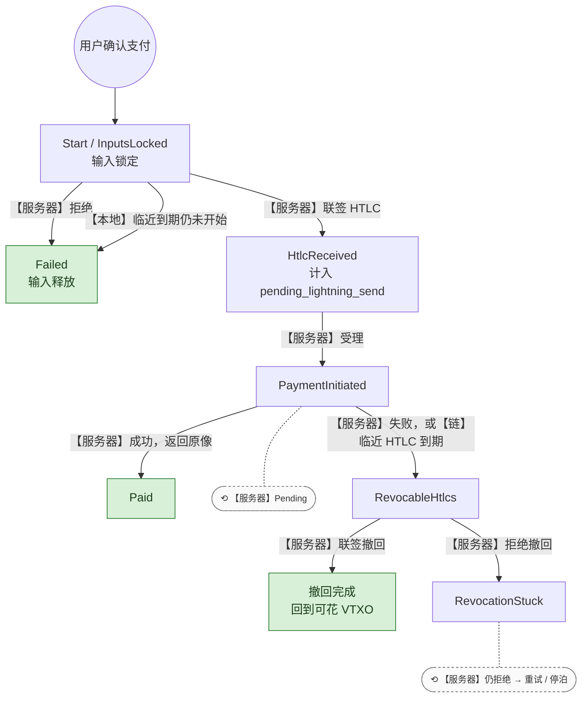
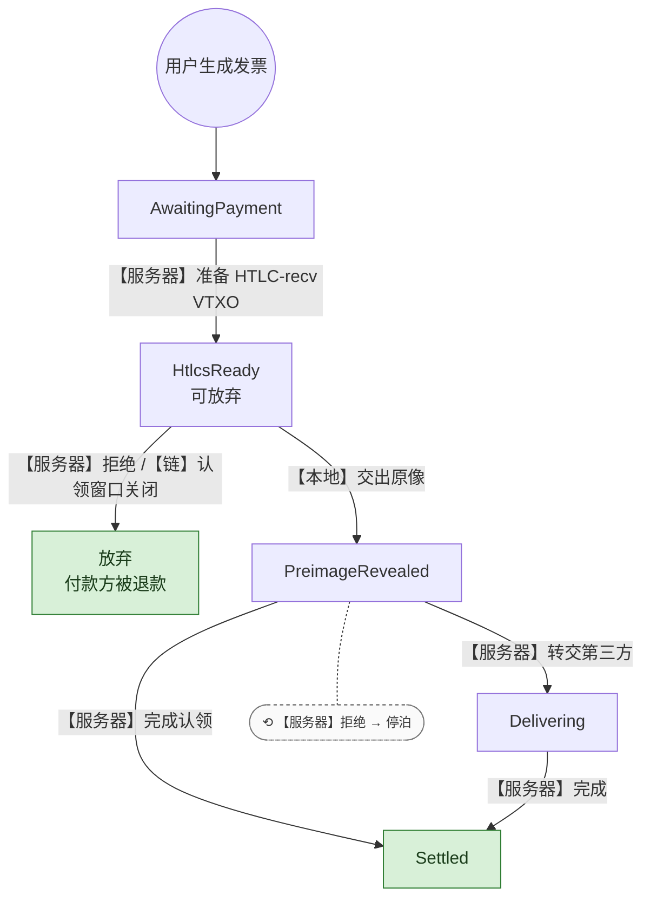

# B1 Lightning 收发（Ark）

[返回目录](../README.md) · B · 支付与收款

## 状态图

GitHub 会直接渲染下方的 Mermaid 代码块；如果显示异常，请打开 SVG 图。

### B1a 发送（付发票）

[SVG 图](diagrams/B1a.svg) · [Mermaid 源](diagrams/B1a.mmd)

### B1b 接收（开发票）

[SVG 图](diagrams/B1b.svg) · [Mermaid 源](diagrams/B1b.mmd)

## 状态表

### 发送

| 编号 | 状态（代码名） | 进入条件 | 资金或数据在哪 | 界面显示 | 用户可做的事 | 是否终态 | 代码位置 |
|---|---|---|---|---|---|---|---|
| B1-01 | `Start` / `InputsLocked` | 用户确认支付 | 输入 VTXO 被动作锁定 | `InProgress` | 等待 | 否 | `BK/actions/lightning/pay.rs:326-330`, `:221-229` |
| B1-02 | `HtlcReceived` | 服务器联签 HTLC 输出 | HTLC VTXO 锁定，计入 `pending_lightning_send` | `InProgress` | 等待 | 否 | `BK/actions/lightning/pay.rs:331-332` |
| B1-03 | `PaymentInitiated` | 已通知服务器付款 | 同上 | `InProgress` | 等待 | 否 | `BK/actions/lightning/pay.rs:183-207` |
| B1-04 | `RevocableHtlcs` | 服务器报失败，或 HTLC 临近到期仍 Pending | 同上，准备撤回 | `InProgress` | 等待 | 否 | `BK/actions/lightning/pay.rs:189-198` |
| B1-05 | `RevocationStuck` | 服务器拒绝撤回 | 同上 | `InProgress{has_failed_revocation: true}` | 等待 | 否 | `BK/actions/lightning/pay.rs:260-275`, `:299-315`; `W/ark/bark_runtime.rs:3032-3038`; `iOS/Wallet/Ark/ArkWalletModels.swift:1117` |
| B1-06 | `Paid` | 拿到原像 | 已付出 | `Paid` | — | 是 | `BK/actions/lightning/pay.rs:185-188` |
| B1-07 | 撤回完成（Done） | 服务器联签撤回 | 回到可花 VTXO | — | — | 是 | `BK/actions/lightning/pay.rs:209-213` |

### 接收

| 编号 | 状态（代码名） | 进入条件 | 资金或数据在哪 | 界面显示 | 用户可做的事 | 是否终态 | 代码位置 |
|---|---|---|---|---|---|---|---|
| B1-08 | `AwaitingPayment` | 生成发票 | 无 | — | — | 否 | `BK/actions/lightning/receive.rs:257-258` |
| B1-09 | `HtlcsReady` | 服务器准备好 HTLC-recv VTXO | 锁定，尚可放弃 | — | — | 否；认领窗口关闭或被拒即放弃 | `BK/actions/lightning/receive.rs:259-262`, `:204-211`, `:240-246` |
| B1-10 | `PreimageRevealed` | 已向服务器交出原像 | HTLC-recv VTXO 锁定，计入 `claimable_lightning_receive` | — | — | 否；认领失败后停泊 | `BK/actions/lightning/receive.rs:263-269`, `:212-224`, `:247-249`; `BK/lightning/receive.rs:205-240` |
| B1-11 | `Delivering` | 认领输出需转交第三方 | 锁定 | — | — | 否 | `BK/actions/lightning/receive.rs:270-273` |
| B1-12 | `Settled` | 认领完成 | 新 VTXO | — | — | 是 | `W/ark/bark_runtime.rs:3007-3014` |

「同上」指本表上一行。界面显示列中的 `xxx.yyy` 为本地化文案键。
