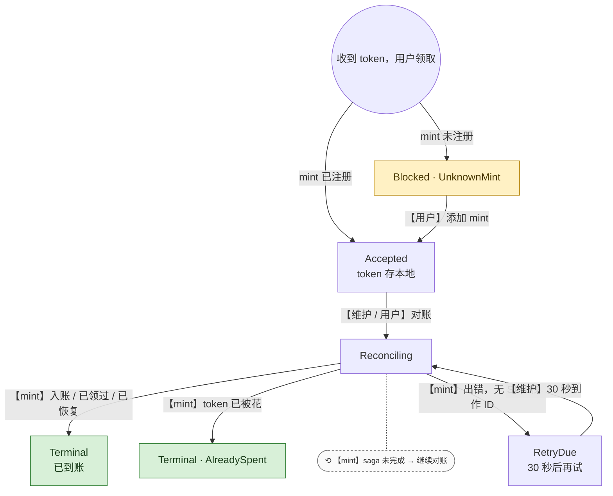

# B2 Cashu 收款

[返回目录](../README.md) · B · 支付与收款

## 状态图

GitHub 会直接渲染下方的 Mermaid 代码块；如果显示异常，请打开 SVG 图。

[SVG 图](diagrams/B2.svg) · [Mermaid 源](diagrams/B2.mmd)

## 状态表

| 编号 | 状态（代码名） | 进入条件 | 资金或数据在哪 | 界面显示 | 用户可做的事 | 是否终态 | 代码位置 |
|---|---|---|---|---|---|---|---|
| B2-01 | `Accepted` | 收到 token，mint 已注册 | bearer token 存于本地加密库（唯一可重放副本） | 收款处理中 | 等待 | 否 | `W/cashu/receive_store.rs:340-345`; `W/cashu/receive_operations.rs:63` |
| B2-02 | `Blocked`（`UnknownMint`） | mint 未注册 | 同上 | 需添加 mint | 添加 mint 后继续 | 否 | `receive_store.rs:342-345`; skipped by maintenance `receive_operations.rs:509-512` |
| B2-03 | `Reconciling` | 正在对账，或 SDK 已有该操作的 saga | token + CDK saga | 处理中 | 等待 | 否 | `receive_operations.rs:188-194`, `:216-226` |
| B2-04 | `RetryDue`（`RetryRequired`） | 对账出错且没有 SDK 操作 ID，30 秒后再试 | token | 处理中 | 等待 | 否 | `receive_operations.rs:192`, `:214-227` |
| B2-05 | `Terminal`（issue 为空） | 收到 `Credited` / `AlreadyReceived` / `Recovered` | 已入 CDK 余额 | 已到账 | — | 是 | `receive_operations.rs:196-206` |
| B2-06 | `Terminal`（`AlreadySpent`） | mint 报 token 已被花 | 无 | `CashuTokenAlreadySpent` 报错 | — | 是 | `receive_operations.rs:207-213` |

「同上」指本表上一行。界面显示列中的 `xxx.yyy` 为本地化文案键。
