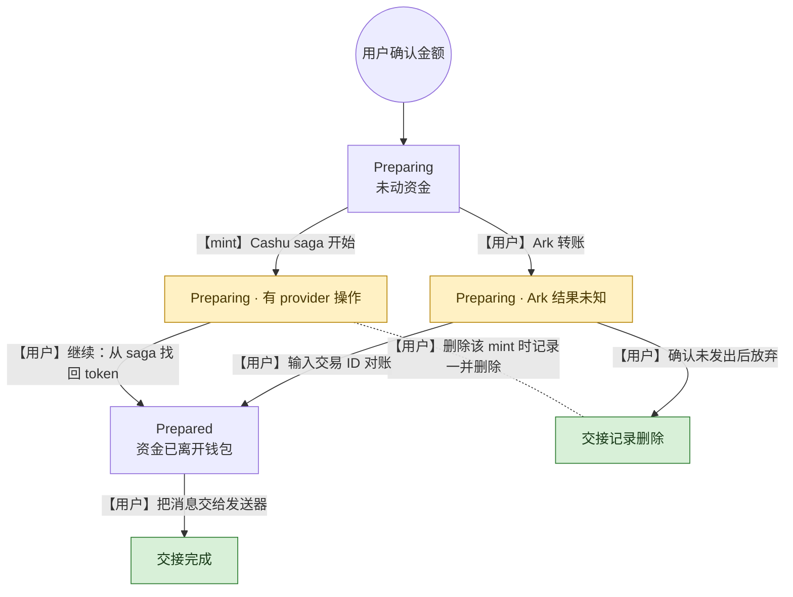
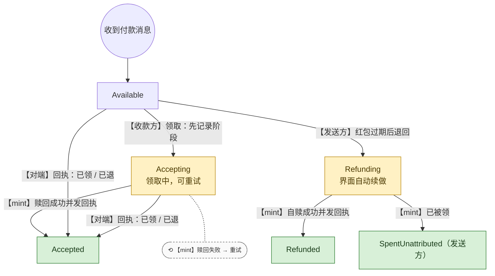

# B3 聊天转账、红包与收款回执

[返回目录](../README.md) · B · 支付与收款

## 状态图

GitHub 会直接渲染下方的 Mermaid 代码块；如果显示异常，请打开 SVG 图。

### B3a 发送方：钱包交接（同房间同身份一笔）

[SVG 图](diagrams/B3a.svg) · [Mermaid 源](diagrams/B3a.mmd)

### B3b 消息侧：Cashu 转账 / 红包（Signal 私聊）

[SVG 图](diagrams/B3b.svg) · [Mermaid 源](diagrams/B3b.mmd)

## 状态表

### 发送方：钱包交接（每个房间同时只能有一笔）

| 编号 | 状态（代码名） | 进入条件 | 资金或数据在哪 | 界面显示 | 用户可做的事 | 是否终态 | 代码位置 |
|---|---|---|---|---|---|---|---|
| B3-01 | `Preparing`，无 provider 操作 | 用户确认金额 | 未动资金 | — | 继续 | 否 | `W/ledger.rs:539-606` |
| B3-02 | `Preparing`，有 provider 操作（Cashu） | Cashu 发送 saga 已开始 | mint 侧 saga；token 可能已生成 | `wallet.chat.previous-cashu-interrupted` | 「继续」：重新从 saga 找回 token | 否 | `WU/wallet.rs:2752-2810`, `:1880-1931` |
| B3-03 | `Preparing`，Ark 未决 | Ark 转账结果未知 | 可能已离开账户 | `wallet.chat.previous-wallet-transfer-interrupted` | 输入交易 ID 对账；或确认未发出后放弃 | 否 | `W/ledger.rs:734-759`; `iOS/Wallet/Views/ChatPayFlowSheet.swift:862-900` |
| B3-04 | `Prepared` | 拿到 token（Cashu）或交易 ID（Ark） | 资金已离开钱包，token 在本地 saga | `wallet.chat.wallet-transfer-complete`（可续交消息） | 继续把消息发出 | 否 | `W/ledger.rs:691-722`; `ChatPayFlowSheet.swift:725-731` |
| B3-05 | 删除（完成） | 消息交给发送器 | 交接记录删除 | — | — | 是 | `W/ledger.rs:724-732`; `ChatPayFlowSheet.swift:851` |

### 消息侧：Cashu 转账 / 红包（仅限 Signal 私聊）

| 编号 | 状态（代码名） | 进入条件 | 资金或数据在哪 | 界面显示 | 用户可做的事 | 是否终态 | 代码位置 |
|---|---|---|---|---|---|---|---|
| B3-06 | 无 → `Pending` / `Available` | 收到或发出 | — | 可领取 | 收款方领取；发送方（红包）不可领 | 否 | `A/payment_lifecycle.rs:826-849` |
| B3-07 | `Accepting` → `Pending` / `Accepting` | 收款方点领取，先落阶段再赎回 | — | 领取中，`can_retry` | 重试 | 否 | `A/messaging/payment_messages.rs:876-935`; projection `payment_lifecycle.rs:843-844`, `:858` |
| B3-08 | `Accepted` → `Succeeded` / `Accepted` | 赎回成功并发回执；或收到对方回执 | — | 已领取 | 回执失败可重发 | 是 | `payment_lifecycle.rs:417-455`, `:828-841` |
| B3-09 | `Refunding` → `Expired` / `Accepting` | 发送方在红包过期后开始退回 | — | `chat.payment.shared.refunding` / `continue-refund` | 继续退回（界面自动续做） | 否 | `payment_lifecycle.rs:470-480`; `iOS/Views/Components/CashuBubble.swift:723-726`, `:330`, `:1007-1025` |
| B3-10 | `Refunded` | 退回完成 | — | 已退回 | 回执失败可重发 | 是 | `payment_lifecycle.rs:497-522`, `:826-827` |
| B3-11 | `SpentUnattributed`（发送方观察） | 发送方发现 token 已被花但无回执 | — | `payment_spent_without_receipt` | — | 是（投影） | `payment_lifecycle.rs:810-815`; `CashuBubble.swift:1001-1003`, `:1018-1019` |

「同上」指本表上一行。界面显示列中的 `xxx.yyy` 为本地化文案键。
