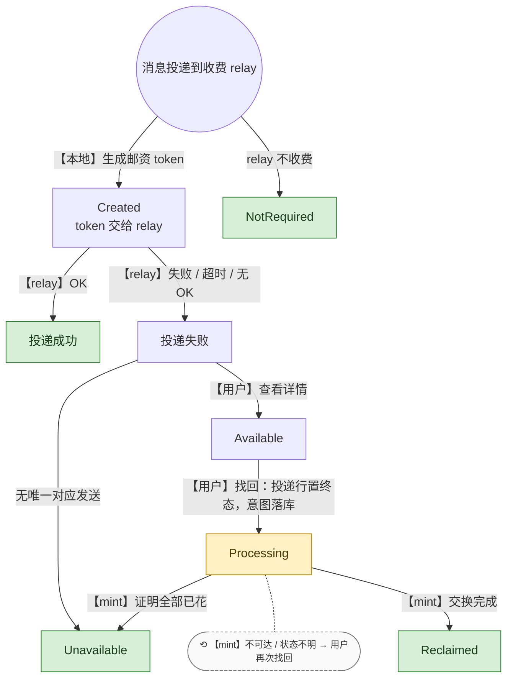

# B4 消息邮资与找回

[返回目录](../README.md) · B · 支付与收款

## 状态图

GitHub 会直接渲染下方的 Mermaid 代码块；如果显示异常，请打开 SVG 图。

[SVG 图](diagrams/B4.svg) · [Mermaid 源](diagrams/B4.mmd)

## 状态表

### 每条投递（消息 × relay）

| 编号 | 状态（代码名） | 进入条件 | 资金或数据在哪 | 界面显示 | 用户可做的事 | 是否终态 | 代码位置 |
|---|---|---|---|---|---|---|---|
| B4-01 | `NotRequired` | relay 不收邮资 | — | — | — | 是（该投递） | `PC/transport.rs:79-84` |
| B4-02 | `NotStarted` / `Unavailable` | 尚未付或无法付 | 未付出 | — | — | 否 | same as above |
| B4-03 | `Created` | 已生成邮资 token 并随事件发给 relay | token 交给 relay，钱包流水记 `relay_stamp` 发送 | — | — | 是（该投递） | same as above; ledger marker `W/cashu/stamp_reclaim.rs:132-142` |

### 找回（只对失败的投递行开放）

| 编号 | 状态（代码名） | 进入条件 | 资金或数据在哪 | 界面显示 | 用户可做的事 | 是否终态 | 代码位置 |
|---|---|---|---|---|---|---|---|
| B4-04 | 不可找回（无绑定） | 投递行状态不在 failed / timeout / no_ack / terminal_failed / retry_exhausted 之列，或曾收到 OK | — | 不显示入口 | — | — | `A/messaging/stamp_reclaim.rs:5-23` |
| B4-05 | `Available` | 绑定唯一对应一笔 `TokenCreated` 的发送 saga | token 仍可能未被 relay 兑现 | 显示找回 | 找回 | 否 | `W/cashu/stamp_reclaim.rs:128-186` |
| B4-06 | `Processing` | 已接受找回意图（先落库再动 mint），或 mint 状态不明、连不上 | 意图 + 原证明 | 处理中 | 再次找回 | 否 | `W/cashu/stamp_reclaim.rs:187-199`, `:209-252` |
| B4-07 | `Reclaimed` | 交换完成 | 回到钱包 | 已找回 | — | 是 | `W/cashu/stamp_reclaim.rs:203-208`, `:415` |
| B4-08 | `Unavailable` | 证明全部已被花（relay 已兑现），或找不到唯一对应流水 | relay 处 | 不可找回 | — | 是 | `W/cashu/stamp_reclaim.rs:149-158`, `:220-224` |

「同上」指本表上一行。界面显示列中的 `xxx.yyy` 为本地化文案键。
