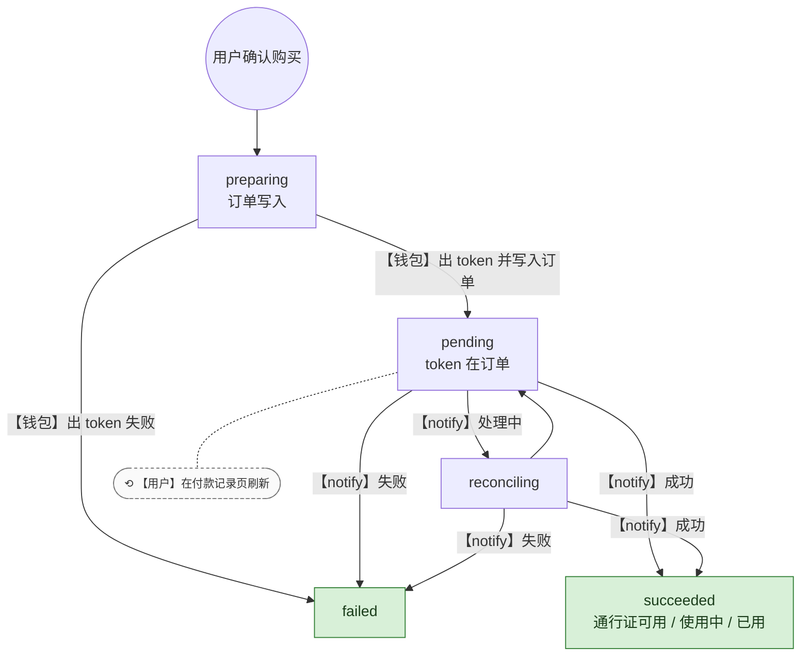

# B5 付费通话票

[返回目录](../README.md) · B · 支付与收款

## 状态图

GitHub 会直接渲染下方的 Mermaid 代码块；如果显示异常，请打开 SVG 图。

[SVG 图](diagrams/B5.svg) · [Mermaid 源](diagrams/B5.mmd)

## 状态表

| 编号 | 状态（代码名） | 进入条件 | 资金或数据在哪 | 界面显示 | 用户可做的事 | 是否终态 | 代码位置 |
|---|---|---|---|---|---|---|---|
| B5-01 | `preparing` → `Preparing` | 用户确认购买，订单行写入 | 尚未出 token；或已出 token 尚未写入 | 付款中 | 继续 / 取消 | 否 | `R/app_storage/rtc_tickets.rs:110`; `R/rtc/payments.rs:132` |
| B5-02 | `pending` / `reconciling` → `Confirming` | token 写入订单并交给 notify | token 在订单 | 确认中；确认页只给 Continue | 继续轮询 | 否 | `rtc_tickets.rs:128-141`; `R/rtc/payments.rs:58-59`, `:177-199`, `:329` |
| B5-03 | `succeeded` → `Available` / `UsePending` / `Used` | notify 确认；随后按使用情况投影 | 通行证 | 可用 / 使用中 / 已用 | 拨打 | 是（支付面） | `rtc_tickets.rs:143-153` |
| B5-04 | `failed` → `Failed` | notify 回失败，或钱包出 token 失败 | token 被置空 | 失败 | — | 是 | `rtc_tickets.rs:118-125`, `:152` |

「同上」指本表上一行。界面显示列中的 `xxx.yyy` 为本地化文案键。
