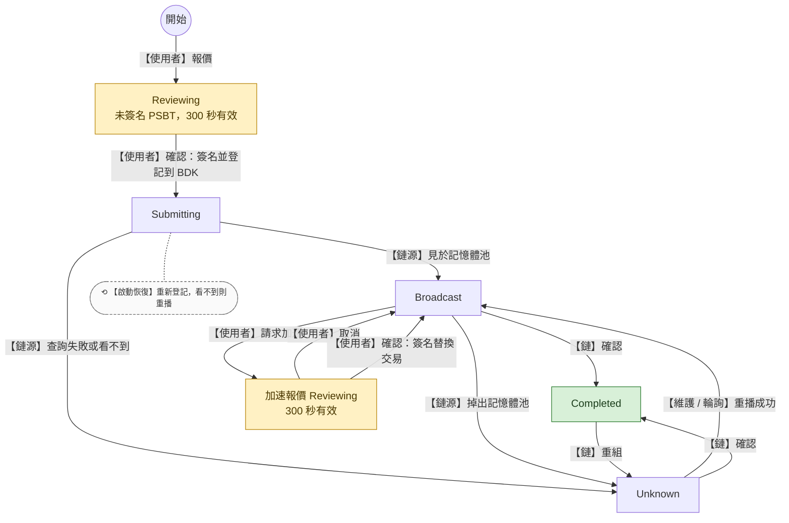
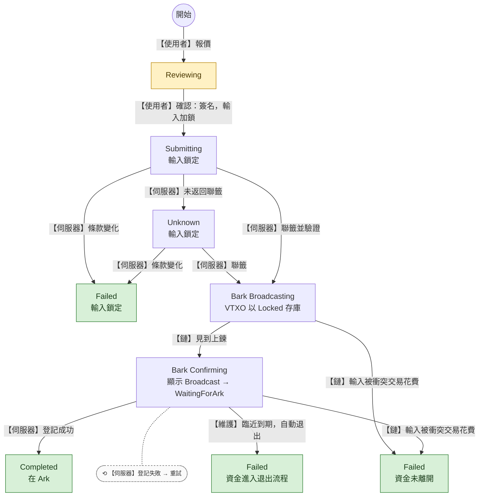

# A1 轉入 Ark、直接傳送 BTC、RBF 加速

[返回目錄](../README.md) · A · 鏈上與 Ark 資金

## 狀態圖

GitHub 會直接渲染下方的 Mermaid 程式碼塊；如果顯示異常，請開啟 SVG 圖。

### A1a 直接傳送 BTC（含 RBF）

[SVG 圖](diagrams/A1a.svg) · [Mermaid 源](diagrams/A1a.mmd)

### A1b 轉入 Ark（onboard）

[SVG 圖](diagrams/A1b.svg) · [Mermaid 源](diagrams/A1b.mmd)

## 狀態表

### 共用記錄（`keychat_bitcoin_transfers`）

| 編號 | 狀態（程式碼名） | 進入條件 | 資金或資料在哪 | 介面顯示 | 使用者可做的事 | 是否終態 | 程式碼位置 |
|---|---|---|---|---|---|---|---|
| A1-01 | `Reviewing` | 報價生成即落庫，有效期 300 秒 | 未簽名 PSBT；資金仍在鏈上錢包，未加鎖 | `wallet.bitcoin.review` | 確認；或放棄報價（加速報價可刪除） | 否（無過期清理，過期後確認被拒） | `W/ark/bitcoin/transfer.rs:308-336`, `:355-358` |
| A1-02 | `Submitting` | 已簽名並寫入 `signed_tx_hex` | 簽名交易在本地；直接傳送已 `register_tx` 進 BDK，餘額按已花計；onboard 輸入被鎖定 | `wallet.bitcoin.submitting` + `wallet.bitcoin.unknown-help` | 只能等待 | 否 | direct send `W/ark/bitcoin/transfer.rs:382-393`; onboard `W/ark/bark_runtime/onboard.rs:220-236` |
| A1-03 | `Broadcast` | 鏈源報 Mempool | 交易在記憶體池 | `wallet.bitcoin.onboard.awaiting-confirmation` + `wallet.bitcoin.waiting-chain` | 等待；直接傳送可 RBF | 否 | direct `W/ark/bitcoin/replacement.rs:803-807`; onboard `W/ark/bark_runtime/onboard.rs:339` |
| A1-04 | `WaitingForArk` | 僅 onboard：資金交易已確認，Ark 尚未登記 | 資金在 board 輸出；board VTXO 被 movement 鎖定 | 同上 + `wallet.bitcoin.waiting-ark` | 等待 | 否 | `W/ark/bark_runtime/onboard.rs:336-338` |
| A1-05 | `Unknown` | 鏈源查詢失敗、看不到交易、onboard 未拿到聯籤或 movement 缺失 | 直接傳送：簽名交易仍在 BDK；onboard：輸入鎖定 | `wallet.bitcoin.checking` + `wallet.bitcoin.unknown-help` | 等待 | 否 | direct `W/ark/bitcoin/replacement.rs:806`, `:808-809`; onboard `W/ark/bark_runtime/onboard.rs:311-313`, `:340-345`; projected as Unknown without chain source `W/ark/provider/shared_bitcoin.rs:818-840` |
| A1-06 | `Completed` | 直接傳送：某次嘗試被確認；onboard：movement 成功且有退出憑據 | 直接傳送：已到對方；onboard：在 Ark | `wallet.bitcoin.completed` | — | 是（直接傳送遇鏈重組可回到 Unknown） | `W/ark/bitcoin/replacement.rs:796-802`; `W/ark/bark_runtime/onboard.rs:325-327` |
| A1-07 | `Failed` | 僅 onboard：伺服器條款變化（`submit_signed_board` 返回 None），或 Bark movement 記為 Failed/Canceled | 條款變化時：輸入仍鎖定；movement 失敗時：資金可能處於退出流程中 | `wallet.bitcoin.failed`（"Transfer failed. Review a new quote to try again."） | 重新報價 | 是 | `W/ark/bark_runtime/onboard.rs:306-310`, `:328-329` |

### onboard 疊加的 Bark 狀態（`Board.progress`）

| 編號 | 狀態（程式碼名） | 進入條件 | 資金或資料在哪 | 介面顯示 | 使用者可做的事 | 是否終態 | 程式碼位置 |
|---|---|---|---|---|---|---|---|
| A1-08 | `Broadcasting` | 拿到聯籤、VTXO 已構建 | 資金交易待推送；VTXO 以 Locked 存庫 | — | 見到上鍊 → `Confirming`；輸入被確認交易衝突 → 失敗；否則停泊等待 | 否 | `BK/actions/board.rs:147-160`, `:230-283` |
| A1-09 | `Confirming` | 資金交易在記憶體池或區塊 | board VTXO Locked，計入 `pending_board` | — | 確認數夠即登記；登記失敗則重試；臨近到期自動發起退出 | 否 | `BK/actions/board.rs:290-393` |
| A1-10 | movement `Failed`（退出後） | VTXO 已 Exited 或已被衝突花費 | 前者在退出流程中，後者資金未離開 | — | 終態 | 是 | `BK/actions/board.rs:299-314` |

### RBF 加速（直接傳送的「譜系」）

| 編號 | 狀態（程式碼名） | 進入條件 | 資金或資料在哪 | 介面顯示 | 使用者可做的事 | 是否終態 | 程式碼位置 |
|---|---|---|---|---|---|---|---|
| A1-11 | 加速報價 `Reviewing` + `replacement` | 使用者請求加速，條件滿足 | 未簽名替換 PSBT，300 秒有效 | — | 確認；或取消（只刪未簽名記錄） | 否（隨譜系） | `W/ark/bitcoin/replacement.rs:378-401`, `:403-450` |
| A1-12 | 父記錄 `replaced_by` 置位、子記錄簽名 | 使用者確認 | 父子同一事務提交 | — | 等待 | 否（隨譜系） | `W/ark/bitcoin/replacement.rs:825-860` |
| A1-13 | 譜系狀態 | 任一嘗試確認即該嘗試 Completed，其餘維持；頭部按記憶體池/未見判定 | — | — | — | 否（隨譜系） | `W/ark/bitcoin/replacement.rs:786-823` |

「同上」指本表上一行。介面顯示列中的 `xxx.yyy` 為本地化文案鍵。
