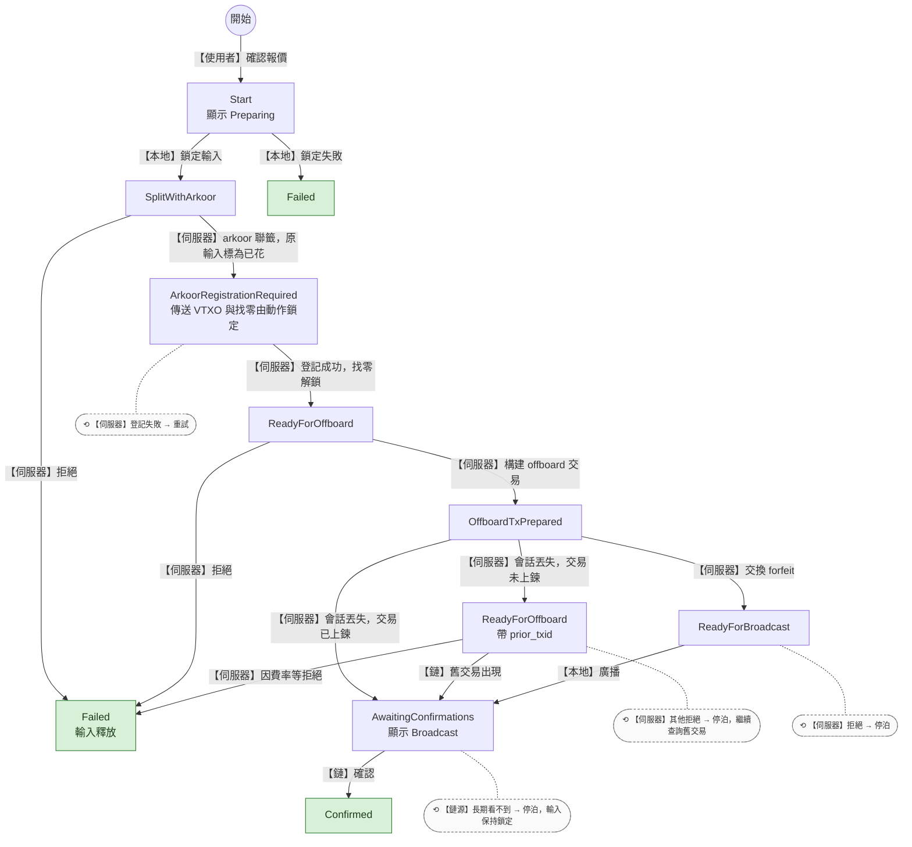

# A2 從 Ark 傳送 BTC 到鏈上地址

[返回目錄](../README.md) · A · 鏈上與 Ark 資金

## 狀態圖

GitHub 會直接渲染下方的 Mermaid 程式碼塊；如果顯示異常，請開啟 SVG 圖。

[SVG 圖](diagrams/A2.svg) · [Mermaid 源](diagrams/A2.mmd)

## 狀態表

| 編號 | 狀態（程式碼名） | 進入條件 | 資金或資料在哪 | 介面顯示 | 使用者可做的事 | 是否終態 | 程式碼位置 |
|---|---|---|---|---|---|---|---|
| A2-01 | `Preparing`（Bark `Start` / `SplitWithArkoor`） | 使用者確認，動作檢查點寫入 | 輸入 VTXO 被動作鎖定 | `wallet.bitcoin-send.preparing`（"Payment in progress"） | 「檢查狀態」 | 否 | projection `W/ark/bark_runtime/bitcoin_send.rs:105-111`, `:127-139`; locking `BK/actions/offboard.rs:553-572` |
| A2-02 | `Preparing`（Bark `ArkoorRegistrationRequired`） | 已做 arkoor 拆分，原輸入標為已花 | 拆出的傳送 VTXO **與找零** 都被動作鎖定，等待向伺服器登記 | 同上 | 同上 | 否 | `BK/actions/offboard.rs:605-636`, `:641-661` |
| A2-03 | `Preparing`（Bark `ReadyForOffboard` / `OffboardTxPrepared` / `ReadyForBroadcast`） | 登記成功，與伺服器交換 offboard 交易與 forfeit | 傳送 VTXO 鎖定；找零已解鎖 | 同上 | 同上 | 否 | `BK/actions/offboard.rs:263-286`, `:670-760` |
| A2-04 | `Broadcast`（Bark `AwaitingConfirmations`） | offboard 交易已推送 | 資金在鏈上交易裡；VTXO 已 forfeit | `wallet.bitcoin-send.broadcast` | 「檢查狀態」 | 否 | `bitcoin_send.rs:109`; `BK/actions/offboard.rs:287-326` |
| A2-05 | `Confirmed` | movement Successful | 已到對方地址 | `wallet.bitcoin-send.confirmed` | — | 是 | `bitcoin_send.rs:106` |
| A2-06 | `Failed` | movement Failed / Canceled（Bark 在 `Start`、`SplitWithArkoor`、未經 forfeit 的 `ReadyForOffboard` 失敗時釋放輸入） | 輸入回到可花 | `wallet.bitcoin-send.failed` | 重新報價 | 是 | `bitcoin_send.rs:107`; `BK/actions/offboard.rs:352-414` |
| A2-07 | 結果未知（確認呼叫超時或報錯） | `start_send_onchain_confirmed` 已寫檢查點但返回超時 | 同所在 Bark 狀態 | `wallet.bitcoin-send.uncertain` | 先查原操作，不能新建 | 否 | `bitcoin_send.rs:73-79`; `iOS/Wallet/Views/Forms/ArkBitcoinSendReview.swift:240-242` |

「同上」指本表上一行。介面顯示列中的 `xxx.yyy` 為本地化文案鍵。
