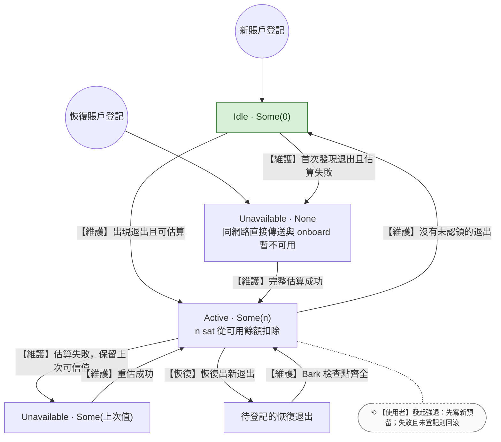

# A3 出口預留

[返回目錄](../README.md) · A · 鏈上與 Ark 資金

## 狀態圖

GitHub 會直接渲染下方的 Mermaid 程式碼塊；如果顯示異常，請開啟 SVG 圖。

[SVG 圖](diagrams/A3.svg) · [Mermaid 源](diagrams/A3.mmd)

## 狀態表

| 編號 | 狀態（程式碼名） | 進入條件 | 資金或資料在哪 | 介面顯示 | 使用者可做的事 | 是否終態 | 程式碼位置 |
|---|---|---|---|---|---|---|---|
| A3-01 | `Idle`，`remaining_sats = Some(0)` | 新賬戶登記；沒有未認領的退出 | 無預留 | 無 | — | 否（可再次進入 Active） | registration `W/ark/bitcoin.rs:259-271`; zeroing `W/ark/bark_runtime/exit_fee.rs:195-200` |
| A3-02 | `Active`，`Some(n)` | 有進行中的退出，且能估算出手續費 | 共享 BTC 中 n sat 被視為預留，從可用餘額扣除 | 餘額結構裡有 `reserved_sats` / `available_sats`（`W/ark/types.rs:429-439`） | 使用者傳送時如侵佔預留須單獨確認（`BitcoinExitReserveImpact`） | 否 | `exit_fee.rs:215-221`, `:116-122` |
| A3-03 | `Unavailable`，`Some(上次值)` | 估算失敗，保留上次可信值 | 同上 | 同上 | 同上 | 否 | `exit_fee.rs:207-212`; retention rule `W/ark/bitcoin.rs:322-330` |
| A3-04 | `Unavailable`，`None` | 恢復開始、恢復出新退出、從 Idle 首次發現退出、或授權新退出但不可重估 | 預留未知，同網路的直接傳送與 onboard 暫不可用 | 傳送報錯 | 無 | 否 | `W/ark/bitcoin.rs:62-77`, `:245-251`, `:259-267`; `exit_fee.rs:123-131`; error site `W/ark/bitcoin/transfer.rs:232-235` |
| A3-05 | 待登記的恢復退出（`pending_recovered_exit_ids` 非空） | 恢復出的退出已登記、Bark 檢查點未齊 | 同上 | 同上 | 無 | 否 | `W/ark/bitcoin.rs:69`; rejected on read `transfer.rs:231-234`; cleared `exit_fee.rs:92-105` |

「同上」指本表上一行。介面顯示列中的 `xxx.yyy` 為本地化文案鍵。
