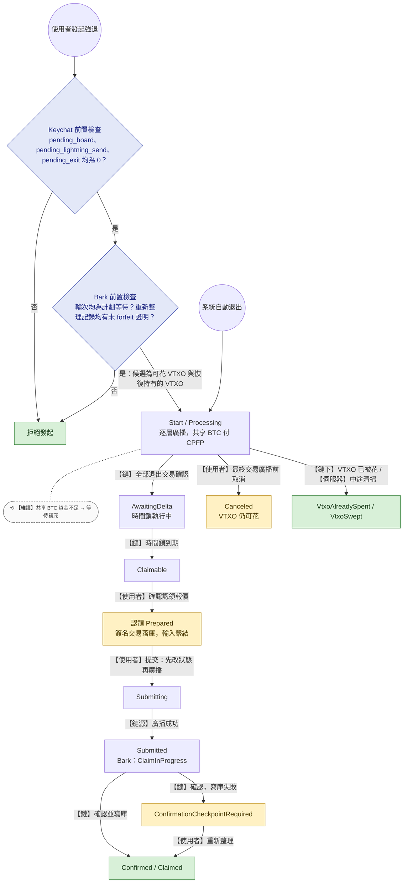

# A4 強制退出與認領

[返回目錄](../README.md) · A · 鏈上與 Ark 資金

## 狀態圖

GitHub 會直接渲染下方的 Mermaid 程式碼塊；如果顯示異常，請開啟 SVG 圖。

[SVG 圖](diagrams/A4.svg) · [Mermaid 源](diagrams/A4.mmd)

## 狀態表

### 退出（每個 VTXO 一條）

| 編號 | 狀態（程式碼名） | 進入條件 | 資金或資料在哪 | 介面顯示 | 使用者可做的事 | 是否終態 | 程式碼位置 |
|---|---|---|---|---|---|---|---|
| A4-01 | `Start` / `Processing` | 使用者確認強退，或系統為 board / HTLC 自動退出 | 退出鏈交易逐層廣播，需要共享 BTC 付 CPFP | `wallet.ark.exit-in-progress`、`wallet.ark.pending-funding`、`wallet.ark.refresh-to-progress-exit` | 重新整理推進；補充鏈上資金 | 否 | `BK/exit/progress/mod.rs:45-56`; funding check `W/ark/bark_runtime/exit_fee.rs:225-250` |
| A4-02 | `AwaitingDelta` | 全部退出交易確認 | 退出輸出，時間鎖未到 | `wallet.ark.claim-timelock-running` | 等待 | 否 | `BK/exit/progress/mod.rs:57` |
| A4-03 | `Claimable` | 時間鎖到期 | 退出輸出，僅使用者可花 | `wallet.ark.claim-to-bitcoin-address` | 認領 | 否 | `BK/exit/progress/states.rs:356-361` |
| A4-04 | `ClaimInProgress` | 鏈上出現花費該輸出的記憶體池交易 | 認領交易在記憶體池 | `wallet.ark.claim-in-progress` | 等待 | 否；交易掉出記憶體池回到 `Claimable` | `BK/exit/progress/states.rs:367-389` |
| A4-05 | `Claimed` | 花費交易確認 | 在使用者地址 | — | — | 是 | `BK/exit/progress/states.rs:344-349`, `:375-378` |
| A4-06 | `VtxoAlreadySpent` / `VtxoSwept` | VTXO 已在鏈下被花；或伺服器在退出中途清掃 | 無 | — | — | 是 | `BK/exit/models/mod.rs:40-47` |
| A4-07 | `Canceled` | 最終交易廣播前取消 | VTXO 仍可花 | — | 重新發起 | 可恢復 | `BK/exit/models/mod.rs:48-51` |

### Keychat 認領記錄（`ark_claims`，輸入與簽名交易一對一繫結）

| 編號 | 狀態（程式碼名） | 進入條件 | 資金或資料在哪 | 介面顯示 | 使用者可做的事 | 是否終態 | 程式碼位置 |
|---|---|---|---|---|---|---|---|
| A4-08 | `Prepared` | 使用者確認報價，簽名交易落庫，輸入登記到 `ark_claim_inputs` | — | `wallet.ark.claim-prepared` | 「提交原交易」 | 否 | `W/ark/bark_runtime/exit_claim.rs:46-61`; `W/ark/claim_store.rs:189-218` |
| A4-09 | `Submitting` | 開始廣播（先改狀態再廣播） | — | 認領中 | 等待 | 否 | `exit_claim.rs:97-104`; `claim_store.rs:262-271` |
| A4-10 | `Submitted` | 廣播返回成功，或鏈源報記憶體池 | — | `wallet.ark.claim-in-progress-message` | 「重新整理」 | 否 | `claim_store.rs:272-279`; `exit_claim.rs:140-142` |
| A4-11 | `ConfirmationCheckpointRequired`（投影） | 鏈上已確認但寫庫失敗 | — | `wallet.ark.claim-confirmation-checkpoint-required` | 重新整理 | 否 | `exit_claim.rs:130-139`, `:153-159` |
| A4-12 | `Confirmed` | 鏈上確認並寫庫 | — | 已認領 | — | 是 | `claim_store.rs:287-293` |

「同上」指本表上一行。介面顯示列中的 `xxx.yyy` 為本地化文案鍵。
