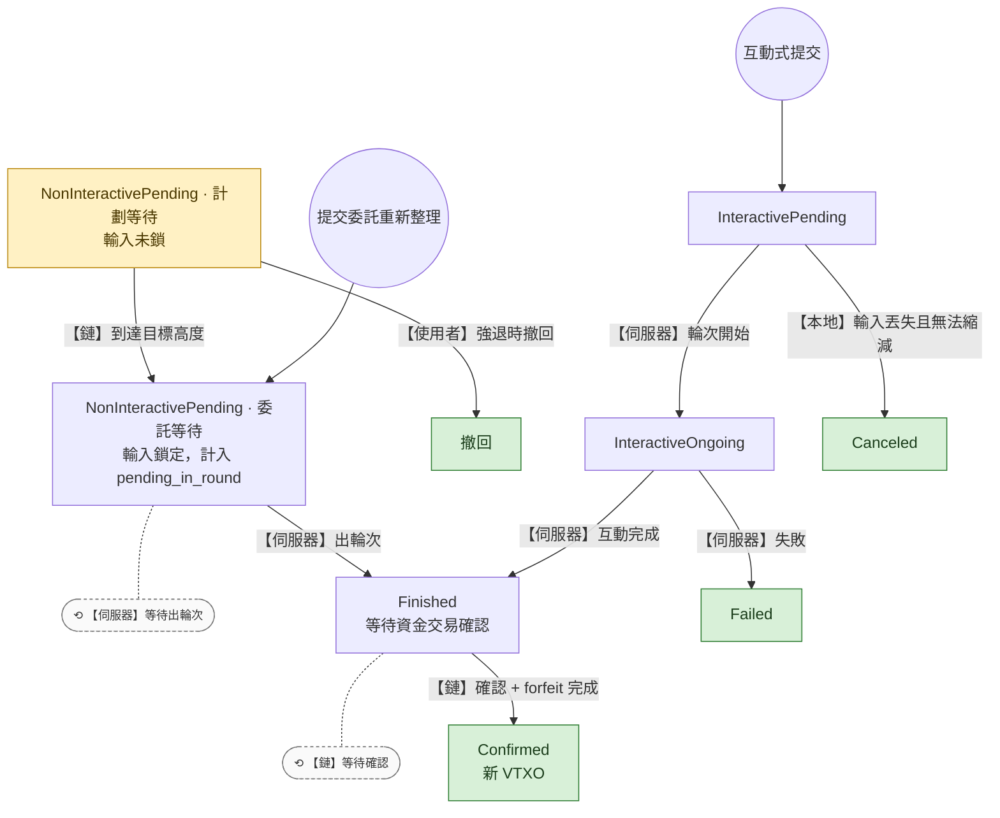
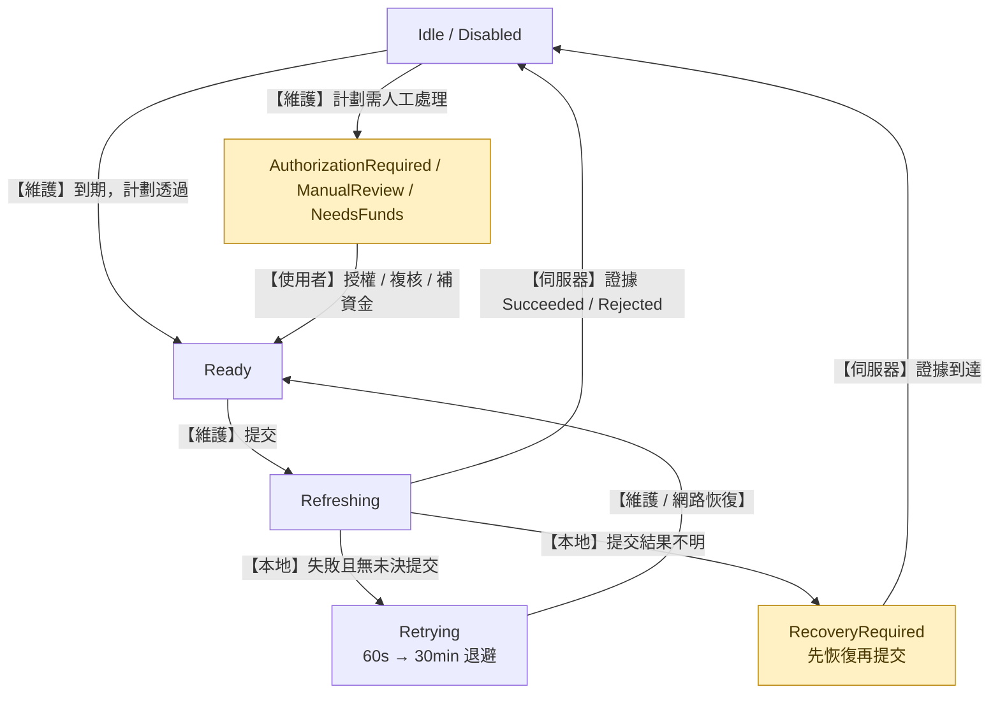

# A5 重新整理與自動維護

[返回目錄](../README.md) · A · 鏈上與 Ark 資金

## 狀態圖

GitHub 會直接渲染下方的 Mermaid 程式碼塊；如果顯示異常，請開啟 SVG 圖。

### A5a 一筆重新整理（Bark 輪次）

[SVG 圖](diagrams/A5a.svg) · [Mermaid 源](diagrams/A5a.mmd)

### A5b Keychat 維護階段（每賬戶）

[SVG 圖](diagrams/A5b.svg) · [Mermaid 源](diagrams/A5b.mmd)

## 狀態表

### 一筆重新整理（Bark 輪次）

| 編號 | 狀態（程式碼名） | 進入條件 | 資金或資料在哪 | 介面顯示 | 使用者可做的事 | 是否終態 | 程式碼位置 |
|---|---|---|---|---|---|---|---|
| A5-01 | `NonInteractivePending{scheduled_height: Some}` | 計劃重新整理已被伺服器接受，等待目標高度；計劃等待：是（`is_scheduled_waiting`） | 輸入未鎖，仍可強退 | — | — | 否 | `BK/round/mod.rs:262-267` |
| A5-02 | `NonInteractivePending{scheduled_height: None}` / `Redelegating` | 委託重新整理已提交，等待伺服器出輪次；計劃等待：否 | 輸入被 movement 鎖定，計入 `pending_in_round` | — | — | 否 | `BK/round/mod.rs:1043-1059`, `:816-830`; balance `BK/balance.rs:190-197` |
| A5-03 | `InteractivePending` / `InteractiveOngoing` | 互動式輪次排隊 / 進行中；計劃等待：否 | 同上 | — | — | 否 | `BK/round/mod.rs:777`, `:783-803` |
| A5-04 | `Finished`（未 done） | 互動結束，等待輪次資金交易確認；計劃等待：否 | 同上；forfeit 尚未完成 | — | — | 否 | `BK/round/mod.rs:923-959` |
| A5-05 | `Finished`（done）→ `Confirmed` | 資金交易確認、forfeit 完成；計劃等待：— | 新 VTXO | — | — | 是 | `BK/round/mod.rs:771-775`, `:937-948` |
| A5-06 | `Failed` / `Canceled` | 輪次失敗、使用者取消、輸入丟失無法縮減；計劃等待：— | 輸入釋放 | — | — | 是 | `BK/round/mod.rs:793-813` |

### Keychat 維護階段（每賬戶一份）

| 編號 | 狀態（程式碼名） | 進入條件 | 資金或資料在哪 | 介面顯示 | 使用者可做的事 | 是否終態 | 程式碼位置 |
|---|---|---|---|---|---|---|---|
| A5-07 | `Idle` / `Disabled` | 無需重新整理 / 自動重新整理關閉 | — | `disabled-title` | 開啟或手動重新整理 | 否（常駐） | `W/ark/maintenance.rs:72-75` |
| A5-08 | `Ready` / `Refreshing` | 計劃已批准 / 已提交 | — | — | 等待 | 否 | `W/ark/provider/maintenance.rs:530-538` |
| A5-09 | `Retrying` | 失敗退避 60s→30min | — | — | 等待 | 否 | `W/ark/maintenance.rs:132-146` |
| A5-10 | `RecoveryRequired` | 提交結果不明，需先恢復 | — | — | 等待（每 `URGENT_CHECK_SECONDS` 再查） | 否 | `W/ark/provider/maintenance.rs:241-258` |
| A5-11 | `AuthorizationRequired` / `ManualReview` / `NeedsFunds` | 需使用者授權費用、人工複核、補資金 | — | `authorization-*`、`funds-title` 等 | 授權、複核或補資金 | 否（待使用者） | `W/ark/maintenance.rs:35-62` |

「同上」指本表上一行。介面顯示列中的 `xxx.yyy` 為本地化文案鍵。
