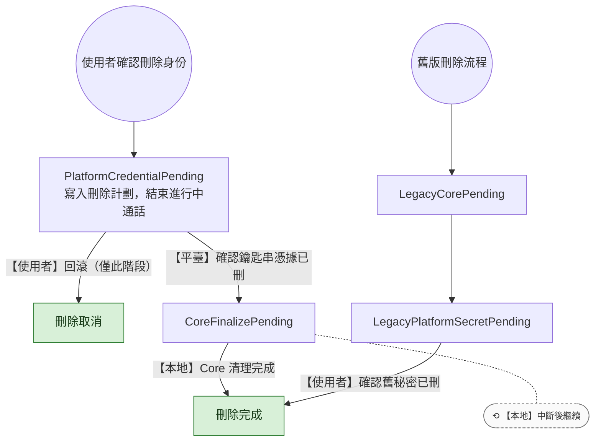

# D1 身份刪除

[返回目錄](../README.md) · D · 身份、裝置與恢復

## 狀態圖

GitHub 會直接渲染下方的 Mermaid 程式碼塊；如果顯示異常，請開啟 SVG 圖。

[SVG 圖](diagrams/D1.svg) · [Mermaid 源](diagrams/D1.mmd)

## 狀態表

| 編號 | 狀態（程式碼名） | 進入條件 | 資金或資料在哪 | 介面顯示 | 使用者可做的事 | 是否終態 | 程式碼位置 |
|---|---|---|---|---|---|---|---|
| D1-01 | `PlatformCredentialPending` | 使用者確認刪除，Core 寫入刪除計劃；結束該身份的進行中通話 | 身份仍在，新工作被擋 | — | 回滾（只此階段允許） | 否 | `A/data_store/identity_deletion.rs:6-50`; rollback `A/app_storage/identities.rs:1386-1409` |
| D1-02 | `CoreFinalizePending` | 平臺確認已刪鑰匙串憑據 | 憑據已刪，Core 資料待清 | — | 繼續（可重複） | 否 | `identity_deletion.rs:54-82`, `:101-138` |
| D1-03 | `LegacyCorePending` / `LegacyPlatformSecretPending` | 舊版刪除流程的中間點 | 同上 | — | 繼續；確認舊秘密已刪 | 否 | `identity_deletion.rs:121-126`, `:237`, `:271` |
| D1-04 | 刪除完成 | Core 清理完成，刪除行移除 | 身份消失 | — | — | 是 | — |

「同上」指本表上一行。介面顯示列中的 `xxx.yyy` 為本地化文案鍵。
