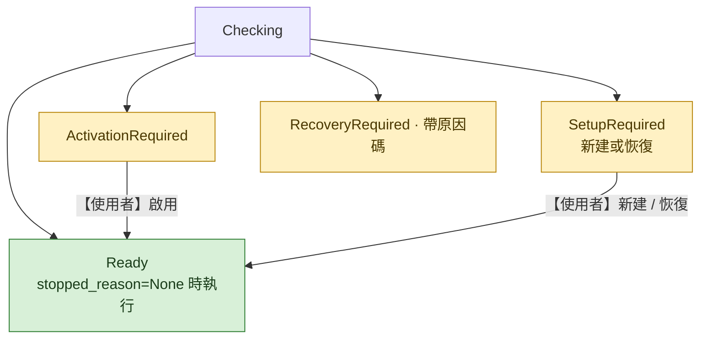
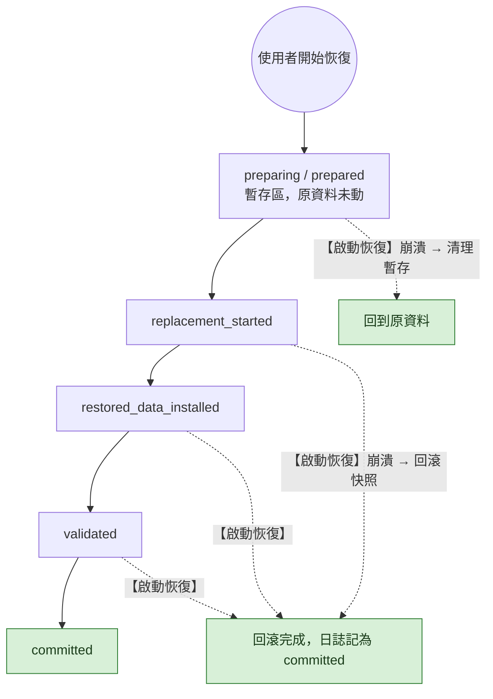

# D2 裝置啟用、啟動與備份恢復

[返回目錄](../README.md) · D · 身份、裝置與恢復

## 狀態圖

GitHub 會直接渲染下方的 Mermaid 程式碼塊；如果顯示異常，請開啟 SVG 圖。

### D2a 啟動

[SVG 圖](diagrams/D2a.svg) · [Mermaid 源](diagrams/D2a.mmd)

### D2b 備份恢復（iOS 事務日誌）

[SVG 圖](diagrams/D2b.svg) · [Mermaid 源](diagrams/D2b.mmd)

## 狀態表

### 啟動

| 編號 | 狀態（程式碼名） | 進入條件 | 資金或資料在哪 | 介面顯示 | 使用者可做的事 | 是否終態 | 程式碼位置 |
|---|---|---|---|---|---|---|---|
| D2-01 | `Checking` | 啟動 | — | — | 等待 | 否 | `A/device_activation.rs:61-62` |
| D2-02 | `SetupRequired` | 無資料 | — | — | 新建或恢復 | 否（待使用者） | `:63` |
| D2-03 | `ActivationRequired{pending}` | 資料在，啟用未驗證 | — | — | 啟用 | 否（待使用者） | `:64-66` |
| D2-04 | `RecoveryRequired{reason}` | 恢復被擋、庫金鑰缺失、儲存不可用 / 不相容、鑰匙串不可用、憑據衝突、策略不支援 | — | — | 按原因處理 | 否（待使用者） | `:49-58`, `:67-69` |
| D2-05 | `Ready{stopped_reason}` | 一切就緒；或因手動 / 遷移源 / 遷移目標暫停 | — | — | — | 是（常駐） | `:70-80` |

### 備份恢復（Core 進度）與 iOS 事務日誌

| 編號 | 狀態（程式碼名） | 進入條件 | 資金或資料在哪 | 介面顯示 | 使用者可做的事 | 是否終態 | 程式碼位置 |
|---|---|---|---|---|---|---|---|
| D2-06 | `RestoreInspecting` / `RestoreValidating` / `RestoreStaging`（iOS：`preparing` / `prepared`） | — | 暫存區；原資料未動 | — | 啟動時清理暫存 | 否 | `A/backup_restore.rs:606-621`; `iOS/Services/BackupRestoreTransaction.swift:197-199` |
| D2-07 | `RestoreReplacingLocalData` / `RestoreWritingKeychain`（iOS：`replacement_started` / `restored_data_installed`） | — | 原資料快照 + 新資料 | — | 啟動時回滾到快照，回滾後把日誌記為 committed 以免重複回滾 | 否 | `BackupRestoreTransaction.swift:200-205`, `:209-258` |
| D2-08 | `RestoreReopeningClient` / `RestoreWalletChecking`（iOS：`validated`） | — | 新資料 | — | 同上（回滾） | 否 | same as above |
| D2-09 | `RestoreComplete`（iOS：`committed`） | — | 新資料，快照清理 | — | — | 是 | `BackupRestoreTransaction.swift:178-181` |
| D2-10 | `Failed`（iOS：—） | — | 視失敗點 | — | 只能回到 Idle | 是 | `A/backup_restore.rs:698-741` |

「同上」指本表上一行。介面顯示列中的 `xxx.yyy` 為本地化文案鍵。
