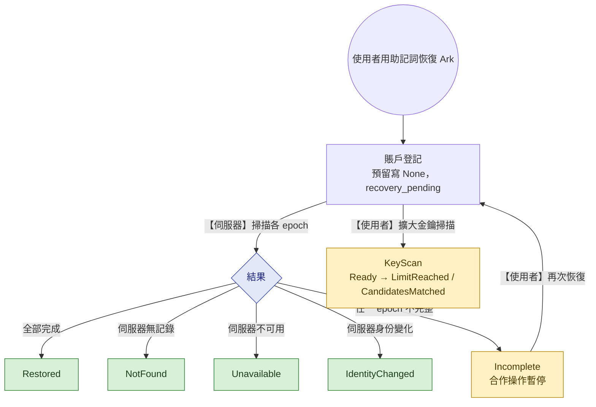

# D3 錢包恢復

[返回目錄](../README.md) · D · 身份、裝置與恢復

## 狀態圖

GitHub 會直接渲染下方的 Mermaid 程式碼塊；如果顯示異常，請開啟 SVG 圖。

[SVG 圖](diagrams/D3.svg) · [Mermaid 源](diagrams/D3.mmd)

## 狀態表

| 編號 | 狀態（程式碼名） | 進入條件 | 資金或資料在哪 | 介面顯示 | 使用者可做的事 | 是否終態 | 程式碼位置 |
|---|---|---|---|---|---|---|---|
| D3-01 | `Restored` | 所有 epoch 完成 | 已恢復的 VTXO 與退出 | — | — | 是 | `W/ark/types.rs:69` |
| D3-02 | `NotFound` | 伺服器無此錢包記錄 | — | — | 換源再試 | 是 | `types.rs:70` |
| D3-03 | `Incomplete` | 任一 epoch 不完整；賬戶保持 `recovery_pending`，合作操作被拒，預留為 None | 部分恢復 | — | 再次恢復 | 否 | `W/ark/types.rs:71` |
| D3-04 | `Unavailable` / `IdentityChanged` | 伺服器不可用 / 伺服器身份變了 | — | — | 稍後再試 / 人工判斷 | 是（本次） | `types.rs:72-73` |
| D3-05 | 金鑰掃描 `Ready` / `LimitReached` / `CandidatesMatched` | 按索引掃描到上限或命中 | 掃描進度 | — | 擴大掃描 | 否 | `types.rs:89-108` |
| D3-06 | BTC 歷史掃描 `Ready` / `LimitReached` / `UnsupportedChainSource` | 同上（共享 BTC） | 已發現地址數 | — | 擴大掃描 | 否 | `types.rs:441-457` |

「同上」指本表上一行。介面顯示列中的 `xxx.yyy` 為本地化文案鍵。
