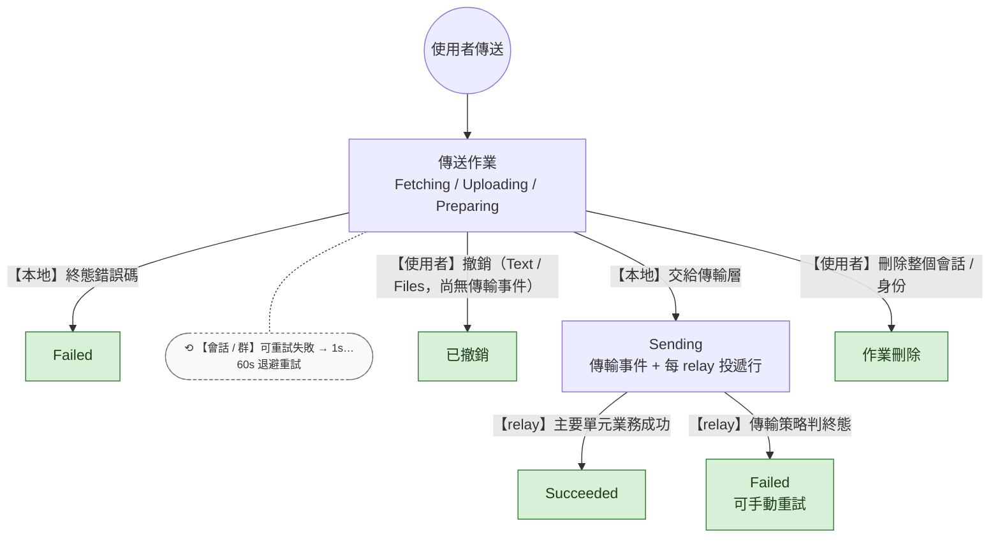

# C1 訊息傳送

[返回目錄](../README.md) · C · 訊息與關係

## 狀態圖

GitHub 會直接渲染下方的 Mermaid 程式碼塊；如果顯示異常，請開啟 SVG 圖。

[SVG 圖](diagrams/C1.svg) · [Mermaid 源](diagrams/C1.mmd)

## 狀態表

| 編號 | 狀態（程式碼名） | 進入條件 | 資金或資料在哪 | 介面顯示 | 使用者可做的事 | 是否終態 | 程式碼位置 |
|---|---|---|---|---|---|---|---|
| C1-01 | `Fetching` | 有連結預覽意圖未完成 | 傳送作業 | 傳送中 | 文字 / 檔案可撤銷 | 否 | `A/messaging/delivery_queries.rs:420-424` |
| C1-02 | `Uploading` | 附件意圖未完成 | 傳送作業 + 本地附件 | 上傳中 | 同上 | 否 | `delivery_queries.rs:425-429` |
| C1-03 | `Preparing` | 作業存在，尚未交給傳輸層 | 傳送作業 | 傳送中 | 同上 | 否 | `delivery_queries.rs:430-432` |
| C1-04 | `Failed`（作業內） | 上傳被暫停 | 傳送作業 | 失敗 | 重試 | 否 | `delivery_queries.rs:421-422` |
| C1-05 | `Sending` | 已生成傳輸事件，未達業務成功也未終態 | `app_message_transport_events` + 每 relay 投遞行 | 傳送中 | 等待 | 否 | `delivery_queries.rs:443-445` |
| C1-06 | `Succeeded` | 主要單元達到業務成功 | 投遞行 | 已傳送 | — | 是 | `delivery_queries.rs:433-437` |
| C1-07 | `Failed`（投遞） | 傳輸策略判終態 | 投遞行 | 失敗 | 手動重試（視 `manual_retryable`） | 是 | `delivery_queries.rs:438-442` |

「同上」指本表上一行。介面顯示列中的 `xxx.yyy` 為本地化文案鍵。
