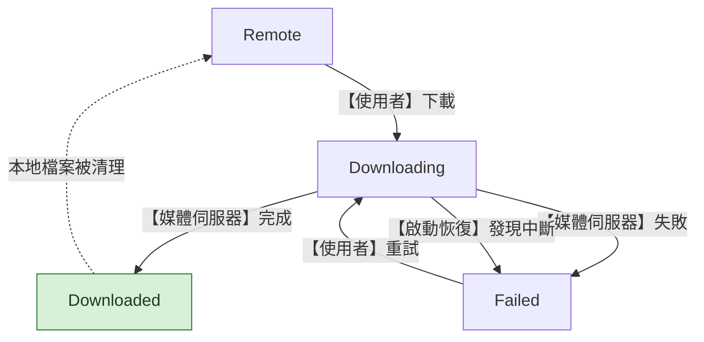
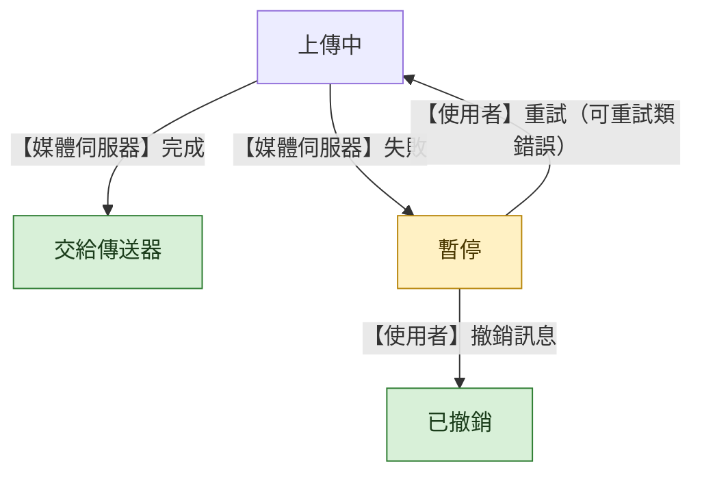

# C2 附件上傳與下載

[返回目錄](../README.md) · C · 訊息與關係

## 狀態圖

GitHub 會直接渲染下方的 Mermaid 程式碼塊；如果顯示異常，請開啟 SVG 圖。

### C2a 下載

[SVG 圖](diagrams/C2a.svg) · [Mermaid 源](diagrams/C2a.mmd)

### C2b 上傳（隨傳送作業）

[SVG 圖](diagrams/C2b.svg) · [Mermaid 源](diagrams/C2b.mmd)

## 狀態表

### 下載

| 編號 | 狀態（程式碼名） | 進入條件 | 資金或資料在哪 | 介面顯示 | 使用者可做的事 | 是否終態 | 程式碼位置 |
|---|---|---|---|---|---|---|---|
| C2-01 | `Remote` | 未下載 | 遠端 URL + 金鑰 | 可下載 | 下載 | 否 | `A/data_store/message_snapshot.rs:536-540` |
| C2-02 | `Downloading` | 開始下載（`transfer_state=1`） | 臨時檔案 | 下載中 | 等待 | 否 | `A/app_storage/attachments.rs:356` |
| C2-03 | `Downloaded` | `transfer_state=2` 且本地檔案存在 | 本地檔案 | 可開啟 | — | 是（檔案丟失則回到 Remote 投影） | `message_snapshot.rs:527-535` |
| C2-04 | `Failed` | 下載失敗，或啟動 / 重啟執行時發現中斷 | `last_error_code` | 失敗 | 重試 | 否 | `attachments.rs:462-469`, `:472-492` |

### 上傳（隨訊息傳送作業）

| 編號 | 狀態（程式碼名） | 進入條件 | 資金或資料在哪 | 介面顯示 | 使用者可做的事 | 是否終態 | 程式碼位置 |
|---|---|---|---|---|---|---|---|
| C2-05 | 上傳中 | 附件意圖未完成 | — | `Uploading` | 文字 / 檔案訊息可撤銷 | 否 | `A/messaging/delivery_queries.rs:425-429` |
| C2-06 | 暫停（作業內失敗） | 上傳失敗寫 `upload_state='paused'` | — | `Failed` | 可重試類錯誤允許重試；來源丟失、意圖無效、不安全目標不可重試 | 否 | `A/app_storage/message_sender_attachments.rs:349`; `A/message_sender/projection.rs:73-94` |

「同上」指本表上一行。介面顯示列中的 `xxx.yyy` 為本地化文案鍵。
