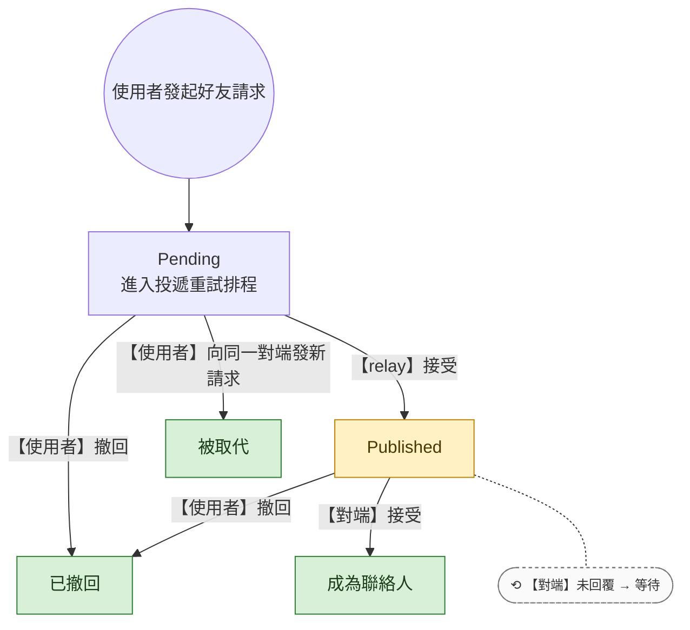

# C3 好友請求與 PQXDH 升級

[返回目錄](../README.md) · C · 訊息與關係

## 狀態圖

GitHub 會直接渲染下方的 Mermaid 程式碼塊；如果顯示異常，請開啟 SVG 圖。

[SVG 圖](diagrams/C3.svg) · [Mermaid 源](diagrams/C3.mmd)

## 狀態表

| 編號 | 狀態（程式碼名） | 進入條件 | 資金或資料在哪 | 介面顯示 | 使用者可做的事 | 是否終態 | 程式碼位置 |
|---|---|---|---|---|---|---|---|
| C3-01 | `Pending`（發出方） | 請求已提交入投遞重試排程 | 待發請求 + 協議層待定會話 | 等待對方 | 撤回請求 | 否 | `A/friend_request.rs:1260-1263`, `:1611-1625` |
| C3-02 | `Published` | 至少一處 relay 接受 | 同上 | 等待對方 | 撤回請求 | 否 | `A/types.rs:3512` |
| C3-03 | 被對方接受 | 收到對方回覆 | 會話建立 | 聯絡人 | — | 是 | — |
| C3-04 | 撤回 | 使用者撤回；或同一對端的新請求取代舊請求 | 清除協議層待定會話與傳輸 | — | — | 是 | `A/friend_request.rs:1265-1369`, `:1220-1258` |
| C3-05 | PQXDH 升級重試 | 使用者手動觸發 | — | `Sent` / `AlreadyUpgraded` / `PeerNotReady` / `IneligibleRoom` / `InFlight` 分別提示 | 稍後重試 | 每次呼叫即返回 | `A/types.rs:533-540` |

「同上」指本表上一行。介面顯示列中的 `xxx.yyy` 為本地化文案鍵。
