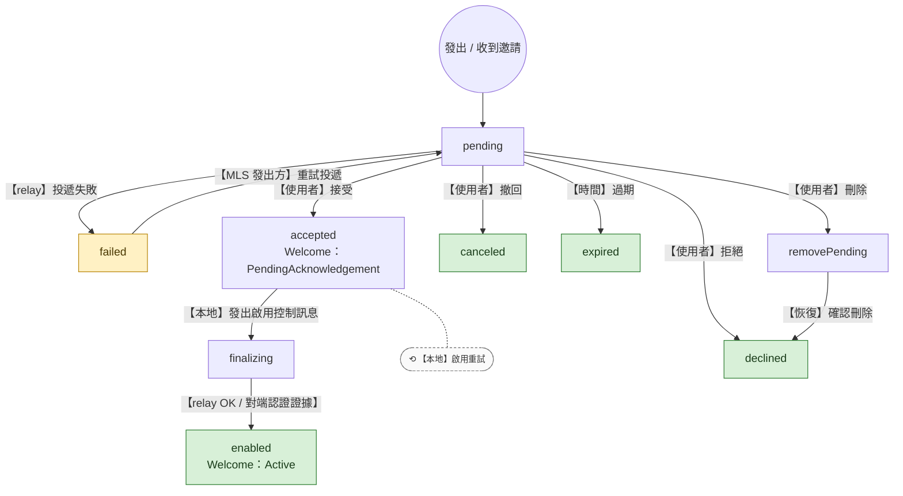

# C4 群邀請與 MLS Welcome 啟用

[返回目錄](../README.md) · C · 訊息與關係

## 狀態圖

GitHub 會直接渲染下方的 Mermaid 程式碼塊；如果顯示異常，請開啟 SVG 圖。

[SVG 圖](diagrams/C4.svg) · [Mermaid 源](diagrams/C4.mmd)

## 狀態表

| 編號 | 狀態（程式碼名） | 進入條件 | 資金或資料在哪 | 介面顯示 | 使用者可做的事 | 是否終態 | 程式碼位置 |
|---|---|---|---|---|---|---|---|
| C4-01 | `pending` | 發出或收到邀請；投遞重試回到待定 | — | — | 接受 / 拒絕 / 撤回 | 否 | `A/group_invite/outgoing.rs:216`, `:395`; `A/group_invite/welcome.rs:212`; `A/group_invite/delivery.rs:413` |
| C4-02 | `failed` | 投遞失敗、決定處理失敗 | — | — | MLS 發出方可重試投遞（`group_invite_lifecycle_allows_delivery_retry`） | 否 | `outgoing.rs:440`, `:482`, `:519`; `A/group_invite/decisions.rs:244`; `A/group_invite.rs:308-318` |
| C4-03 | `accepted` / `finalizing` | 接受後等待成員啟用控制訊息落地 | — | `PendingAcknowledgement` | 等待 | 否 | `A/group_invite/projection.rs:14`, `:24` |
| C4-04 | `enabled` | 收到認證的啟用證據或 relay OK | — | `Active` | — | 是 | `A/group_invite/delivery.rs:513`; `projection.rs:25` |
| C4-05 | `declined` / `canceled` / `expired` | 拒絕、撤回、過期 | — | — | — | 是 | `A/group_invite/removal_recovery.rs:55-63`, `:93-103` |
| C4-06 | `removePending` | 刪除過程中待確認 | — | — | — | 否 | `A/group_invite/decisions.rs:175`; `removal_recovery.rs:235`, `:345` |

「同上」指本表上一行。介面顯示列中的 `xxx.yyy` 為本地化文案鍵。
