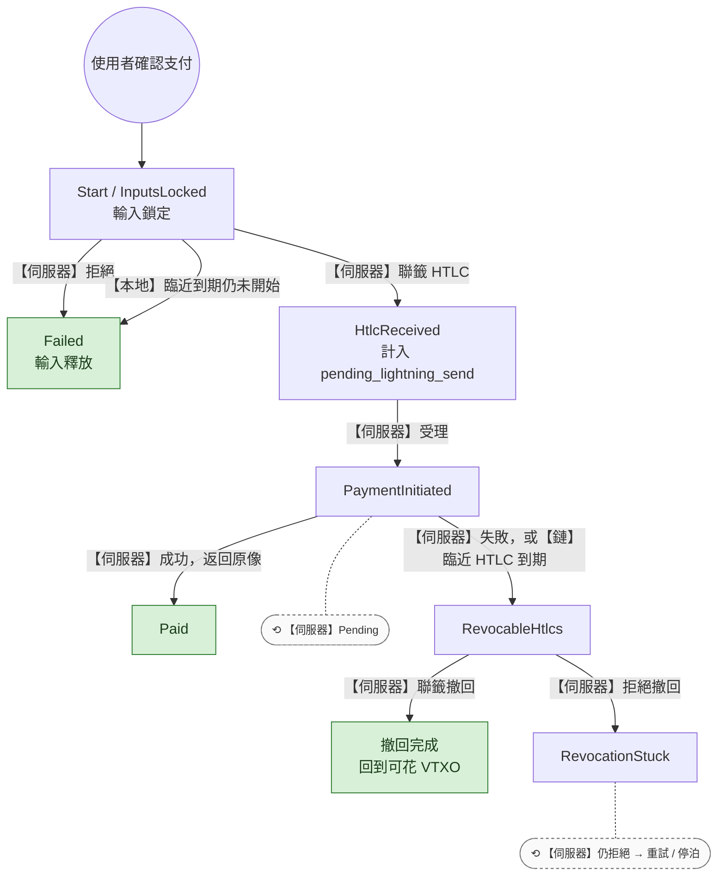
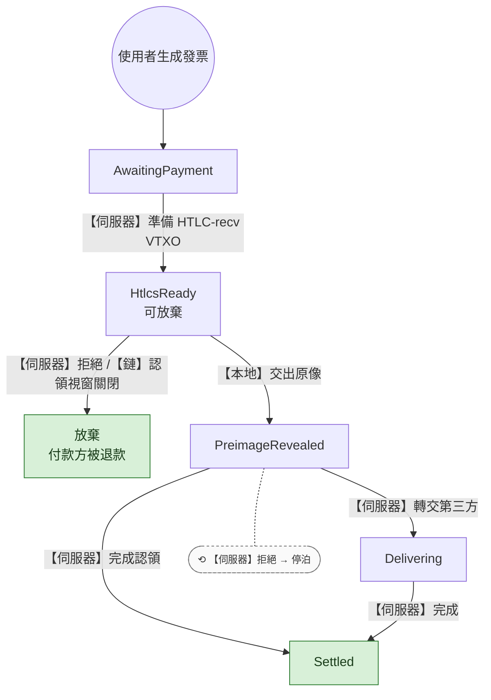

# B1 Lightning 收發（Ark）

[返回目錄](../README.md) · B · 支付與收款

## 狀態圖

GitHub 會直接渲染下方的 Mermaid 程式碼塊；如果顯示異常，請開啟 SVG 圖。

### B1a 傳送（付發票）

[SVG 圖](diagrams/B1a.svg) · [Mermaid 源](diagrams/B1a.mmd)

### B1b 接收（開發票）

[SVG 圖](diagrams/B1b.svg) · [Mermaid 源](diagrams/B1b.mmd)

## 狀態表

### 傳送

| 編號 | 狀態（程式碼名） | 進入條件 | 資金或資料在哪 | 介面顯示 | 使用者可做的事 | 是否終態 | 程式碼位置 |
|---|---|---|---|---|---|---|---|
| B1-01 | `Start` / `InputsLocked` | 使用者確認支付 | 輸入 VTXO 被動作鎖定 | `InProgress` | 等待 | 否 | `BK/actions/lightning/pay.rs:326-330`, `:221-229` |
| B1-02 | `HtlcReceived` | 伺服器聯籤 HTLC 輸出 | HTLC VTXO 鎖定，計入 `pending_lightning_send` | `InProgress` | 等待 | 否 | `BK/actions/lightning/pay.rs:331-332` |
| B1-03 | `PaymentInitiated` | 已通知伺服器付款 | 同上 | `InProgress` | 等待 | 否 | `BK/actions/lightning/pay.rs:183-207` |
| B1-04 | `RevocableHtlcs` | 伺服器報失敗，或 HTLC 臨近到期仍 Pending | 同上，準備撤回 | `InProgress` | 等待 | 否 | `BK/actions/lightning/pay.rs:189-198` |
| B1-05 | `RevocationStuck` | 伺服器拒絕撤回 | 同上 | `InProgress{has_failed_revocation: true}` | 等待 | 否 | `BK/actions/lightning/pay.rs:260-275`, `:299-315`; `W/ark/bark_runtime.rs:3032-3038`; `iOS/Wallet/Ark/ArkWalletModels.swift:1117` |
| B1-06 | `Paid` | 拿到原像 | 已付出 | `Paid` | — | 是 | `BK/actions/lightning/pay.rs:185-188` |
| B1-07 | 撤回完成（Done） | 伺服器聯籤撤回 | 回到可花 VTXO | — | — | 是 | `BK/actions/lightning/pay.rs:209-213` |

### 接收

| 編號 | 狀態（程式碼名） | 進入條件 | 資金或資料在哪 | 介面顯示 | 使用者可做的事 | 是否終態 | 程式碼位置 |
|---|---|---|---|---|---|---|---|
| B1-08 | `AwaitingPayment` | 生成發票 | 無 | — | — | 否 | `BK/actions/lightning/receive.rs:257-258` |
| B1-09 | `HtlcsReady` | 伺服器準備好 HTLC-recv VTXO | 鎖定，尚可放棄 | — | — | 否；認領視窗關閉或被拒即放棄 | `BK/actions/lightning/receive.rs:259-262`, `:204-211`, `:240-246` |
| B1-10 | `PreimageRevealed` | 已向伺服器交出原像 | HTLC-recv VTXO 鎖定，計入 `claimable_lightning_receive` | — | — | 否；認領失敗後停泊 | `BK/actions/lightning/receive.rs:263-269`, `:212-224`, `:247-249`; `BK/lightning/receive.rs:205-240` |
| B1-11 | `Delivering` | 認領輸出需轉交第三方 | 鎖定 | — | — | 否 | `BK/actions/lightning/receive.rs:270-273` |
| B1-12 | `Settled` | 認領完成 | 新 VTXO | — | — | 是 | `W/ark/bark_runtime.rs:3007-3014` |

「同上」指本表上一行。介面顯示列中的 `xxx.yyy` 為本地化文案鍵。
