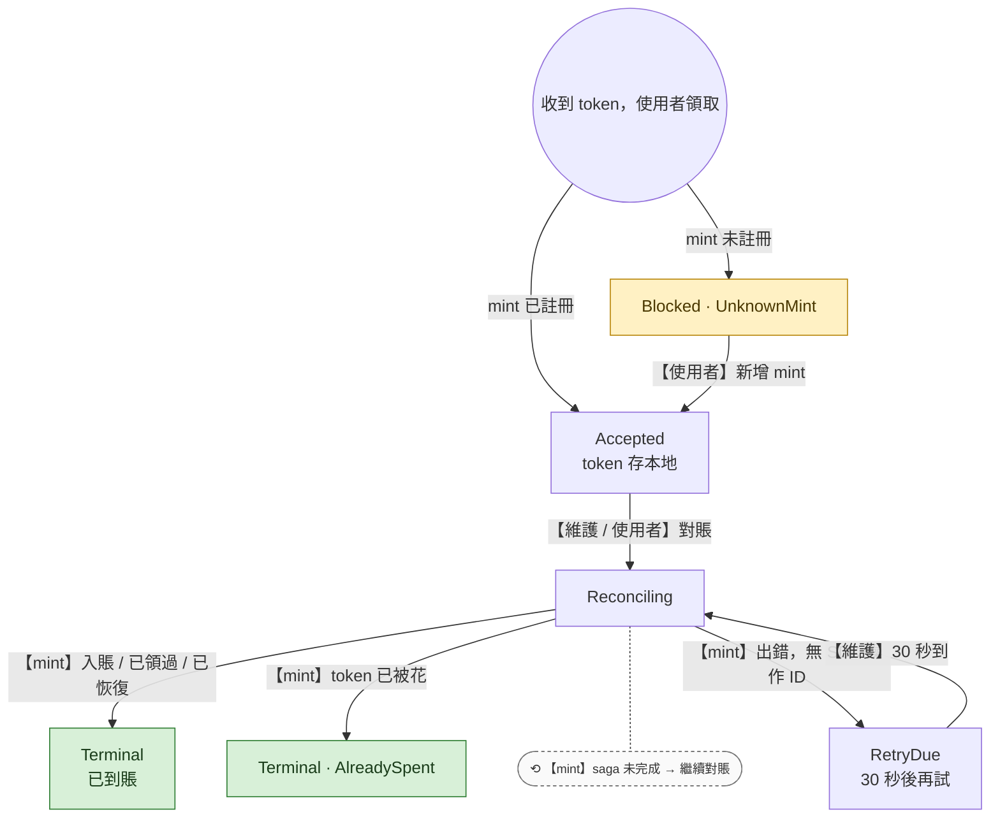

# B2 Cashu 收款

[返回目錄](../README.md) · B · 支付與收款

## 狀態圖

GitHub 會直接渲染下方的 Mermaid 程式碼塊；如果顯示異常，請開啟 SVG 圖。

[SVG 圖](diagrams/B2.svg) · [Mermaid 源](diagrams/B2.mmd)

## 狀態表

| 編號 | 狀態（程式碼名） | 進入條件 | 資金或資料在哪 | 介面顯示 | 使用者可做的事 | 是否終態 | 程式碼位置 |
|---|---|---|---|---|---|---|---|
| B2-01 | `Accepted` | 收到 token，mint 已註冊 | bearer token 存於本地加密庫（唯一可重放副本） | 收款處理中 | 等待 | 否 | `W/cashu/receive_store.rs:340-345`; `W/cashu/receive_operations.rs:63` |
| B2-02 | `Blocked`（`UnknownMint`） | mint 未註冊 | 同上 | 需新增 mint | 新增 mint 後繼續 | 否 | `receive_store.rs:342-345`; skipped by maintenance `receive_operations.rs:509-512` |
| B2-03 | `Reconciling` | 正在對賬，或 SDK 已有該操作的 saga | token + CDK saga | 處理中 | 等待 | 否 | `receive_operations.rs:188-194`, `:216-226` |
| B2-04 | `RetryDue`（`RetryRequired`） | 對賬出錯且沒有 SDK 操作 ID，30 秒後再試 | token | 處理中 | 等待 | 否 | `receive_operations.rs:192`, `:214-227` |
| B2-05 | `Terminal`（issue 為空） | 收到 `Credited` / `AlreadyReceived` / `Recovered` | 已入 CDK 餘額 | 已到賬 | — | 是 | `receive_operations.rs:196-206` |
| B2-06 | `Terminal`（`AlreadySpent`） | mint 報 token 已被花 | 無 | `CashuTokenAlreadySpent` 報錯 | — | 是 | `receive_operations.rs:207-213` |

「同上」指本表上一行。介面顯示列中的 `xxx.yyy` 為本地化文案鍵。
