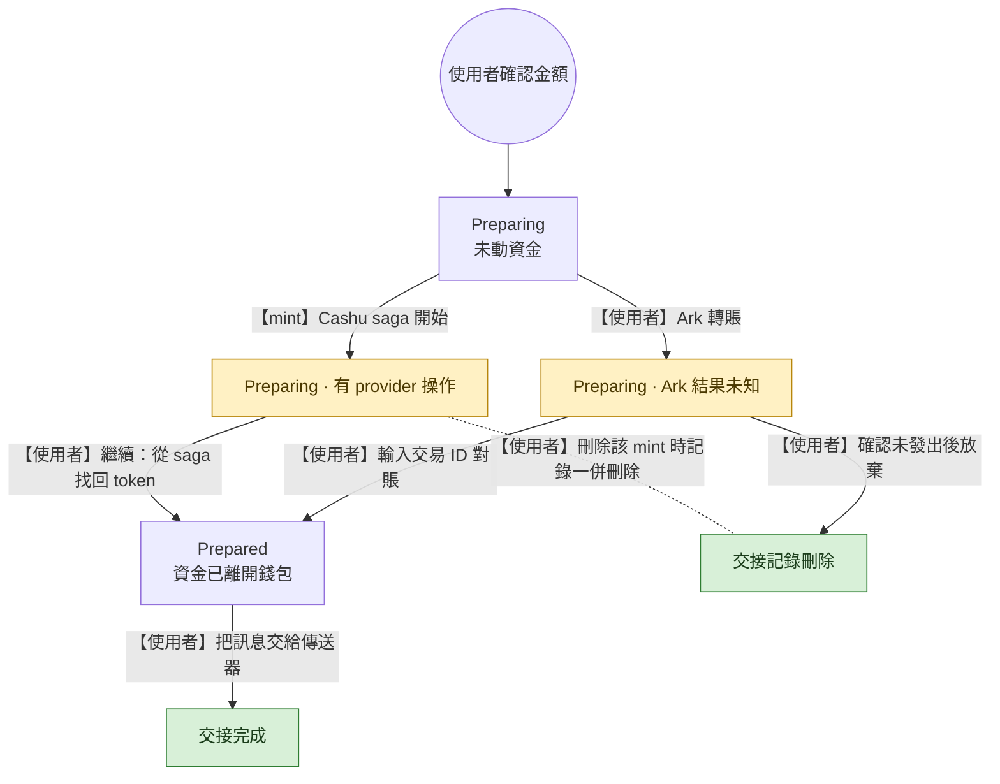
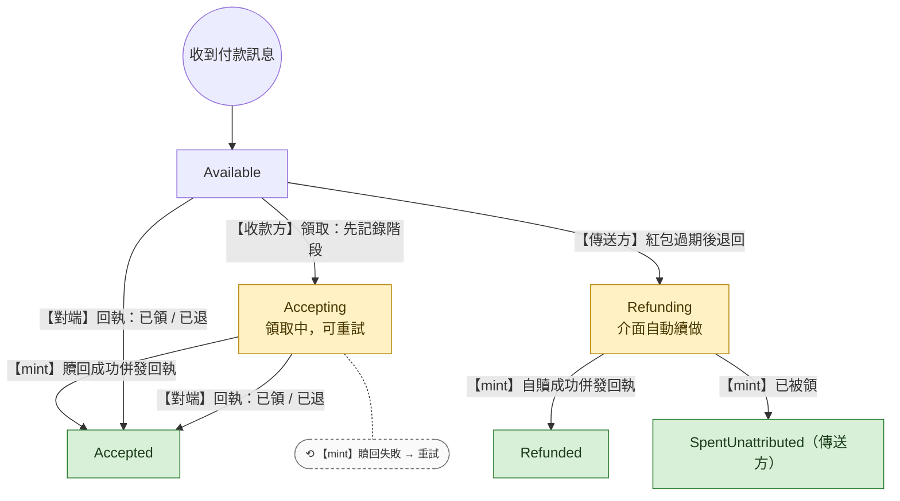

# B3 聊天轉賬、紅包與收款回執

[返回目錄](../README.md) · B · 支付與收款

## 狀態圖

GitHub 會直接渲染下方的 Mermaid 程式碼塊；如果顯示異常，請開啟 SVG 圖。

### B3a 傳送方：錢包交接（同房間同身份一筆）

[SVG 圖](diagrams/B3a.svg) · [Mermaid 源](diagrams/B3a.mmd)

### B3b 訊息側：Cashu 轉賬 / 紅包（Signal 私聊）

[SVG 圖](diagrams/B3b.svg) · [Mermaid 源](diagrams/B3b.mmd)

## 狀態表

### 傳送方：錢包交接（每個房間同時只能有一筆）

| 編號 | 狀態（程式碼名） | 進入條件 | 資金或資料在哪 | 介面顯示 | 使用者可做的事 | 是否終態 | 程式碼位置 |
|---|---|---|---|---|---|---|---|
| B3-01 | `Preparing`，無 provider 操作 | 使用者確認金額 | 未動資金 | — | 繼續 | 否 | `W/ledger.rs:539-606` |
| B3-02 | `Preparing`，有 provider 操作（Cashu） | Cashu 傳送 saga 已開始 | mint 側 saga；token 可能已生成 | `wallet.chat.previous-cashu-interrupted` | 「繼續」：重新從 saga 找回 token | 否 | `WU/wallet.rs:2752-2810`, `:1880-1931` |
| B3-03 | `Preparing`，Ark 未決 | Ark 轉賬結果未知 | 可能已離開賬戶 | `wallet.chat.previous-wallet-transfer-interrupted` | 輸入交易 ID 對賬；或確認未發出後放棄 | 否 | `W/ledger.rs:734-759`; `iOS/Wallet/Views/ChatPayFlowSheet.swift:862-900` |
| B3-04 | `Prepared` | 拿到 token（Cashu）或交易 ID（Ark） | 資金已離開錢包，token 在本地 saga | `wallet.chat.wallet-transfer-complete`（可續交訊息） | 繼續把訊息發出 | 否 | `W/ledger.rs:691-722`; `ChatPayFlowSheet.swift:725-731` |
| B3-05 | 刪除（完成） | 訊息交給傳送器 | 交接記錄刪除 | — | — | 是 | `W/ledger.rs:724-732`; `ChatPayFlowSheet.swift:851` |

### 訊息側：Cashu 轉賬 / 紅包（僅限 Signal 私聊）

| 編號 | 狀態（程式碼名） | 進入條件 | 資金或資料在哪 | 介面顯示 | 使用者可做的事 | 是否終態 | 程式碼位置 |
|---|---|---|---|---|---|---|---|
| B3-06 | 無 → `Pending` / `Available` | 收到或發出 | — | 可領取 | 收款方領取；傳送方（紅包）不可領 | 否 | `A/payment_lifecycle.rs:826-849` |
| B3-07 | `Accepting` → `Pending` / `Accepting` | 收款方點領取，先落階段再贖回 | — | 領取中，`can_retry` | 重試 | 否 | `A/messaging/payment_messages.rs:876-935`; projection `payment_lifecycle.rs:843-844`, `:858` |
| B3-08 | `Accepted` → `Succeeded` / `Accepted` | 贖回成功併發回執；或收到對方回執 | — | 已領取 | 回執失敗可重發 | 是 | `payment_lifecycle.rs:417-455`, `:828-841` |
| B3-09 | `Refunding` → `Expired` / `Accepting` | 傳送方在紅包過期後開始退回 | — | `chat.payment.shared.refunding` / `continue-refund` | 繼續退回（介面自動續做） | 否 | `payment_lifecycle.rs:470-480`; `iOS/Views/Components/CashuBubble.swift:723-726`, `:330`, `:1007-1025` |
| B3-10 | `Refunded` | 退回完成 | — | 已退回 | 回執失敗可重發 | 是 | `payment_lifecycle.rs:497-522`, `:826-827` |
| B3-11 | `SpentUnattributed`（傳送方觀察） | 傳送方發現 token 已被花但無回執 | — | `payment_spent_without_receipt` | — | 是（投影） | `payment_lifecycle.rs:810-815`; `CashuBubble.swift:1001-1003`, `:1018-1019` |

「同上」指本表上一行。介面顯示列中的 `xxx.yyy` 為本地化文案鍵。
